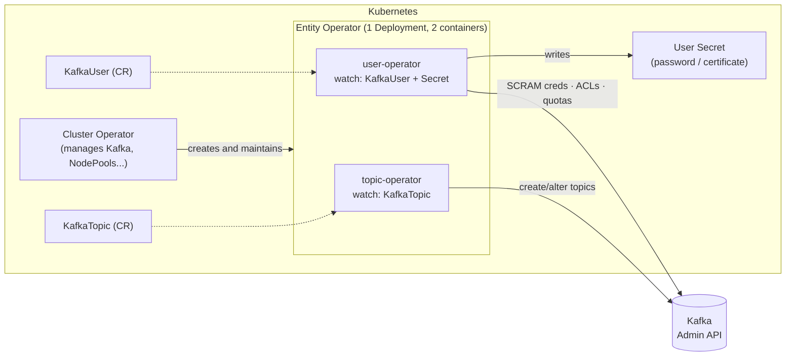
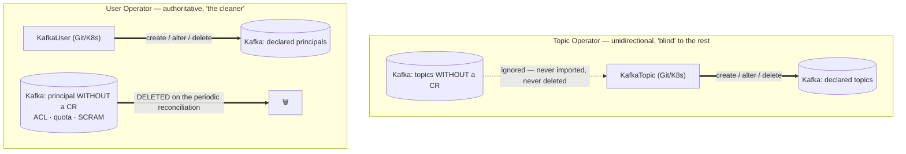
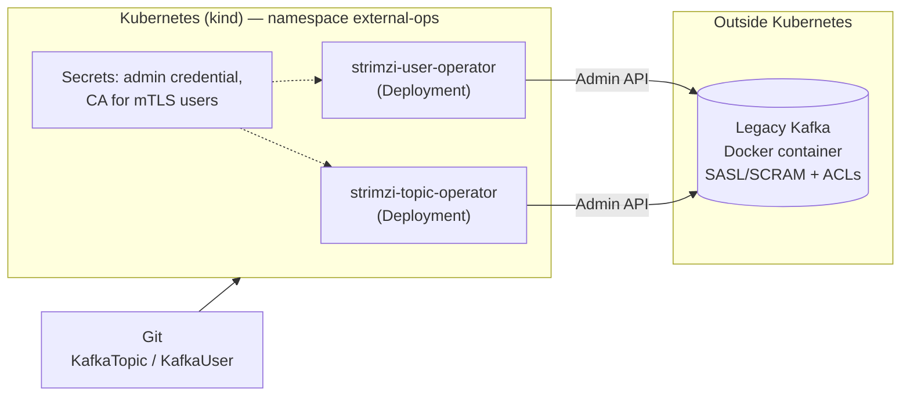

# Topic Operator and User Operator — Topics and Users as Code (the foundation for GitOps)

> **Goal:** truly understand how Strimzi's **Topic Operator** and **User Operator** work —
> what each one sees, **which direction they sync**, what they do with what already exists in
> Kafka and what they do with what is **not** declared — and then use them in two scenarios:
> (1) **inside the cluster**, via `Kafka.spec.entityOperator`, and (2) in **standalone** mode,
> controlling a **Kafka that runs outside Kubernetes**. This Day is the foundation of
> [Day 9](../Day9-GitOps-MultiTime/), where `KafkaTopic` and `KafkaUser` become files in a Git
> repository, delivered by ArgoCD to many teams and many regions. Every command and result in
> this Day was executed end to end on a kind cluster (Strimzi 1.1.0, Kafka 4.3.0) — the
> outputs shown are real, and the gotchas marked "reproduced in this lab" are observed
> behavior, not assumptions.
>
> **This README is also the run script:** the `bash` blocks in sections 6 and 7 run in order,
> copy-paste friendly, and were validated from scratch on a clean kind cluster.

---

## Table of Contents

1. [Context](#1-context)
2. [Anatomy: who is who](#2-anatomy-who-is-who)
3. [The main question: which way does it sync?](#3-the-main-question-which-way-does-it-sync)
4. [Prerequisites](#4-prerequisites)
5. [Lab Structure](#5-lab-structure)
6. [Part 1 — Inside the cluster (Entity Operator)](#6-part-1--inside-the-cluster-entity-operator)
7. [Part 2 — Standalone: controlling a Kafka outside Kubernetes](#7-part-2--standalone-controlling-a-kafka-outside-kubernetes)
8. [In-cluster vs. standalone: when to use each](#8-in-cluster-vs-standalone-when-to-use-each)
9. [Production checklist](#9-production-checklist)
10. [Cleanup](#10-cleanup)
11. [Next step: Day 9](#11-next-step-day-9)
12. [Suggested video outline](#12-suggested-video-outline)
13. [References](#13-references)

---

## 1. Context

In the previous Days we created topics and users with `kubectl apply` — already better than
running `kafka-topics.sh` and `kafka-acls.sh` by hand. But one question was left open, and it
decides whether this scales to a company:

> If `KafkaTopic` and `KafkaUser` are just YAML, **what happens when the reality of Kafka
> diverges from the YAML?** Someone creates a topic by hand. Someone adds an ACL with
> `kafka-acls.sh`. Someone deletes a topic in Kafka. Who wins?

The answer is **different for each operator** — and it is the central subject of this Day:

- The **Topic Operator** is *unidirectional* (Kubernetes → Kafka) and **ignores** what it
  does not know.
- The **User Operator** is also Kubernetes → Kafka, but it is **authoritative**: whatever is
  not declared, **it deletes**.

Whoever doesn't know this, or assumes "they are all the same", loses production ACLs on the
first reconciliation. We will prove every statement by running it.

The two lab scenarios:

1. **In-cluster** — the Cluster Operator brings up the *Entity Operator* next to Kafka. The
   default path when Kafka also runs on Kubernetes via Strimzi.
2. **Standalone** — both operators run as plain `Deployment`s, **without the Cluster
   Operator**, and connect to any Kafka reachable over the network: VM, bare metal, MSK,
   Confluent Cloud, Aiven... Here Kubernetes is just the "declarative control panel" of a
   Kafka that lives elsewhere.

## 2. Anatomy: who is who



Points worth saying out loud:

- The **Entity Operator** is not one more operator: it is the *name of the Deployment* the
  Cluster Operator creates with **two containers** — `topic-operator` and `user-operator`. You
  turn them on (and configure them) in `Kafka.spec.entityOperator`. Reproduced in this lab:
  `kubectl get pod -l strimzi.io/name=my-cluster-entity-operator -o jsonpath='{.items[0].spec.containers[*].name}'`
  → `topic-operator user-operator`.
- Both talk to Kafka **only through the Admin API** (the same thing `kafka-topics.sh`,
  `kafka-acls.sh` and `kafka-configs.sh` use). That is why they work against any Kafka that
  exposes this API — and exactly what makes standalone mode possible.
- Each operator watches **a single namespace** (`watchedNamespace`, by default the Kafka's)
  and filters by **label** (`strimzi.io/cluster`). A `KafkaTopic` without the label is invisible.
- There are two reconciliation mechanisms at the same time: **events** (watch — reacts
  immediately to a `kubectl apply`) and **periodic full reconciliation**
  (`reconciliationIntervalMs`, default **120000 ms = 2 min**). The periodic one is what
  "heals" divergences that generated no Kubernetes event, such as someone changing Kafka directly.

> **History that shows up in certification exams:** the first generation of the Topic
> Operator was *bidirectional* (it synced Kafka ↔ Kubernetes with a three-way merge and a
> *topic store* based on Kafka Streams/Zookeeper). It had scalability problems and corner
> cases, and was replaced by the **Unidirectional Topic Operator (UTO)**, which went GA in
> Strimzi **0.41** (the feature gate became permanently enabled). Today only the UTO exists:
> no topic store, no internal `strimzi-store-topic` topics, and `KafkaTopic` resources are the
> single source of truth. See the [UTO introduction post](https://strimzi.io/blog/2023/11/02/unidirectional-topic-operator/).

## 3. The main question: which way does it sync?

Pocket table — every row was **reproduced in this lab** (sections 6 and 7 show the command and output):

| Situation | Topic Operator (`KafkaTopic`) | User Operator (`KafkaUser`) |
|---|---|---|
| You create the CR | Creates the topic in Kafka | Creates the SCRAM credential/cert, ACLs, quotas and the `Secret` |
| You change the CR | Applies it to Kafka (increasing partitions ✅; **decreasing ❌** `NotSupported`; changing `replicas` ❌ without Cruise Control) | Applies it to Kafka |
| Someone **changes by hand** in Kafka something the CR manages | **Reverted** at the next reconciliation (even *extra* configs that are not in the spec) | **Reverted** (an extra ACL on a managed user disappears) |
| Something is **created by hand** in Kafka and **has no CR** | **Ignored.** Not imported, not deleted, no warning | **DELETED.** ACLs, quotas and SCRAM credentials of any principal without a `KafkaUser` are gone |
| Something **already exists** in Kafka and you create the CR later ("adoption") | The `spec` **overwrites** reality (config not in the spec returns to the broker default) | The `spec` overwrites: ACLs outside the spec are removed and **the SCRAM password is replaced** (the old one stops working) |
| Someone **deletes by hand** in Kafka (CR remains) | **Recreated empty** (new `TopicId`, data lost) | Recreated |
| You **delete the CR** | **Deletes the topic** (via finalizer), unless `strimzi.io/managed: "false"` | Deletes credential, ACLs, quotas and the Secret |

One sentence for the video:

> **Topic Operator: "I only care about what is declared — the rest doesn't exist to me".
> User Operator: "only what is declared exists — I remove the rest".**



> **Why the asymmetry makes sense:** topics carry *data* — deleting an "orphan" topic would
> destroy data somebody created for a legitimate reason (apps with auto-create, Kafka
> Streams, tooling). ACLs and credentials, on the other hand, are *access policy*: an ACL
> nobody declared is, from a security standpoint, a hole — the operator treats it as drift.
> The practical consequence: **adopting an existing Kafka is safe for topics and dangerous
> for users** (section 7.6).

## 4. Prerequisites

- [Docker](https://docs.docker.com/get-docker/) with ~6GB of free RAM (3 dual-role brokers + the external Kafka of Part 2)
- [kind](https://kind.sigs.k8s.io/docs/user/quick-start/#installation)
- [kubectl](https://kubernetes.io/docs/tasks/tools/#kubectl)
- `openssl` (Part 2 only, to generate the CA for mTLS users)
- Have done [Day 4](../Day4-Autenticacao-Autorizacao/) (we assume you know `KafkaUser`, SCRAM and ACLs — here the focus is **how the operator** manages them, not what each field means)

> **Watch out for your `kubectl` context:** every command in this Day uses
> `--context kind-strimzi-day8` so it is impossible to apply something to the wrong cluster.
> If your `kubeconfig` holds work clusters, **do not trust the current context** — in the
> blocks below we define a `kx` function for that.

## 5. Lab Structure

```
Day8-TopicUserOperators/
├── kind-config.yaml                    # kind: 1 control-plane + 2 workers
├── kafka-nodepool-dual-role.yaml       # KafkaNodePool 3x (controller+broker)
├── kafka-cluster.yaml                  # Kafka CR: SCRAM + ACL + entityOperator (TO + UO)
├── kafka-cluster-ignored-users.yaml    # same + STRIMZI_IGNORED_USERS_PATTERN (section 6.12)
├── kafkauser-admin.yaml                # SCRAM superuser (created by the User Operator itself)
├── kafkauser-orders-app.yaml           # application user with ACLs
├── kafka-topic-orders.yaml             # basic KafkaTopic
├── kafka-topic-adopt-legacy.yaml       # adopting a pre-existing topic
├── kafka-topic-duplicate.yaml          # two CRs, same topic → ResourceConflict
├── kafka-topic-weird-name.yaml         # spec.topicName (invalid in k8s, valid in Kafka)
├── standalone/
│   ├── 00-namespace.yaml               # external-ops namespace
│   ├── external-kafka/
│   │   ├── docker-compose.yml          # "legacy" Kafka OUTSIDE k8s (container on the kind network)
│   │   └── server.properties           # KRaft + SASL/SCRAM + ACLs
│   ├── topic-operator.yaml             # SA + Role + RoleBinding + Deployment (standalone)
│   ├── user-operator.yaml              # same for the User Operator
│   ├── kafkatopic-ext-payments.yaml    # KafkaTopic for the external Kafka
│   └── kafkauser-ext-billing.yaml      # KafkaUser for the external Kafka
├── README.md
└── README-EN.md
```

---

## 6. Part 1 — Inside the cluster (Entity Operator)

> **How to use this from here on:** every ` ```bash ` block is meant to be **copied and pasted,
> in order, in the same terminal** (zsh or bash). ` ```text ` blocks are the **expected
> output** — they don't run. Everything was validated from scratch on a clean kind cluster.
> Total time: ~15 min of commands running with no pauses to explain (Kafka takes ~2 min to come up).

**Before you start** — Docker running and the tools installed:

```bash
docker info --format 'docker {{.ServerVersion}}' && kind version && kubectl version --client | head -1 && openssl version
```

**Reset** (if you ran the lab before). Run it **from the repository root**:

```bash
kind delete cluster --name strimzi-day8 2>/dev/null
( cd kafka-strimzi/Day8-TopicUserOperators/standalone/external-kafka 2>/dev/null && docker compose down 2>/dev/null )
echo "clean"
```

### 6.1 Bringing up the cluster and installing Strimzi

The `kx` function **pins the context** of `kubectl` — do not depend on your kubeconfig's
`current-context`. It's a function (not an `alias`) so it works the same in zsh and bash.

```bash
cd kafka-strimzi/Day8-TopicUserOperators
kind create cluster --config=kind-config.yaml --name strimzi-day8
kx() { kubectl --context kind-strimzi-day8 "$@"; }
kx wait --for=condition=Ready node --all --timeout=120s
kx get nodes
```

> **If you open another terminal, paste the `kx` function line again** — functions don't persist across terminals.

```bash
kx create namespace kafka
curl -sL https://github.com/strimzi/strimzi-kafka-operator/releases/download/1.1.0/strimzi-cluster-operator-1.1.0.yaml \
  | sed 's/namespace: myproject/namespace: kafka/g' \
  | kx create -f - -n kafka > /dev/null
kx wait deployment/strimzi-cluster-operator -n kafka --for=condition=Available --timeout=180s
```

### 6.2 Enabling both operators in `Kafka`

Everything the Cluster Operator needs to know to bring up the Entity Operator lives in
`spec.entityOperator`. Excerpt from [`kafka-cluster.yaml`](kafka-cluster.yaml):

```yaml
spec:
  kafka:
    authorization: { type: simple, superUsers: [admin] }   # the User Operator needs an authorizer
    config:
      auto.create.topics.enable: false                     # see section 6.8
  entityOperator:
    topicOperator:
      reconciliationIntervalMs: 30000    # default 120000. Lab shortcut, to see the "healing" quickly
    userOperator:
      reconciliationIntervalMs: 30000
```

- Empty `topicOperator: {}` and `userOperator: {}` already enable each one with the defaults.
  **You can enable just one of them** — e.g. only `userOperator` if topics are managed by
  another tool.
- Useful fields in each: `watchedNamespace`, `reconciliationIntervalMs`, `resources`,
  `logging`, `jvmOptions`, probes. `userOperator` also has `secretPrefix` (prefix of the
  generated Secrets' names).
- Environment variables that have **no** dedicated field go through
  `entityOperator.template.topicOperatorContainer.env` / `userOperatorContainer.env`
  (examples in sections 6.9 and 6.12).

```bash
kx apply -n kafka -f kafka-nodepool-dual-role.yaml -f kafka-cluster.yaml
kx wait kafka/my-cluster -n kafka --for=condition=Ready --timeout=420s
kx get pods -n kafka
```

```text
NAME                                          READY   STATUS    RESTARTS   AGE
my-cluster-dual-role-0                        1/1     Running   0          74s
my-cluster-dual-role-1                        1/1     Running   0          74s
my-cluster-dual-role-2                        1/1     Running   0          74s
my-cluster-entity-operator-5d57d6fdc8-hdw9f   2/2     Running   0          28s     ← 2/2 = Topic Op + User Op
strimzi-cluster-operator-66c7bc49db-zkrr5     1/1     Running   0          2m10s
```

The two containers of the Entity Operator:

```bash
kx get pod -n kafka -l strimzi.io/name=my-cluster-entity-operator -o jsonpath='{.items[0].spec.containers[*].name}'; echo
```

### 6.3 The first user and the first topic, as code

An elegant detail: the `admin` superuser (listed in `authorization.superUsers`) **doesn't come
from a script** — it's a `KafkaUser` like any other. The User Operator authenticates to Kafka
with the Entity Operator's own certificate (which Strimzi treats as an internal superuser), so
it can create `admin` even before any SCRAM user exists.

```bash
kx apply -n kafka -f kafkauser-admin.yaml -f kafka-topic-orders.yaml
kx wait kafkauser/admin kafkatopic/orders.events -n kafka --for=condition=Ready --timeout=120s
kx get kt,ku -n kafka
```

```text
NAME                                        CLUSTER      PARTITIONS   REPLICATION FACTOR   READY
kafkatopic.kafka.strimzi.io/orders.events   my-cluster   3            3                    True

NAME                               CLUSTER      AUTHENTICATION   AUTHORIZATION   READY
kafkauser.kafka.strimzi.io/admin   my-cluster   scram-sha-512                    True
```

The `KafkaTopic` `status` already says what Kafka really has (`topicId`, `topicName`,
`observedGeneration`). The golden status rule: **`metadata.generation` must equal
`status.observedGeneration`** — if it doesn't, the operator hasn't seen your latest change yet.

```bash
kx get kt orders.events -n kafka -o jsonpath='{.status}'; echo
```

```text
{"conditions":[{"status":"True","type":"Ready",...}],"observedGeneration":1,"topicId":"KZMXdGE5Qp6iUkMvvLODyg","topicName":"orders.events"}
```

### 6.4 Helpers to "talk" to Kafka the way a human would

To prove what the operator does, we need to touch Kafka **from the outside** of Kubernetes,
the way a hurried administrator would. We create an `admin` `client.properties` inside the
broker and four functions (`kbin`, `kt`, `kcfg`, `kacl`):

```bash
ADMIN_PASS=$(kx get secret admin -n kafka -o jsonpath='{.data.password}' | base64 -d)
kx exec -n kafka my-cluster-dual-role-0 -c kafka -- bash -c "cat > /tmp/admin.properties <<EOF
security.protocol=SASL_PLAINTEXT
sasl.mechanism=SCRAM-SHA-512
sasl.jaas.config=org.apache.kafka.common.security.scram.ScramLoginModule required username=\"admin\" password=\"${ADMIN_PASS}\";
EOF"

BS=my-cluster-kafka-bootstrap:9092
kbin() { local b=$1; shift; kx exec -n kafka my-cluster-dual-role-0 -c kafka -- /opt/kafka/bin/$b --bootstrap-server $BS --command-config /tmp/admin.properties "$@"; }
kt()   { kbin kafka-topics.sh  "$@"; }
kcfg() { kbin kafka-configs.sh "$@"; }
kacl() { kbin kafka-acls.sh    "$@"; }

kt --describe --topic orders.events
```

```text
Topic: orders.events  PartitionCount: 3  ReplicationFactor: 3  Configs: min.insync.replicas=2,retention.ms=604800000
```

`kt` = topics, `kcfg` = configs/quotas/SCRAM, `kacl` = ACLs. Like `kx`, they **don't persist across terminals**.

### 6.5 Experiment 1 — A manual change in Kafka is reverted

The hurried administrator "fixes an incident" by shortening retention and adding a config
that **doesn't even exist** in the `spec`:

```bash
kcfg --entity-type topics --entity-name orders.events --alter --add-config retention.ms=1000,max.message.bytes=2000000
kt --describe --topic orders.events | head -1
```

```text
Configs: min.insync.replicas=2,retention.ms=1000,max.message.bytes=2000000
```

Wait for the periodic reconciliation (30 s in this lab) to undo it:

```bash
until kt --describe --topic orders.events | head -1 | grep -q "retention.ms=604800000"; do echo "waiting for the Topic Operator..."; sleep 5; done
kt --describe --topic orders.events | head -1
```

```text
Configs: min.insync.replicas=2,retention.ms=604800000      ← back, and max.message.bytes is GONE
```

The `topic-operator` log shows the trigger (`kubectl logs deploy/my-cluster-entity-operator -c topic-operator`):

```text
INFO  TopicEventHandler:49 - Triggering periodic reconciliation of KafkaTopic resources for namespace kafka
INFO  LoopRunnable:216 - [Batch #887] Reconciling batch of 1 topics
INFO  LoopRunnable:225 - [Batch #887] Batch reconciliation completed
```

**Lesson:** the `KafkaTopic` is the *only* source of truth — and "what isn't in the spec" is
also truth: configs missing from `spec.config` go back to the broker default. Great for
GitOps (zero drift) and dangerous for whoever expected the operator to "just add" configs.

### 6.6 Experiment 2 — A topic created directly in Kafka is *ignored*; adopting it has a price

An app (or a person) creates a topic on the side, compacted and with 1 day of retention:

```bash
kt --create --topic legacy.payments --partitions 6 --replication-factor 3 --config retention.ms=86400000 --config cleanup.policy=compact
sleep 70
echo "--- KafkaTopics in Kubernetes (legacy.payments does NOT show up):"; kx get kt -n kafka
echo "--- Topics in Kafka (legacy.payments is still there):"; kt --list
```

The Topic Operator **neither imports nor deletes** topics it doesn't know. To start managing
it, just create a `KafkaTopic` with the same name ("adoption"). First the **naive adoption**
— we create the CR forgetting `cleanup.policy`:

```bash
cat <<'EOF' | kx apply -n kafka -f -
apiVersion: kafka.strimzi.io/v1
kind: KafkaTopic
metadata:
  name: legacy.payments
  labels:
    strimzi.io/cluster: my-cluster
spec:
  partitions: 6
  replicas: 3
  config:
    retention.ms: 172800000
EOF
kx wait kt/legacy.payments -n kafka --for=condition=Ready --timeout=60s
kt --describe --topic legacy.payments | head -1
```

```text
Configs: min.insync.replicas=2,retention.ms=172800000      ← cleanup.policy=compact is GONE!
```

Reproduced in this lab: **the adoption rewrote the retention and removed `cleanup.policy=compact`.**
A compacted topic that becomes `delete` starts deleting the latest version of each key. That's
why the safe adoption procedure is: **read the real config (`kcfg ... --describe`), copy it
into the spec, only then apply** — which is what
[`kafka-topic-adopt-legacy.yaml`](kafka-topic-adopt-legacy.yaml) does:

```bash
kx apply -n kafka -f kafka-topic-adopt-legacy.yaml
until kt --describe --topic legacy.payments | head -1 | grep -q "cleanup.policy=compact"; do sleep 3; done
kt --describe --topic legacy.payments | head -1
```

### 6.7 Experiment 3 — What the operator **cannot** do: shrink partitions and change replicas

Decreasing partitions:

```bash
kx patch kt legacy.payments -n kafka --type merge -p '{"spec":{"partitions":3}}'
sleep 8
kx get kt legacy.payments -n kafka -o jsonpath='{range .status.conditions[*]}{.type}={.status} {.reason}: {.message}{"\n"}{end}'
```

Changing the replication factor:

```bash
kx patch kt legacy.payments -n kafka --type merge -p '{"spec":{"partitions":6,"replicas":2}}'
sleep 8
kx get kt legacy.payments -n kafka -o jsonpath='{range .status.conditions[*]}{.type}={.status} {.reason}: {.message}{"\n"}{end}'
```

Increasing partitions (this works):

```bash
kx patch kt legacy.payments -n kafka --type merge -p '{"spec":{"partitions":8,"replicas":3}}'
sleep 8
kx get kt legacy.payments -n kafka -o jsonpath='{range .status.conditions[*]}{.type}={.status} {.reason}: {.message}{"\n"}{end}'
kt --describe --topic legacy.payments | head -1
```

```text
Ready=False NotSupported: Decreasing partitions not supported
Ready=False NotSupported: Replication factor change not supported, but required for partitions [0, 1, 2, 3, 4, 5]
Ready=True    → increasing partitions works (8)
```

- **Decreasing partitions:** Kafka itself doesn't support it. The operator doesn't pretend it
  does — it goes `Ready=False` and **doesn't touch the topic**.
- **Changing `replicas`:** without [Cruise Control](../Day6-CruiseControl/) the operator refuses
  (`NotSupported`). With Cruise Control enabled in the cluster, the UTO can change the
  replication factor by orchestrating the replica reassignment (supported since Strimzi 0.41).
- **Rule for GitOps:** a `Ready=False` on the CR means "Git says one thing, Kafka has another".
  ArgoCD's sync can be *green* while the topic is *red* — monitor the CR `status` (section 9).

### 6.8 Experiment 4 — Invalid names and the race with `auto.create`

**A name Kubernetes doesn't accept.** Kafka allows `Orders_V1.DLQ`; Kubernetes doesn't
(`metadata.name` must be DNS-1123). Use `spec.topicName` — and remember it **cannot be
changed later**:

```bash
kx apply -n kafka -f kafka-topic-weird-name.yaml
kx wait kt/orders-v1-dlq -n kafka --for=condition=Ready --timeout=60s
kt --list | grep -i dlq
```

> **In GitOps, `spec.topicName` is the naming-standardization tool**: the file and resource
> name follow Kubernetes convention, and the real name in Kafka follows the company convention.

**The race with `auto.create.topics.enable`.** Documented by Strimzi: if an app starts and
produces *before* the `KafkaTopic` is reconciled, the broker creates the topic with the
defaults (1 partition, for example). Then the operator tries to adjust and may fail (if it
would need to *decrease* partitions). That's why this Day's `kafka-cluster.yaml` has
`auto.create.topics.enable: false` — the official recommendation. It doesn't protect against
apps that use the `AdminClient` to create topics (Kafka Streams): in those cases the app must
**wait** for the topic to exist (init container).

### 6.9 Experiment 5 — Deleting: `managed=false`, pause, finalizer, deleted from the outside

**Deleted the CR → deleted the topic** (this is the default behavior and it's *intentional*).
There are **three safety knobs**, from the lightest to the heaviest:

| Mechanism | What it does | If you delete the CR |
|---|---|---|
| `strimzi.io/managed: "false"` | Operator **stops managing** (`status: Unmanaged`) | Only the CR goes away; **the topic stays in Kafka** |
| `strimzi.io/pause-reconciliation: "true"` | Operator **ignores changes** to the CR (`ReconciliationPaused`) | The topic **is deleted** (it's still "managed", just paused) |
| `STRIMZI_USE_FINALIZERS=false` | No finalizer on the CR | CR goes away immediately; the operator still tries to delete the topic if it's up |

**`managed=false`**: the CR goes away, the topic **stays**.

```bash
kx annotate kt legacy.payments -n kafka strimzi.io/managed=false --overwrite
sleep 6
kx delete kt legacy.payments -n kafka
kt --list
```

`legacy.payments` **is still in Kafka** — use this to "migrate the CR name" without losing the topic.

**Pause**: changes are ignored, but the delete still deletes the topic.

```bash
kx annotate kt orders.events -n kafka strimzi.io/pause-reconciliation=true --overwrite
sleep 4
kx patch kt orders.events -n kafka --type merge -p '{"spec":{"config":{"retention.ms":1234567}}}'
sleep 10
kt --describe --topic orders.events | head -1
kx delete kt orders.events -n kafka
sleep 6
kt --list
```

`retention.ms` **did not change** (paused), but the delete went through: the `orders.events` topic was deleted.

**The finalizer trap.** The `KafkaTopic` carries `finalizers: [strimzi.io/topic-operator]`.
If the operator is stopped and you delete the CR, it stays in **`Terminating`** forever —
and the same goes for the entire *namespace*:

```bash
kx apply -n kafka -f kafka-topic-orders.yaml
kx wait kt/orders.events -n kafka --for=condition=Ready --timeout=60s
kx wait kt/orders.events -n kafka --for=jsonpath='{.metadata.finalizers[0]}'=strimzi.io/topic-operator --timeout=60s
kx scale deploy/my-cluster-entity-operator -n kafka --replicas=0
sleep 5
kx delete kt orders.events -n kafka --wait=false
sleep 3
kx get kt orders.events -n kafka -o jsonpath='{.metadata.deletionTimestamp} finalizers={.metadata.finalizers}'; echo
```

```text
2026-10-31T07:55:02Z finalizers=["strimzi.io/topic-operator"]     ← stuck
```

When you turn it back on, the operator finishes the cleanup by itself:

```bash
kx scale deploy/my-cluster-entity-operator -n kafka --replicas=1
kx rollout status deploy/my-cluster-entity-operator -n kafka --timeout=120s
until [ -z "$(kx get kt -n kafka -o name | grep orders.events)" ]; do sleep 3; done
kx get kt -n kafka; kt --list
```

(If the operator never comes back, the emergency exit is to remove the finalizers:
`kubectl get kt -o yaml | yq 'del(.items[].metadata.finalizers[])' | kubectl apply -f -`.)

> **GitOps gotcha (previewing Day 9):** in a repository, *deleting the topic's YAML file* =
> *deleting the topic in production*. We'll handle it with `Prune=false` in ArgoCD and
> mandatory PR review — don't leave this for later.

**And if someone deletes the topic directly in Kafka?** The CR still exists, so the operator
**recreates** it on the next reconciliation — but **empty** (note the `TopicId` change; Git
doesn't bring the data back):

```bash
kx apply -n kafka -f kafka-topic-weird-name.yaml
kt --describe --topic Orders_V1.DLQ | head -1 | cut -f1-2
kt --delete --topic Orders_V1.DLQ
until kt --list | grep -q "Orders_V1.DLQ"; do echo "waiting for the recreation..."; sleep 5; done
kt --describe --topic Orders_V1.DLQ | head -1 | cut -f1-2
```

### 6.10 Experiment 6 — Two CRs for the same topic (`ResourceConflict`) and the "ghost"

The oldest wins; the new one goes `Ready=False` and **changes nothing** in Kafka (here
[`kafka-topic-duplicate.yaml`](kafka-topic-duplicate.yaml) uses `spec.topicName: orders.events` and `partitions: 12`):

```bash
kx apply -n kafka -f kafka-topic-orders.yaml
kx wait kt/orders.events -n kafka --for=condition=Ready --timeout=60s
kx apply -n kafka -f kafka-topic-duplicate.yaml
sleep 8
kx get kt orders-events-duplicate -n kafka -o jsonpath='{.status.conditions[0].reason}: {.status.conditions[0].message}{"\n"}'
kt --describe --topic orders.events | head -1
kx delete kt orders-events-duplicate -n kafka
sleep 6
kt --list | grep orders.events
```

The duplicate CR ends up with `ResourceConflict: Managed by Ref{namespace='kafka', name='orders.events'}`,
the topic keeps its 3 partitions, and deleting the **loser** doesn't delete the topic.

> **Gotcha reproduced (Strimzi 1.1.0):** the Topic Operator keeps in **memory** who manages
> each topic. After deleting the *losing* CR, if you **delete and recreate the winner**, the new
> CR shows up as `ResourceConflict` pointing to a CR that **no longer exists**. Only restarting
> the operator clears it. See:

```bash
kx delete kt orders.events -n kafka
sleep 8
kx apply -n kafka -f kafka-topic-orders.yaml
sleep 20
kx get kt orders.events -n kafka -o jsonpath='{.status.conditions[0].reason}: {.status.conditions[0].message}{"\n"}'
```

```text
ResourceConflict: Managed by Ref{namespace='kafka', name='orders-events-duplicate'}     ← the duplicate no longer exists!
```

The way out: restart the Entity Operator (the memory is rebuilt from the CRs that really exist):

```bash
kx rollout restart deploy/my-cluster-entity-operator -n kafka
kx rollout status deploy/my-cluster-entity-operator -n kafka --timeout=120s
kx wait kt/orders.events -n kafka --for=condition=Ready --timeout=120s
kx get kt -n kafka
```

### 6.11 `KafkaUser`: the cleaner operator

```bash
kx apply -n kafka -f kafkauser-orders-app.yaml
kx wait ku/orders-app -n kafka --for=condition=Ready --timeout=60s
kacl --list --principal User:orders-app
```

```text
Current ACLs for resource `ResourcePattern(resourceType=GROUP, name=orders-app-, patternType=PREFIXED)`:
	(principal=User:orders-app, host=*, operation=READ, permissionType=ALLOW)
Current ACLs for resource `ResourcePattern(resourceType=TOPIC, name=orders., patternType=PREFIXED)`:
	(principal=User:orders-app, host=*, operation=READ/WRITE/DESCRIBE, permissionType=ALLOW)
```

What the User Operator did from 12 lines of YAML: generated a password, wrote the SCRAM hash
into Kafka, created the ACLs and published `Secret/orders-app` with the password and a ready
`sasl.jaas.config` for the application to consume (the basis of
[Day 5 — KafkaAccessOperator](../Day5-KafkaAccessOperator/)).

**Experiment 7 — whatever is left in Kafka without a `KafkaUser` dies.** We create on the side
a `ghost` principal with ACL, SCRAM credential and quota, plus an extra ACL for `orders-app`:

```bash
kacl --add --allow-principal User:ghost --operation Read --topic secret.data
kcfg --entity-type users --entity-name ghost --alter --add-config 'SCRAM-SHA-512=[password=ghost-pw]'
kcfg --entity-type users --entity-name ghost --alter --add-config 'producer_byte_rate=1048576'
kacl --add --allow-principal User:orders-app --operation All --topic secret.data
echo "--- BEFORE:"; kcfg --entity-type users --describe
```

```bash
until [ "$(kacl --list --principal User:ghost | grep -c principal=)" = "0" ] && [ "$(kacl --list --principal User:orders-app | grep -c secret.data)" = "0" ]; do echo "waiting for the User Operator..."; sleep 5; done
echo "--- AFTER (ghost gone; orders-app's extra ACL reverted):"; kcfg --entity-type users --describe
```

`ghost` (ACL + SCRAM + quota) is gone, and the managed user's extra ACL was reverted too.

On every cycle the User Operator builds the list of "who exists" from the **union** of:
`KafkaUser`s (with the label), principals with ACLs, principals with quotas and principals with
a SCRAM credential in Kafka. Every name that shows up in Kafka but has no `KafkaUser` is
reconciled to "desired state = nothing" — i.e. deleted. It does this **for every principal in
the cluster**, not only the ones it created.

> **Note on latency:** the User Operator works on top of caches (ACLs/quotas/SCRAM) refreshed
> every `STRIMZI_CACHE_REFRESH_INTERVAL_MS` (default **15 s**). So an ACL added by hand can
> survive ~15–45 s before being removed — not a bug, it's the cache.

**If something managed is deleted from the outside, it is recreated:**

```bash
kacl --remove --allow-principal User:orders-app --operation Read --operation Write --operation Describe --topic orders. --resource-pattern-type prefixed --force
until [ "$(kacl --list --principal User:orders-app | grep -c principal=)" = "4" ]; do echo "waiting for the ACLs to be recreated..."; sleep 5; done
kacl --list --principal User:orders-app
```

**Adopting an existing user.** We create `adopt-me` on the side with its own password, and only
afterwards a `KafkaUser` with the same name. The old password **stops working**:

```bash
kcfg --entity-type users --entity-name adopt-me --alter --add-config 'SCRAM-SHA-512=[password=old-pw-from-legacy]'
kx exec -n kafka my-cluster-dual-role-0 -c kafka -- bash -c 'cat > /tmp/adopt.properties <<EOF
security.protocol=SASL_PLAINTEXT
sasl.mechanism=SCRAM-SHA-512
sasl.jaas.config=org.apache.kafka.common.security.scram.ScramLoginModule required username="adopt-me" password="old-pw-from-legacy";
EOF
/opt/kafka/bin/kafka-topics.sh --bootstrap-server my-cluster-kafka-bootstrap:9092 --command-config /tmp/adopt.properties --list >/dev/null 2>&1; echo "login with the OLD password BEFORE adoption: rc=$?"'
```

```bash
cat <<'EOF' | kx apply -n kafka -f -
apiVersion: kafka.strimzi.io/v1
kind: KafkaUser
metadata:
  name: adopt-me
  labels:
    strimzi.io/cluster: my-cluster
spec:
  authentication:
    type: scram-sha-512
EOF
kx wait ku/adopt-me -n kafka --for=condition=Ready --timeout=60s
sleep 5
kx exec -n kafka my-cluster-dual-role-0 -c kafka -- bash -c '/opt/kafka/bin/kafka-topics.sh --bootstrap-server my-cluster-kafka-bootstrap:9092 --command-config /tmp/adopt.properties --list >/dev/null 2>&1; echo "login with the OLD password AFTER adoption: rc=$?"'
kx delete ku adopt-me -n kafka
```

```text
login with the OLD password BEFORE adoption:  rc=0
login with the OLD password AFTER adoption:   rc=1     ← the operator generated a new password and wrote it
```

To adopt without breaking clients, supply the existing password in the CR itself
(`spec.authentication.password.valueFrom.secretKeyRef`) and declare the same ACLs in the `spec`.

### 6.12 Experiment 8 — Protecting what isn't yours: `STRIMZI_IGNORED_USERS_PATTERN`

When part of the principals is managed by something else (legacy scripts, another tool, a team
that hasn't migrated yet), tell the operator **not to see them**
([`kafka-cluster-ignored-users.yaml`](kafka-cluster-ignored-users.yaml) adds this to `Kafka`):

```yaml
  entityOperator:
    template:
      userOperatorContainer:
        env:
          - name: STRIMZI_IGNORED_USERS_PATTERN
            value: "^legacy-.*$"
```

```bash
kx apply -n kafka -f kafka-cluster-ignored-users.yaml
sleep 5
kx rollout status deploy/my-cluster-entity-operator -n kafka --timeout=180s
kx get deploy my-cluster-entity-operator -n kafka -o jsonpath='{.spec.template.spec.containers[?(@.name=="user-operator")].env[?(@.name=="STRIMZI_IGNORED_USERS_PATTERN")]}'; echo
```

Test: we create `legacy-batch` (matches the pattern) and `ghost2` (doesn't), both by hand:

```bash
kacl --add --allow-principal User:legacy-batch --operation Read --topic legacy.payments
kcfg --entity-type users --entity-name legacy-batch --alter --add-config 'SCRAM-SHA-512=[password=pw1]'
kacl --add --allow-principal User:ghost2 --operation Read --topic legacy.payments
sleep 100
echo "legacy-batch (ignored, should have 1):"; kacl --list --principal User:legacy-batch | grep -c principal=
echo "ghost2 (not ignored, should have 0):";   kacl --list --principal User:ghost2 | grep -c principal=; true
```

`legacy-batch` **survived several cycles**, while `ghost2` (outside the pattern) was deleted.
The pattern is matched against the name **exactly as Kafka stores it** — for mTLS users that's
`CN=name`, so the regex must account for `CN=`. Classic cases to ignore: `ANONYMOUS`, `*`,
integration principals.

### 6.13 Minimum observability

Both operators expose Prometheus metrics (`/metrics`; TO on port 8080, UO on 8081):

| Metric | What for |
|---|---|
| `strimzi_resources` | How many `KafkaTopic`/`KafkaUser` the operator sees |
| `strimzi_reconciliations_total` / `_successful_total` | Reconciliation rate and the fraction that succeed (alert: `total - successful` rising) |
| `strimzi_reconciliations_duration_seconds_*` | Cycle latency |
| `strimzi_reconciliations_locked_total` (TO) / `_already_enqueued_total` (UO) | Queue pressure |
| `strimzi_reconciliations_periodical_total` (UO) | Periodic cycles executed |

---

## 7. Part 2 — Standalone: controlling a Kafka outside Kubernetes

Now Kafka is **not Strimzi's**. It can be a VM, bare metal, MSK, Confluent Cloud, Aiven.
Kubernetes only runs the two operators, which become a "declarative control plane" for that
Kafka's topics and users.



**What does NOT need to exist:** Cluster Operator, `Kafka` CR, `KafkaNodePool`, Entity
Operator. All that must exist is (a) the `KafkaTopic` and `KafkaUser` **CRDs**, (b) the two
`Deployment`s and (c) a connection to Kafka.

### 7.1 Bringing up the "legacy Kafka" outside Kubernetes

The container joins the `kind` Docker network (created by `kind create cluster`), so the pods
reach it **by name** `external-kafka:9092` — no port-forward, no host IP:

```bash
cd standalone/external-kafka
docker compose up -d
until docker logs external-kafka 2>&1 | grep -q "Kafka Server started"; do sleep 2; done
docker logs external-kafka 2>&1 | grep "Kafka Server started"
cd ../..
```

[`server.properties`](standalone/external-kafka/server.properties) enables SASL/SCRAM and the
`StandardAuthorizer`. The subtle point is in `docker-compose.yml`: `kafka-storage.sh format
--add-scram` registers the bootstrap credential **inside the KRaft metadata log** at format
time — without it nobody can authenticate to create the first user.

Helper to talk to it (note: **outside** Kubernetes, via `docker exec`):

```bash
docker exec external-kafka bash -c 'cat > /tmp/admin.properties <<EOF
security.protocol=SASL_PLAINTEXT
sasl.mechanism=SCRAM-SHA-512
sasl.jaas.config=org.apache.kafka.common.security.scram.ScramLoginModule required username="admin" password="admin-secret";
EOF'
EXT() { docker exec external-kafka /opt/kafka/bin/$1 --bootstrap-server external-kafka:9092 --command-config /tmp/admin.properties "${@:2}"; }
EXT kafka-topics.sh --list; echo "(empty = ok)"
```

### 7.2 Installing only what is necessary (CRDs + operators)

On a **clean** cluster, with no Cluster Operator, you install only the two CRDs from Strimzi's
deployment package. **Don't run this in this lab** (the `strimzi-cluster-operator-1.1.0.yaml`
from Part 1 already installed all the CRDs):

```text
curl -sL https://github.com/strimzi/strimzi-kafka-operator/releases/download/1.1.0/strimzi-1.1.0.tar.gz | tar xz
kubectl apply -f strimzi-1.1.0/install/topic-operator/04-Crd-kafkatopic.yaml \
              -f strimzi-1.1.0/install/user-operator/04-Crd-kafkauser.yaml
```

(We tested exactly this on a brand-new kind, with only those two CRDs and no Cluster Operator:
both `Deployment`s came up and reconciled the external Kafka. The `external-ops` namespace is
outside the Cluster Operator's area of action, which only watches `kafka`, so the two worlds
don't mix.)

The `Deployment`s are the files from `install/topic-operator/` and `install/user-operator/` in
the 1.1.0 package, adjusted in [`topic-operator.yaml`](standalone/topic-operator.yaml) and
[`user-operator.yaml`](standalone/user-operator.yaml). First the namespace and the external
Kafka's admin credential (the password **never** lives in a versioned YAML: in production this
Secret comes from External Secrets / Vault / Sealed Secrets):

```bash
kx apply -f standalone/00-namespace.yaml

kx create secret generic external-kafka-admin -n external-ops \
  --from-literal=username=admin --from-literal=password=admin-secret \
  --from-literal=admin-client.properties='security.protocol=SASL_PLAINTEXT
sasl.mechanism=SCRAM-SHA-512
sasl.jaas.config=org.apache.kafka.common.security.scram.ScramLoginModule required username="admin" password="admin-secret";'
```

Now the two operators:

```bash
kx apply -n external-ops -f standalone/topic-operator.yaml -f standalone/user-operator.yaml
kx wait deploy/strimzi-topic-operator deploy/strimzi-user-operator -n external-ops --for=condition=Available --timeout=150s
```

### 7.3 The configuration map — and the differences between the two operators

The two connections to Kafka are configured **in different ways** (a common gotcha):

| | Topic Operator | User Operator |
|---|---|---|
| Watched namespace | `STRIMZI_NAMESPACE` | `STRIMZI_NAMESPACE` |
| Bootstrap | `STRIMZI_KAFKA_BOOTSTRAP_SERVERS` | `STRIMZI_KAFKA_BOOTSTRAP_SERVERS` |
| Which CRs are mine | `STRIMZI_RESOURCE_LABELS` | `STRIMZI_LABELS` ← **different name** |
| Periodic interval | `STRIMZI_FULL_RECONCILIATION_INTERVAL_MS` (120000) | same |
| SASL authentication | dedicated variables: `STRIMZI_SASL_ENABLED`, `_MECHANISM`, `_USERNAME`, `_PASSWORD`, `STRIMZI_SECURITY_PROTOCOL` | **has none**: uses `STRIMZI_KAFKA_ADMIN_CLIENT_CONFIGURATION` (a block of Admin Client properties) |
| TLS / mTLS | `STRIMZI_TLS_TRUSTED_CERTS_SECRET_NAME`, `STRIMZI_TLS_SECRET_NAME`, `_KEY_NAME`, `_CERT_NAME` | `STRIMZI_CLUSTER_CA_CERT_SECRET_NAME`, `STRIMZI_EO_KEY_SECRET_NAME`, `_KEY_NAME`, `_CERT_NAME` |
| Finalizers | `STRIMZI_USE_FINALIZERS` | — |
| Ignore principals | — | `STRIMZI_IGNORED_USERS_PATTERN` |
| Clients' CA | — | `STRIMZI_CA_CERT_NAME` + `STRIMZI_CA_KEY_NAME` (**mandatory**) |
| ACL authorization | — | `STRIMZI_ACLS_ADMIN_API_SUPPORTED` (`false` if Kafka doesn't expose the ACL API, e.g. some managed services) |
| Managed service (MSK IAM etc.) | `STRIMZI_SASL_CUSTOM_CONFIG_JSON` (only `sasl.*` keys), `STRIMZI_ALTERABLE_TOPIC_CONFIG`, `STRIMZI_SKIP_CLUSTER_CONFIG_REVIEW` | `STRIMZI_KAFKA_ADMIN_CLIENT_CONFIGURATION` |
| Scale | `STRIMZI_MAX_QUEUE_SIZE` (1024), `STRIMZI_MAX_BATCH_SIZE` (100), `STRIMZI_MAX_BATCH_LINGER_MS` (100) | `STRIMZI_WORK_QUEUE_SIZE` (1024), `STRIMZI_CONTROLLER_THREAD_POOL_SIZE` (50) |

Two golden rules of the standalone deployment (from the official documentation):

- **A namespace is watched by at most one Topic Operator and one User Operator.** For several
  Kafkas, use one namespace per Kafka — never two operators for different clusters in the same
  namespace (they fight over the same CRs). This will be the basis of Day 9: **one namespace
  per Kafka/region**.
- **The queue must fit your resources.** The UTO brings the pod down if the queue exceeds
  `STRIMZI_MAX_QUEUE_SIZE` (Kubernetes restarts it). If you manage thousands of topics,
  increase it.

> **For managed services** (MSK, Confluent...), the Topic Operator has three specific knobs:
> `STRIMZI_SASL_CUSTOM_CONFIG_JSON` (e.g. MSK's IAM login module, with the libs added to the
> image), `STRIMZI_ALTERABLE_TOPIC_CONFIG` (list of topic configs the provider lets you change
> — e.g. `retention.ms,max.message.bytes`) and `STRIMZI_SKIP_CLUSTER_CONFIG_REVIEW=true` (don't
> read broker configs, which the provider blocks).

### 7.4 Why the CA is mandatory even if you only use SCRAM

We brought up the User Operator **without** the CA Secrets: it starts normally and creates SCRAM
users without any problem. But a `KafkaUser` with `authentication: tls` fails — let's see it:

```bash
cat <<'EOF' | kx apply -n external-ops -f -
apiVersion: kafka.strimzi.io/v1
kind: KafkaUser
metadata:
  name: tls-user
  labels:
    strimzi.io/cluster: external-kafka
spec:
  authentication:
    type: tls
EOF
sleep 15
kx get ku tls-user -n external-ops -o jsonpath='{range .status.conditions[*]}{.type}={.status} {.reason}: {.message}{"\n"}{end}'
```

```text
NotReady=True ExecutionException: ... InvalidConfigurationException:
  Secret external-clients-ca-cert in namespace external-ops not found
```

The `STRIMZI_CA_CERT_NAME`/`STRIMZI_CA_KEY_NAME` variables are mandatory (the operator won't
start without them defined), but the Secrets are only read when there's an mTLS user. We create
the clients' CA (the two Secrets the User Operator requires):

```bash
openssl req -x509 -newkey rsa:2048 -nodes -keyout ca.key.tmp -out ca.crt -subj "/CN=external-clients-ca" -days 365 2>/dev/null
openssl pkcs8 -topk8 -nocrypt -in ca.key.tmp -out ca.key
kx create secret generic external-clients-ca-cert -n external-ops --from-file=ca.crt
kx create secret generic external-clients-ca      -n external-ops --from-file=ca.key
rm -f ca.key.tmp ca.key ca.crt
until [ "$(kx get ku tls-user -n external-ops -o jsonpath='{.status.conditions[0].type}')" = "Ready" ]; do echo "waiting..."; sleep 5; done
kx get ku -n external-ops
```

The user goes `Ready` and `Secret/tls-user` gains `ca.crt`, `user.crt`, `user.key`,
`user.p12` and `user.password`.

> In in-cluster mode this CA is the "clients CA" that the Cluster Operator creates and
> **renews** by itself. In standalone, **renewal is on you**: `STRIMZI_CA_VALIDITY`/
> `STRIMZI_CA_RENEWAL` govern the *user certificates*, but you replace the CA itself on your own.

### 7.5 Declaring topics and users of the external Kafka

```bash
kx apply -n external-ops -f standalone/kafkatopic-ext-payments.yaml -f standalone/kafkauser-ext-billing.yaml
kx wait kt/payments.events ku/billing-app -n external-ops --for=condition=Ready --timeout=90s
kx get kt,ku -n external-ops
```

```text
NAME                                          CLUSTER          PARTITIONS   REPLICATION FACTOR   READY
kafkatopic.kafka.strimzi.io/payments.events   external-kafka   3            1                    True

NAME                                     CLUSTER          AUTHENTICATION   AUTHORIZATION   READY
kafkauser.kafka.strimzi.io/billing-app   external-kafka   scram-sha-512    simple          True
```

And the proof that the Kafka **outside Kubernetes** received everything:

```bash
EXT kafka-topics.sh --describe --topic payments.events | head -1
EXT kafka-acls.sh --list --principal User:billing-app
```

```text
Topic: payments.events  PartitionCount: 3  ReplicationFactor: 1  Configs: min.insync.replicas=1,retention.ms=259200000
(principal=User:billing-app, operation=DESCRIBE/WRITE, resource TOPIC payments.* PREFIXED)
```

`Secret/billing-app` in `external-ops` holds the generated password — applications running in
Kubernetes consume it directly; the ones running outside receive it through a secure channel.

> Note that the `strimzi.io/cluster: external-kafka` label **doesn't point to any `Kafka`
> resource** — it's just a label that matches `STRIMZI_RESOURCE_LABELS` / `STRIMZI_LABELS`. It's
> the label that defines "which CRs are mine", and it's what lets N operators coexist in Day 9.

### 7.6 The danger of adoption: the User Operator deletes the legacy Kafka's ACLs

Here the section 3 asymmetry really bites. The User Operator is connected to a Kafka that
already had ACLs from other systems (`legacy-reports`) — and this Deployment's ignore regex
(`^(admin|ANONYMOUS)$`) does **not** cover that name. We create a topic and an ACL on the side:

```bash
EXT kafka-topics.sh --create --topic legacy.raw --partitions 1 --replication-factor 1
EXT kafka-acls.sh --add --allow-principal User:legacy-reports --operation Read --topic payments.events --group reports-
echo "ACLs before:"; EXT kafka-acls.sh --list --principal User:legacy-reports | grep -c principal=
```

```bash
until [ "$(EXT kafka-acls.sh --list --principal User:legacy-reports | grep -c principal=)" = "0" ]; do echo "waiting for the User Operator to delete..."; sleep 5; done
echo "ACLs after:"; EXT kafka-acls.sh --list --principal User:legacy-reports | grep -c principal=
echo "topic created on the side (survives):"; EXT kafka-topics.sh --list
```

`legacy-reports`'s ACLs were **deleted**; meanwhile the `legacy.raw` topic created by hand in
the same Kafka **survived intact** (the Topic Operator ignores what it doesn't know).

**Safe roadmap to adopt an existing Kafka:**

1. Bring up the **Topic Operator first** (low risk — it only acts on CRs you create).
2. Before turning on the User Operator, **list everything that exists** (`kafka-acls.sh --list`,
   `kafka-configs.sh --describe --entity-type users`) and either (a) convert each principal into a
   `KafkaUser` (with the existing password via `valueFrom.secretKeyRef`), or (b) cover them with
   `STRIMZI_IGNORED_USERS_PATTERN` — like our `^(admin|ANONYMOUS)$`, which protects the
   operator's own credential.
3. Start the User Operator with a high `reconciliationInterval` and watch the log
   (`kubectl logs deploy/strimzi-user-operator`) on the first cycle.
4. Narrow the regex as you migrate each principal to Git.

---

## 8. In-cluster vs. standalone: when to use each

| Criterion | In-cluster (`Kafka.spec.entityOperator`) | Standalone |
|---|---|---|
| Kafka runs on K8s via Strimzi | ✅ natural | Possible, but redundant |
| Kafka outside K8s (VM, MSK, Confluent...) | ❌ | ✅ the only way |
| Who installs and upgrades | Cluster Operator (version follows) | You (image `quay.io/strimzi/operator:<version>`) |
| Connection to Kafka | Automatic (the cluster's own certificates) | Manual (bootstrap, SASL/TLS, Secrets) |
| CA for mTLS users | Generated and **renewed** by the Cluster Operator | **You** create and renew |
| Namespaces | One, by default the `Kafka`'s | **One namespace per Kafka** (as many as you like) |
| Cruise Control integration (changing `replicas`) | Automatic | `STRIMZI_CRUISE_CONTROL_*` variables (advanced) |
| Typical scenario | 100% Strimzi streaming platform | Heterogeneous fleet or multi-region with Kafkas outside K8s |

## 9. Production checklist

- [ ] `auto.create.topics.enable: false` — the operator is the sole owner of topic creation
- [ ] Monitor the CRs' **`status`** (alert on `Ready=False` for more than N min) and the `strimzi_reconciliations_*` metrics — a green ArgoCD sync does **not** guarantee a healthy topic
- [ ] Decide the **delete** policy: `strimzi.io/managed: "false"` on critical topics, or protection in GitOps (`Prune=false`, Day 9 section)
- [ ] Be clear that shrinking partitions / changing `replicas` without Cruise Control **will not** happen via YAML
- [ ] Names: short, valid `metadata.name` on K8s; real, standardized name in `spec.topicName`
- [ ] `STRIMZI_IGNORED_USERS_PATTERN` covering `ANONYMOUS`, `*` and everything that is **not** yours
- [ ] Passwords out of Git: `KafkaUser` generates the Secret; if you need your own password, `valueFrom.secretKeyRef` + External Secrets/Vault
- [ ] One namespace per Kafka (standalone) and **never** two Kafkas in the same namespace
- [ ] Reconciliation interval (`reconciliationIntervalMs`) matched to the size: 120 s works for hundreds of resources; thousands call for a bigger queue and batch
- [ ] Before enabling the User Operator on an existing Kafka: **inventory of ACLs/users** (section 7.6)
- [ ] Namespace/CRD stuck in `Terminating`? Suspect a finalizer without a live operator

## 10. Cleanup

```bash
( cd standalone/external-kafka && docker compose down )
kind delete cluster --name strimzi-day8
unset -f kx kbin kt kcfg kacl EXT 2>/dev/null; true
cd ../..
```

## 11. Next step: Day 9

So far, `KafkaTopic` and `KafkaUser` are YAML applied by hand.
[Day 9](../Day9-GitOps-MultiTime/) turns this into a **platform**: many global teams, many
Kafkas (one per region), a Git repository with `APP / ENV / CLUSTER`, an **ArgoCD
ApplicationSet** discovering the folders, `CODEOWNERS` per team, and a CI that **automatically
opens a PR to the owner of a topic** when another team asks for access to it. Everything you
learned here (labels, namespace per Kafka, `Prune`, adoption, `Ready=False`) becomes a design rule.

## 12. Suggested video outline

Target length: **~15–18 min**. The section 3 table is the common thread — show it early and come back to it.

| Time | Block | What to show |
|---|---|---|
| 0:00 | Hook | "What happens if someone creates a topic/ACL by hand?" — the section 1 question |
| 1:30 | Anatomy | Section 2 diagram; `kubectl get pod` → `2/2` (TO + UO) |
| 3:30 | Topic Operator live | Experiments 1 (config reverted) and 2 (topic created on the side is ignored) |
| 7:00 | Adoption and limits | `cleanup.policy` vanishing; `NotSupported` on partitions/replicas |
| 9:00 | User Operator | Experiment 7: `ghost` deleted and extra ACL reverted — the contrast with the TO |
| 11:30 | Standalone | Kafka in Docker outside K8s; the 2 Deployments; `EXT kafka-topics --describe` |
| 14:30 | Golden gotcha | `legacy-reports` ACLs deleted on adoption + `IGNORED_USERS_PATTERN` |
| 16:00 | Wrap-up | Checklist (section 9) + Day 9 teaser (multi-team GitOps) |

## 13. References

- [Strimzi — Deploying the standalone User Operator](https://github.com/strimzi/strimzi-kafka-operator/blob/main/documentation/modules/deploying/proc-deploy-user-operator-standalone.adoc)
- [Strimzi — Deploying the standalone Topic Operator](https://github.com/strimzi/strimzi-kafka-operator/blob/main/documentation/modules/deploying/proc-deploy-topic-operator-standalone.adoc)
- [Strimzi blog — Introducing the Unidirectional Topic Operator](https://strimzi.io/blog/2023/11/02/unidirectional-topic-operator/)
- [Strimzi — Using the Topic Operator to manage Kafka topics](https://strimzi.io/docs/operators/latest/deploying.html#using-the-topic-operator-str)
- [Strimzi — Using the User Operator to manage Kafka users](https://strimzi.io/docs/operators/latest/deploying.html#assembly-using-the-user-operator-str)
- [Strimzi proposal 051 — Unidirectional Topic Operator](https://github.com/strimzi/proposals/blob/main/051-unidirectional-topic-operator.md)
- Source code consulted for the section 3 claims: `UserController` / `KafkaUserOperator.getAllUsers` (union of CR + ACL + quota + SCRAM) and `BatchingTopicController` in the [strimzi-kafka-operator](https://github.com/strimzi/strimzi-kafka-operator) repository
