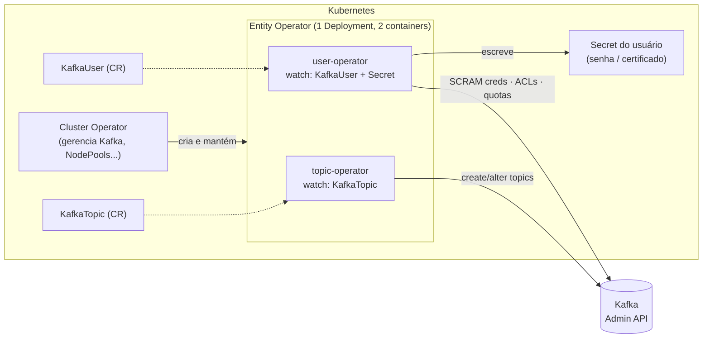
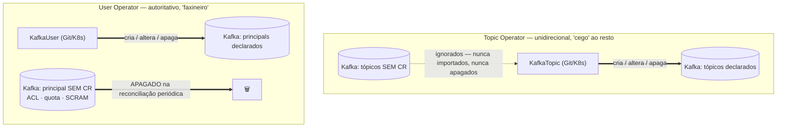
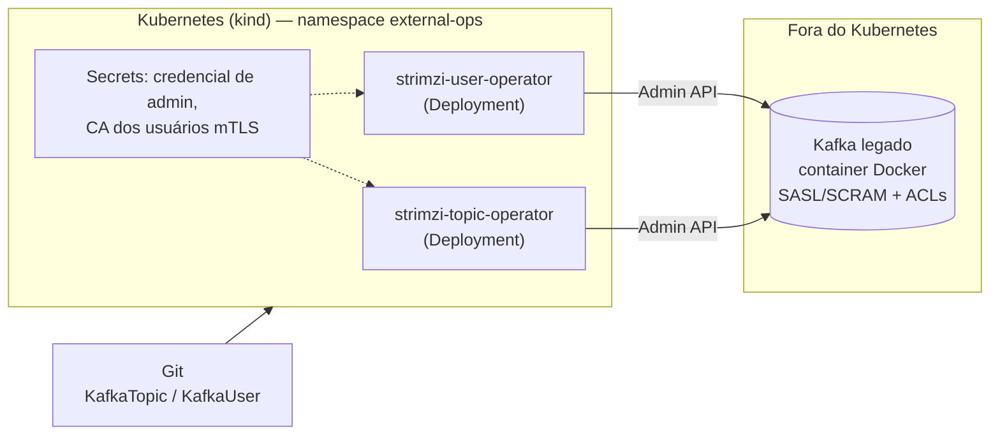

# Topic Operator e User Operator — Tópicos e Usuários como Código (a base para GitOps)

> **Objetivo:** entender, de verdade, como o **Topic Operator** e o **User Operator** do
> Strimzi funcionam — o que cada um enxerga, **em qual direção sincronizam**, o que fazem
> com o que já existe no Kafka e o que fazem com o que **não** está declarado — e então
> usá-los em dois cenários: (1) **dentro do cluster**, via `Kafka.spec.entityOperator`, e
> (2) em modo **standalone**, controlando um **Kafka que roda fora do Kubernetes**. Este
> Day é a fundação do [Day 9](../Day9-GitOps-MultiTime/), onde `KafkaTopic` e `KafkaUser`
> viram arquivos num repositório Git, entregues pelo ArgoCD para vários times e várias
> regiões. Todo comando e todo resultado deste Day foram executados de ponta a ponta num
> cluster kind (Strimzi 1.1.0, Kafka 4.3.0) — as saídas mostradas são reais, e as
> pegadinhas marcadas como "reproduzido neste lab" são comportamentos observados, não
> suposições.
>
> **Este README é também o roteiro de execução:** os blocos `bash` das seções 6 e 7 rodam em
> ordem, copiando e colando, e foram validados do zero num kind limpo.

---

## Índice

1. [Contexto](#1-contexto)
2. [Anatomia: quem é quem](#2-anatomia-quem-é-quem)
3. [A pergunta principal: sincroniza para que lado?](#3-a-pergunta-principal-sincroniza-para-que-lado)
4. [Pré-requisitos](#4-pré-requisitos)
5. [Estrutura do Lab](#5-estrutura-do-lab)
6. [Parte 1 — Dentro do cluster (Entity Operator)](#6-parte-1--dentro-do-cluster-entity-operator)
7. [Parte 2 — Standalone: controlando um Kafka fora do Kubernetes](#7-parte-2--standalone-controlando-um-kafka-fora-do-kubernetes)
8. [In-cluster vs. standalone: quando usar cada um](#8-in-cluster-vs-standalone-quando-usar-cada-um)
9. [Checklist de produção](#9-checklist-de-produção)
10. [Cleanup](#10-cleanup)
11. [Próximo passo: Day 9](#11-próximo-passo-day-9)
12. [Roteiro sugerido para o vídeo](#12-roteiro-sugerido-para-o-vídeo)
13. [Referências](#13-referências)

---

## 1. Contexto

Nos Days anteriores criamos tópicos e usuários com `kubectl apply` — e já era melhor do que
rodar `kafka-topics.sh` e `kafka-acls.sh` na mão. Mas ficou uma pergunta em aberto, e é ela
que decide se isso escala para uma empresa:

> Se `KafkaTopic` e `KafkaUser` são só YAML, **o que acontece quando a realidade do Kafka
> diverge do YAML?** Alguém cria um tópico na mão. Alguém adiciona uma ACL pelo
> `kafka-acls.sh`. Alguém apaga um tópico no Kafka. Quem ganha?

A resposta é **diferente para cada operador** — e é o assunto central deste Day:

- O **Topic Operator** é *unidirecional* (Kubernetes → Kafka) e **ignora** o que não conhece.
- O **User Operator** também é Kubernetes → Kafka, mas é **autoritativo**: o que não está
  declarado, **ele apaga**.

Quem não sabe disso ou acha que "é tudo igual" perde ACLs de produção na primeira
reconciliação. Vamos provar cada afirmação rodando.

Os dois cenários do lab:

1. **In-cluster** — o Cluster Operator sobe o *Entity Operator* junto do Kafka. É o caminho
   padrão quando o Kafka também roda no Kubernetes via Strimzi.
2. **Standalone** — os dois operadores rodam como `Deployment` simples, **sem Cluster
   Operator**, e se conectam a qualquer Kafka alcançável pela rede: VM, bare metal, MSK,
   Confluent Cloud, Aiven... Aqui o Kubernetes vira só o "painel de controle declarativo"
   de um Kafka que mora em outro lugar.

## 2. Anatomia: quem é quem



Pontos que valem ser ditos em voz alta:

- O **Entity Operator** não é um operador a mais: é o *nome do Deployment* que o Cluster
  Operator cria com **dois containers** — `topic-operator` e `user-operator`. Você os liga
  (e configura) em `Kafka.spec.entityOperator`. Reproduzido neste lab:
  `kubectl get pod -l strimzi.io/name=my-cluster-entity-operator -o jsonpath='{.items[0].spec.containers[*].name}'`
  → `topic-operator user-operator`.
- Os dois falam com o Kafka **somente pela Admin API** (o mesmo que `kafka-topics.sh`,
  `kafka-acls.sh` e `kafka-configs.sh` usam). Por isso funcionam contra qualquer Kafka que
  exponha essa API — e é exatamente isso que permite o modo standalone.
- Cada operador observa **um único namespace** (`watchedNamespace`, por padrão o do Kafka)
  e filtra por **label** (`strimzi.io/cluster`). Um `KafkaTopic` sem a label é invisível.
- Existem dois mecanismos de reconciliação ao mesmo tempo: **eventos** (watch — reage na hora
  a um `kubectl apply`) e **reconciliação periódica completa** (`reconciliationIntervalMs`,
  padrão **120000 ms = 2 min**). A periódica é o que "cura" divergências que não geraram
  evento no Kubernetes, como alguém mexer direto no Kafka.

> **Histórico que cai em prova de certificação:** a primeira geração do Topic Operator era
> *bidirecional* (sincronizava Kafka ↔ Kubernetes com um three-way merge e um *topic store*
> baseado em Kafka Streams/Zookeeper). Ela tinha problemas de escala e de casos de borda, e
> foi substituída pelo **Unidirectional Topic Operator (UTO)**, que virou GA no Strimzi
> **0.41** (o feature gate passou a ser permanentemente habilitado). Hoje só existe o UTO:
> sem topic store, sem tópicos internos `strimzi-store-topic`, e os `KafkaTopic` são a única
> fonte da verdade. Veja o [post de introdução do UTO](https://strimzi.io/blog/2023/11/02/unidirectional-topic-operator/).

## 3. A pergunta principal: sincroniza para que lado?

Tabela de bolso — cada linha foi **reproduzida neste lab** (seções 6 e 7 mostram o comando e
a saída):

| Situação | Topic Operator (`KafkaTopic`) | User Operator (`KafkaUser`) |
|---|---|---|
| Você cria o CR | Cria o tópico no Kafka | Cria credencial SCRAM/cert, ACLs, quotas e o `Secret` |
| Você altera o CR | Aplica no Kafka (aumentar partições ✅; **diminuir ❌** `NotSupported`; mudar `replicas` ❌ sem Cruise Control) | Aplica no Kafka |
| Alguém **altera na mão** no Kafka algo que o CR gerencia | **Revertido** na próxima reconciliação (inclusive configs *extras* que não estão no spec) | **Revertido** (ACL extra de um usuário gerenciado some) |
| Algo é **criado na mão** no Kafka e **não tem CR** | **Ignorado.** Não importa, não apaga, não avisa | **APAGADO.** ACLs, quotas e credenciais SCRAM de qualquer principal sem `KafkaUser` somem |
| Algo **já existe** no Kafka e você cria o CR depois ("adoção") | O `spec` **sobrescreve** a realidade (config que não está no spec volta ao default do broker) | O `spec` sobrescreve: ACLs fora do spec são removidas e **a senha SCRAM é trocada** (a antiga para de funcionar) |
| Alguém **apaga na mão** no Kafka (CR continua) | **Recriado vazio** (novo `TopicId`, dados perdidos) | Recriado |
| Você **apaga o CR** | **Apaga o tópico** (via finalizer), a menos que `strimzi.io/managed: "false"` | Apaga credencial, ACLs, quotas e Secret |

Resumo em uma frase para o vídeo:

> **Topic Operator: "só me importo com o que está declarado — o resto não existe pra mim".
> User Operator: "só existe o que está declarado — o resto eu removo".**



> **Por que a assimetria faz sentido:** tópicos carregam *dados* — apagar um tópico "órfão"
> seria destruir dados que alguém criou por motivo legítimo (apps com auto-create, Kafka
> Streams, ferramentas). Já ACLs e credenciais são *política de acesso*: uma ACL que ninguém
> declarou é, do ponto de vista de segurança, uma brecha — o operador a trata como desvio.
> A consequência prática é que **a adoção de um Kafka existente é segura para tópicos e
> perigosa para usuários** (seção 7.6).

## 4. Pré-requisitos

- [Docker](https://docs.docker.com/get-docker/) com ~6GB de RAM livres (3 brokers dual-role + o Kafka externo da Parte 2)
- [kind](https://kind.sigs.k8s.io/docs/user/quick-start/#installation)
- [kubectl](https://kubernetes.io/docs/tasks/tools/#kubectl)
- `openssl` (só na Parte 2, para gerar a CA dos usuários mTLS)
- Ter feito o [Day 4](../Day4-Autenticacao-Autorizacao/) (assumimos que você já conhece `KafkaUser`, SCRAM e ACLs — aqui o foco é **como o operador** os gerencia, não o que cada campo significa)

> **Cuidado com o contexto do `kubectl`:** todos os comandos deste Day usam
> `--context kind-strimzi-day8` para ficar impossível aplicar algo no cluster errado. Se o seu
> `kubeconfig` tem clusters de trabalho, **não confie no contexto atual** — nos blocos abaixo
> definimos uma função `kx` para isso.

## 5. Estrutura do Lab

```
Day8-TopicUserOperators/
├── kind-config.yaml                    # kind: 1 control-plane + 2 workers
├── kafka-nodepool-dual-role.yaml       # KafkaNodePool 3x (controller+broker)
├── kafka-cluster.yaml                  # Kafka CR: SCRAM + ACL + entityOperator (TO + UO)
├── kafka-cluster-ignored-users.yaml    # idem + STRIMZI_IGNORED_USERS_PATTERN (seção 6.12)
├── kafkauser-admin.yaml                # superuser SCRAM (criado pelo próprio User Operator)
├── kafkauser-orders-app.yaml           # usuário de aplicação com ACLs
├── kafka-topic-orders.yaml             # KafkaTopic básico
├── kafka-topic-adopt-legacy.yaml       # adoção de tópico pré-existente
├── kafka-topic-duplicate.yaml          # dois CRs, mesmo tópico → ResourceConflict
├── kafka-topic-weird-name.yaml         # spec.topicName (nome inválido no k8s, válido no Kafka)
├── standalone/
│   ├── 00-namespace.yaml               # namespace external-ops
│   ├── external-kafka/
│   │   ├── docker-compose.yml          # Kafka "legado" FORA do k8s (container na rede do kind)
│   │   └── server.properties           # KRaft + SASL/SCRAM + ACLs
│   ├── topic-operator.yaml             # SA + Role + RoleBinding + Deployment (standalone)
│   ├── user-operator.yaml              # idem para o User Operator
│   ├── kafkatopic-ext-payments.yaml    # KafkaTopic para o Kafka externo
│   └── kafkauser-ext-billing.yaml      # KafkaUser para o Kafka externo
├── README.md
└── README-EN.md
```

---

## 6. Parte 1 — Dentro do cluster (Entity Operator)

> **Como usar daqui para frente:** cada bloco ` ```bash ` é para **copiar e colar, em ordem, no
> mesmo terminal** (zsh ou bash). Os blocos ` ```text ` são a **saída esperada** — não rodam.
> Tudo foi validado do zero num kind limpo. Tempo total: ~15 min de comandos rodando sem pausa
> para explicar (o Kafka leva ~2 min para subir).

**Antes de começar** — Docker rodando e as ferramentas instaladas:

```bash
docker info --format 'docker {{.ServerVersion}}' && kind version && kubectl version --client | head -1 && openssl version
```

**Reset** (se já rodou o lab antes). Execute **a partir da raiz do repositório**:

```bash
kind delete cluster --name strimzi-day8 2>/dev/null
( cd kafka-strimzi/Day8-TopicUserOperators/standalone/external-kafka 2>/dev/null && docker compose down 2>/dev/null )
echo "limpo"
```

### 6.1 Subindo o cluster e instalando o Strimzi

A função `kx` **fixa o contexto** do `kubectl` — não dependa do `current-context` do seu
kubeconfig. É função (não `alias`) para funcionar igual em zsh e bash.

```bash
cd kafka-strimzi/Day8-TopicUserOperators
kind create cluster --config=kind-config.yaml --name strimzi-day8
kx() { kubectl --context kind-strimzi-day8 "$@"; }
kx wait --for=condition=Ready node --all --timeout=120s
kx get nodes
```

> **Se abrir outro terminal, cole a linha da função `kx` de novo** — funções não persistem entre terminais.

```bash
kx create namespace kafka
curl -sL https://github.com/strimzi/strimzi-kafka-operator/releases/download/1.1.0/strimzi-cluster-operator-1.1.0.yaml \
  | sed 's/namespace: myproject/namespace: kafka/g' \
  | kx create -f - -n kafka > /dev/null
kx wait deployment/strimzi-cluster-operator -n kafka --for=condition=Available --timeout=180s
```

### 6.2 Habilitando os dois operadores no `Kafka`

Tudo que o Cluster Operator precisa saber para subir o Entity Operator está em
`spec.entityOperator`. Trecho de [`kafka-cluster.yaml`](kafka-cluster.yaml):

```yaml
spec:
  kafka:
    authorization: { type: simple, superUsers: [admin] }   # o User Operator precisa de um authorizer
    config:
      auto.create.topics.enable: false                     # veja a seção 6.8
  entityOperator:
    topicOperator:
      reconciliationIntervalMs: 30000    # padrão 120000. Atalho de lab, para ver a "cura" rápido
    userOperator:
      reconciliationIntervalMs: 30000
```

- `topicOperator: {}` e `userOperator: {}` (vazios) já ligam cada um com os padrões. **Você
  pode ligar só um dos dois** — por exemplo, só o `userOperator` se os tópicos são gerenciados
  por outra ferramenta.
- Campos úteis em cada um: `watchedNamespace`, `reconciliationIntervalMs`, `resources`,
  `logging`, `jvmOptions`, probes. O `userOperator` tem ainda `secretPrefix` (prefixo do nome
  dos Secrets gerados).
- Variáveis de ambiente que **não** têm campo próprio entram por
  `entityOperator.template.topicOperatorContainer.env` / `userOperatorContainer.env`
  (exemplos nas seções 6.9 e 6.12).

```bash
kx apply -n kafka -f kafka-nodepool-dual-role.yaml -f kafka-cluster.yaml
kx wait kafka/my-cluster -n kafka --for=condition=Ready --timeout=420s
kx get pods -n kafka
```

```text
NAME                                          READY   STATUS    RESTARTS   AGE
my-cluster-dual-role-0                        1/1     Running   0          74s
my-cluster-dual-role-1                        1/1     Running   0          74s
my-cluster-dual-role-2                        1/1     Running   0          74s
my-cluster-entity-operator-5d57d6fdc8-hdw9f   2/2     Running   0          28s     ← 2/2 = Topic Op + User Op
strimzi-cluster-operator-66c7bc49db-zkrr5     1/1     Running   0          2m10s
```

Os dois containers do Entity Operator:

```bash
kx get pod -n kafka -l strimzi.io/name=my-cluster-entity-operator -o jsonpath='{.items[0].spec.containers[*].name}'; echo
```

### 6.3 O primeiro usuário e o primeiro tópico, como código

Um detalhe elegante: o superuser `admin` (listado em `authorization.superUsers`) **não vem
de um script** — é um `KafkaUser` como outro qualquer. O User Operator se autentica no
Kafka com o certificado do próprio Entity Operator (que o Strimzi trata como superuser
interno), então ele consegue criar o `admin` mesmo antes de existir qualquer usuário SCRAM.

```bash
kx apply -n kafka -f kafkauser-admin.yaml -f kafka-topic-orders.yaml
kx wait kafkauser/admin kafkatopic/orders.events -n kafka --for=condition=Ready --timeout=120s
kx get kt,ku -n kafka
```

```text
NAME                                        CLUSTER      PARTITIONS   REPLICATION FACTOR   READY
kafkatopic.kafka.strimzi.io/orders.events   my-cluster   3            3                    True

NAME                               CLUSTER      AUTHENTICATION   AUTHORIZATION   READY
kafkauser.kafka.strimzi.io/admin   my-cluster   scram-sha-512                    True
```

O `status` do `KafkaTopic` já diz o que o Kafka tem de verdade (`topicId`, `topicName`,
`observedGeneration`). A regra de ouro de status: **`metadata.generation` deve ser igual a
`status.observedGeneration`** — se não for, o operador ainda não viu a sua última mudança.

```bash
kx get kt orders.events -n kafka -o jsonpath='{.status}'; echo
```

```text
{"conditions":[{"status":"True","type":"Ready",...}],"observedGeneration":1,"topicId":"KZMXdGE5Qp6iUkMvvLODyg","topicName":"orders.events"}
```

### 6.4 Helpers para "conversar" com o Kafka como um humano faria

Para provar o que o operador faz, precisamos mexer no Kafka **por fora** do Kubernetes, como
um administrador apressado faria. Montamos um `client.properties` do `admin` dentro do broker
e quatro funções (`kbin`, `kt`, `kcfg`, `kacl`):

```bash
ADMIN_PASS=$(kx get secret admin -n kafka -o jsonpath='{.data.password}' | base64 -d)
kx exec -n kafka my-cluster-dual-role-0 -c kafka -- bash -c "cat > /tmp/admin.properties <<EOF
security.protocol=SASL_PLAINTEXT
sasl.mechanism=SCRAM-SHA-512
sasl.jaas.config=org.apache.kafka.common.security.scram.ScramLoginModule required username=\"admin\" password=\"${ADMIN_PASS}\";
EOF"

BS=my-cluster-kafka-bootstrap:9092
kbin() { local b=$1; shift; kx exec -n kafka my-cluster-dual-role-0 -c kafka -- /opt/kafka/bin/$b --bootstrap-server $BS --command-config /tmp/admin.properties "$@"; }
kt()   { kbin kafka-topics.sh  "$@"; }
kcfg() { kbin kafka-configs.sh "$@"; }
kacl() { kbin kafka-acls.sh    "$@"; }

kt --describe --topic orders.events
```

```text
Topic: orders.events  PartitionCount: 3  ReplicationFactor: 3  Configs: min.insync.replicas=2,retention.ms=604800000
```

`kt` = tópicos, `kcfg` = configs/quotas/SCRAM, `kacl` = ACLs. Como `kx`, **não persistem entre terminais**.

### 6.5 Experimento 1 — Mudança manual no Kafka é revertida

O administrador apressado "resolve um incidente" encurtando a retenção e adicionando uma
config que **nem existe** no `spec`:

```bash
kcfg --entity-type topics --entity-name orders.events --alter --add-config retention.ms=1000,max.message.bytes=2000000
kt --describe --topic orders.events | head -1
```

```text
Configs: min.insync.replicas=2,retention.ms=1000,max.message.bytes=2000000
```

Espere a reconciliação periódica (30 s neste lab) desfazer:

```bash
until kt --describe --topic orders.events | head -1 | grep -q "retention.ms=604800000"; do echo "aguardando o Topic Operator..."; sleep 5; done
kt --describe --topic orders.events | head -1
```

```text
Configs: min.insync.replicas=2,retention.ms=604800000      ← voltou, e max.message.bytes SUMIU
```

O log do `topic-operator` mostra o gatilho (`kubectl logs deploy/my-cluster-entity-operator -c topic-operator`):

```text
INFO  TopicEventHandler:49 - Triggering periodic reconciliation of KafkaTopic resources for namespace kafka
INFO  LoopRunnable:216 - [Batch #887] Reconciling batch of 1 topics
INFO  LoopRunnable:225 - [Batch #887] Batch reconciliation completed
```

**Lição:** o `KafkaTopic` é a *única* fonte da verdade — e "o que não está no spec" também é
verdade: configs ausentes do `spec.config` voltam ao default do broker. Isso é ótimo para
GitOps (zero drift) e perigoso para quem esperava que o operador "só somasse" configs.

### 6.6 Experimento 2 — Tópico criado direto no Kafka é *ignorado*; adotá-lo cobra um preço

Um app (ou uma pessoa) cria um tópico por fora, compactado e com retenção de 1 dia:

```bash
kt --create --topic legacy.payments --partitions 6 --replication-factor 3 --config retention.ms=86400000 --config cleanup.policy=compact
sleep 70
echo "--- KafkaTopics no Kubernetes (legacy.payments NÃO aparece):"; kx get kt -n kafka
echo "--- Tópicos no Kafka (legacy.payments continua lá):"; kt --list
```

O Topic Operator **não importa** nem **apaga** tópicos que não conhece. Para passar a
gerenciá-lo, basta criar um `KafkaTopic` com o mesmo nome ("adoção"). Primeiro a **adoção
ingênua** — criamos o CR esquecendo o `cleanup.policy`:

```bash
cat <<'EOF' | kx apply -n kafka -f -
apiVersion: kafka.strimzi.io/v1
kind: KafkaTopic
metadata:
  name: legacy.payments
  labels:
    strimzi.io/cluster: my-cluster
spec:
  partitions: 6
  replicas: 3
  config:
    retention.ms: 172800000
EOF
kx wait kt/legacy.payments -n kafka --for=condition=Ready --timeout=60s
kt --describe --topic legacy.payments | head -1
```

```text
Configs: min.insync.replicas=2,retention.ms=172800000      ← cleanup.policy=compact SUMIU!
```

Reproduzido neste lab: **a adoção reescreveu a retenção e removeu `cleanup.policy=compact`.**
Um tópico compactado que vira `delete` começa a apagar a última versão de cada chave. Por
isso o procedimento seguro de adoção é: **leia a config real (`kcfg ... --describe`), copie
para o spec, só então aplique** — é o que faz
[`kafka-topic-adopt-legacy.yaml`](kafka-topic-adopt-legacy.yaml):

```bash
kx apply -n kafka -f kafka-topic-adopt-legacy.yaml
until kt --describe --topic legacy.payments | head -1 | grep -q "cleanup.policy=compact"; do sleep 3; done
kt --describe --topic legacy.payments | head -1
```

### 6.7 Experimento 3 — O que o operador **não** consegue fazer: encolher partições e mudar réplicas

Diminuir partições:

```bash
kx patch kt legacy.payments -n kafka --type merge -p '{"spec":{"partitions":3}}'
sleep 8
kx get kt legacy.payments -n kafka -o jsonpath='{range .status.conditions[*]}{.type}={.status} {.reason}: {.message}{"\n"}{end}'
```

Mudar o fator de replicação:

```bash
kx patch kt legacy.payments -n kafka --type merge -p '{"spec":{"partitions":6,"replicas":2}}'
sleep 8
kx get kt legacy.payments -n kafka -o jsonpath='{range .status.conditions[*]}{.type}={.status} {.reason}: {.message}{"\n"}{end}'
```

Aumentar partições (isto funciona):

```bash
kx patch kt legacy.payments -n kafka --type merge -p '{"spec":{"partitions":8,"replicas":3}}'
sleep 8
kx get kt legacy.payments -n kafka -o jsonpath='{range .status.conditions[*]}{.type}={.status} {.reason}: {.message}{"\n"}{end}'
kt --describe --topic legacy.payments | head -1
```

```text
Ready=False NotSupported: Decreasing partitions not supported
Ready=False NotSupported: Replication factor change not supported, but required for partitions [0, 1, 2, 3, 4, 5]
Ready=True    → aumentar partições funciona (8)
```

- **Diminuir partições:** o próprio Kafka não suporta. O operador não finge que sim — fica
  `Ready=False` e **não toca no tópico**.
- **Mudar `replicas`:** sem [Cruise Control](../Day6-CruiseControl/) o operador recusa
  (`NotSupported`). Com Cruise Control habilitado no cluster, o UTO consegue mudar o fator de
  replicação orquestrando a reatribuição de réplicas (suporte desde o Strimzi 0.41).
- **Regra para GitOps:** um `Ready=False` no CR significa "o Git diz uma coisa, o Kafka tem
  outra". O sync do ArgoCD pode estar *verde* e o tópico *vermelho* — monitore o `status` do CR (seção 9).

### 6.8 Experimento 4 — Nomes inválidos e a corrida com `auto.create`

**Nome que o Kubernetes não aceita.** Kafka permite `Orders_V1.DLQ`; o Kubernetes não
(`metadata.name` precisa ser DNS-1123). Use `spec.topicName` — e lembre que ele **não pode
ser alterado depois**:

```bash
kx apply -n kafka -f kafka-topic-weird-name.yaml
kx wait kt/orders-v1-dlq -n kafka --for=condition=Ready --timeout=60s
kt --list | grep -i dlq
```

> **Em GitOps, `spec.topicName` é a ferramenta de padronização de nomes**: o nome do arquivo e
> do recurso segue a convenção do Kubernetes, e o nome real no Kafka segue a convenção da empresa.

**A corrida com `auto.create.topics.enable`.** Documentado pelo Strimzi: se um app sobe e
produz *antes* de o `KafkaTopic` ser reconciliado, o broker cria o tópico com os defaults
(1 partição, por exemplo). Aí o operador tenta ajustar e pode falhar (se for preciso *diminuir*
partições). Por isso o `kafka-cluster.yaml` deste Day tem `auto.create.topics.enable: false` —
a recomendação oficial. Isso não protege contra apps que usam o `AdminClient` para criar
tópicos (Kafka Streams): nesses casos o app deve **esperar** o tópico existir (init container).

### 6.9 Experimento 5 — Apagar: `managed=false`, pause, finalizer, apagado por fora

**Apagou o CR → apagou o tópico** (esse é o comportamento padrão e é *intencional*).
Existem **três botões de segurança**, do mais leve ao mais pesado:

| Mecanismo | O que faz | Se apagar o CR |
|---|---|---|
| `strimzi.io/managed: "false"` | Operador **para de gerenciar** (`status: Unmanaged`) | Só o CR some; **o tópico fica no Kafka** |
| `strimzi.io/pause-reconciliation: "true"` | Operador **ignora mudanças** no CR (`ReconciliationPaused`) | O tópico **é apagado** (continua "gerenciado", só pausado) |
| `STRIMZI_USE_FINALIZERS=false` | Sem finalizer no CR | CR some na hora; o operador ainda tenta apagar o tópico se estiver de pé |

**`managed=false`**: o CR some, o tópico **fica**.

```bash
kx annotate kt legacy.payments -n kafka strimzi.io/managed=false --overwrite
sleep 6
kx delete kt legacy.payments -n kafka
kt --list
```

`legacy.payments` **continua no Kafka** — use isto para "migrar o nome do CR" sem perder o tópico.

**Pause**: mudanças são ignoradas, mas o delete ainda apaga o tópico.

```bash
kx annotate kt orders.events -n kafka strimzi.io/pause-reconciliation=true --overwrite
sleep 4
kx patch kt orders.events -n kafka --type merge -p '{"spec":{"config":{"retention.ms":1234567}}}'
sleep 10
kt --describe --topic orders.events | head -1
kx delete kt orders.events -n kafka
sleep 6
kt --list
```

O `retention.ms` **não mudou** (pausado), mas o delete passou: o tópico `orders.events` foi apagado.

**A armadilha do finalizer.** O `KafkaTopic` carrega `finalizers: [strimzi.io/topic-operator]`.
Se o operador estiver parado e você apagar o CR, ele fica em **`Terminating`** para sempre —
e o mesmo vale para o *namespace* inteiro:

```bash
kx apply -n kafka -f kafka-topic-orders.yaml
kx wait kt/orders.events -n kafka --for=condition=Ready --timeout=60s
kx wait kt/orders.events -n kafka --for=jsonpath='{.metadata.finalizers[0]}'=strimzi.io/topic-operator --timeout=60s
kx scale deploy/my-cluster-entity-operator -n kafka --replicas=0
sleep 5
kx delete kt orders.events -n kafka --wait=false
sleep 3
kx get kt orders.events -n kafka -o jsonpath='{.metadata.deletionTimestamp} finalizers={.metadata.finalizers}'; echo
```

```text
2026-10-31T07:55:02Z finalizers=["strimzi.io/topic-operator"]     ← preso
```

Ao religar, o operador conclui a limpeza sozinho:

```bash
kx scale deploy/my-cluster-entity-operator -n kafka --replicas=1
kx rollout status deploy/my-cluster-entity-operator -n kafka --timeout=120s
until [ -z "$(kx get kt -n kafka -o name | grep orders.events)" ]; do sleep 3; done
kx get kt -n kafka; kt --list
```

(Se o operador nunca mais voltar, a saída de emergência é remover os finalizers:
`kubectl get kt -o yaml | yq 'del(.items[].metadata.finalizers[])' | kubectl apply -f -`.)

> **Pegadinha de GitOps (antecipando o Day 9):** num repositório, *apagar o arquivo YAML do
> tópico* = *apagar o tópico em produção*. Vamos tratar disso com `Prune=false` no ArgoCD e
> revisão obrigatória de PR — não deixe isso para depois.

**E se alguém apagar o tópico direto no Kafka?** O CR continua existindo, então o operador
**recria** na próxima reconciliação — mas **vazio** (note o `TopicId` mudar; o Git não traz os
dados de volta):

```bash
kx apply -n kafka -f kafka-topic-weird-name.yaml
kt --describe --topic Orders_V1.DLQ | head -1 | cut -f1-2
kt --delete --topic Orders_V1.DLQ
until kt --list | grep -q "Orders_V1.DLQ"; do echo "aguardando recriação..."; sleep 5; done
kt --describe --topic Orders_V1.DLQ | head -1 | cut -f1-2
```

### 6.10 Experimento 6 — Dois CRs para o mesmo tópico (`ResourceConflict`) e o "fantasma"

O mais antigo vence; o novo fica `Ready=False` e **não muda nada** no Kafka (aqui o
[`kafka-topic-duplicate.yaml`](kafka-topic-duplicate.yaml) usa `spec.topicName: orders.events` e `partitions: 12`):

```bash
kx apply -n kafka -f kafka-topic-orders.yaml
kx wait kt/orders.events -n kafka --for=condition=Ready --timeout=60s
kx apply -n kafka -f kafka-topic-duplicate.yaml
sleep 8
kx get kt orders-events-duplicate -n kafka -o jsonpath='{.status.conditions[0].reason}: {.status.conditions[0].message}{"\n"}'
kt --describe --topic orders.events | head -1
kx delete kt orders-events-duplicate -n kafka
sleep 6
kt --list | grep orders.events
```

O CR duplicado fica com `ResourceConflict: Managed by Ref{namespace='kafka', name='orders.events'}`,
o tópico continua com 3 partições, e apagar o **perdedor** não apaga o tópico.

> **Pegadinha reproduzida (Strimzi 1.1.0):** o Topic Operator guarda em **memória** quem gerencia cada
> tópico. Depois de apagar o CR *perdedor*, se você **apagar e recriar o vencedor**, o novo CR
> aparece como `ResourceConflict` apontando para o CR que **já não existe**. Só reiniciar o
> operador limpa. Veja:

```bash
kx delete kt orders.events -n kafka
sleep 8
kx apply -n kafka -f kafka-topic-orders.yaml
sleep 20
kx get kt orders.events -n kafka -o jsonpath='{.status.conditions[0].reason}: {.status.conditions[0].message}{"\n"}'
```

```text
ResourceConflict: Managed by Ref{namespace='kafka', name='orders-events-duplicate'}     ← o duplicate não existe mais!
```

Saída: reiniciar o Entity Operator (a memória é reconstruída a partir dos CRs que existem de verdade):

```bash
kx rollout restart deploy/my-cluster-entity-operator -n kafka
kx rollout status deploy/my-cluster-entity-operator -n kafka --timeout=120s
kx wait kt/orders.events -n kafka --for=condition=Ready --timeout=120s
kx get kt -n kafka
```

### 6.11 `KafkaUser`: o operador faxineiro

```bash
kx apply -n kafka -f kafkauser-orders-app.yaml
kx wait ku/orders-app -n kafka --for=condition=Ready --timeout=60s
kacl --list --principal User:orders-app
```

```text
Current ACLs for resource `ResourcePattern(resourceType=GROUP, name=orders-app-, patternType=PREFIXED)`:
	(principal=User:orders-app, host=*, operation=READ, permissionType=ALLOW)
Current ACLs for resource `ResourcePattern(resourceType=TOPIC, name=orders., patternType=PREFIXED)`:
	(principal=User:orders-app, host=*, operation=READ/WRITE/DESCRIBE, permissionType=ALLOW)
```

O que o User Operator fez a partir de 12 linhas de YAML: gerou uma senha, gravou o hash SCRAM
no Kafka, criou as ACLs e publicou o `Secret/orders-app` com a senha e o `sasl.jaas.config`
pronto para a aplicação consumir (é a base do [Day 5 — KafkaAccessOperator](../Day5-KafkaAccessOperator/)).

**Experimento 7 — o que sobra no Kafka sem `KafkaUser` morre.** Criamos "por fora" um
principal `ghost` com ACL, credencial SCRAM e quota, e uma ACL extra para o `orders-app`:

```bash
kacl --add --allow-principal User:ghost --operation Read --topic secret.data
kcfg --entity-type users --entity-name ghost --alter --add-config 'SCRAM-SHA-512=[password=ghost-pw]'
kcfg --entity-type users --entity-name ghost --alter --add-config 'producer_byte_rate=1048576'
kacl --add --allow-principal User:orders-app --operation All --topic secret.data
echo "--- ANTES:"; kcfg --entity-type users --describe
```

```bash
until [ "$(kacl --list --principal User:ghost | grep -c principal=)" = "0" ] && [ "$(kacl --list --principal User:orders-app | grep -c secret.data)" = "0" ]; do echo "aguardando o User Operator..."; sleep 5; done
echo "--- DEPOIS (ghost sumiu; ACL extra do orders-app revertida):"; kcfg --entity-type users --describe
```

O `ghost` (ACL + SCRAM + quota) sumiu, e a ACL extra do usuário gerenciado também foi revertida.

O User Operator monta, a cada ciclo, a lista de "quem existe" pela **união** de: `KafkaUser`
(com a label), principals com ACL, principals com quota e principals com credencial SCRAM no
Kafka. Todo nome que aparece no Kafka mas não tem `KafkaUser` é reconciliado com "estado
desejado = nada" — ou seja, apagado. Ele faz isso **para todos os principals do cluster**, não
só para os que ele criou.

> **Nota sobre latência:** o User Operator trabalha em cima de caches (ACLs/quotas/SCRAM)
> atualizados a cada `STRIMZI_CACHE_REFRESH_INTERVAL_MS` (padrão **15 s**). Por isso uma ACL
> adicionada na mão pode sobreviver ~15–45 s antes de ser removida — não é bug, é cache.

**Se o que é gerenciado for apagado por fora, é recriado:**

```bash
kacl --remove --allow-principal User:orders-app --operation Read --operation Write --operation Describe --topic orders. --resource-pattern-type prefixed --force
until [ "$(kacl --list --principal User:orders-app | grep -c principal=)" = "4" ]; do echo "aguardando recriar as ACLs..."; sleep 5; done
kacl --list --principal User:orders-app
```

**Adoção de usuário existente.** Criamos `adopt-me` por fora, com senha própria, e só depois
um `KafkaUser` de mesmo nome. A senha antiga **para de funcionar**:

```bash
kcfg --entity-type users --entity-name adopt-me --alter --add-config 'SCRAM-SHA-512=[password=old-pw-from-legacy]'
kx exec -n kafka my-cluster-dual-role-0 -c kafka -- bash -c 'cat > /tmp/adopt.properties <<EOF
security.protocol=SASL_PLAINTEXT
sasl.mechanism=SCRAM-SHA-512
sasl.jaas.config=org.apache.kafka.common.security.scram.ScramLoginModule required username="adopt-me" password="old-pw-from-legacy";
EOF
/opt/kafka/bin/kafka-topics.sh --bootstrap-server my-cluster-kafka-bootstrap:9092 --command-config /tmp/adopt.properties --list >/dev/null 2>&1; echo "login com a senha antiga ANTES da adoção: rc=$?"'
```

```bash
cat <<'EOF' | kx apply -n kafka -f -
apiVersion: kafka.strimzi.io/v1
kind: KafkaUser
metadata:
  name: adopt-me
  labels:
    strimzi.io/cluster: my-cluster
spec:
  authentication:
    type: scram-sha-512
EOF
kx wait ku/adopt-me -n kafka --for=condition=Ready --timeout=60s
sleep 5
kx exec -n kafka my-cluster-dual-role-0 -c kafka -- bash -c '/opt/kafka/bin/kafka-topics.sh --bootstrap-server my-cluster-kafka-bootstrap:9092 --command-config /tmp/adopt.properties --list >/dev/null 2>&1; echo "login com a senha antiga DEPOIS da adoção: rc=$?"'
kx delete ku adopt-me -n kafka
```

```text
login com a senha antiga ANTES da adoção:  rc=0
login com a senha antiga DEPOIS da adoção: rc=1     ← o operador gerou uma senha nova e a gravou
```

Para adotar sem quebrar clientes, forneça a senha existente no próprio CR
(`spec.authentication.password.valueFrom.secretKeyRef`) e declare as mesmas ACLs no `spec`.

### 6.12 Experimento 8 — Protegendo quem não é seu: `STRIMZI_IGNORED_USERS_PATTERN`

Quando parte dos principals é gerenciada por outra coisa (scripts legados, outra ferramenta,
um time que ainda não migrou), diga ao operador para **não enxergá-los**
([`kafka-cluster-ignored-users.yaml`](kafka-cluster-ignored-users.yaml) acrescenta isto ao `Kafka`):

```yaml
  entityOperator:
    template:
      userOperatorContainer:
        env:
          - name: STRIMZI_IGNORED_USERS_PATTERN
            value: "^legacy-.*$"
```

```bash
kx apply -n kafka -f kafka-cluster-ignored-users.yaml
sleep 5
kx rollout status deploy/my-cluster-entity-operator -n kafka --timeout=180s
kx get deploy my-cluster-entity-operator -n kafka -o jsonpath='{.spec.template.spec.containers[?(@.name=="user-operator")].env[?(@.name=="STRIMZI_IGNORED_USERS_PATTERN")]}'; echo
```

Teste: criamos `legacy-batch` (casa com o padrão) e `ghost2` (não casa), ambos na mão:

```bash
kacl --add --allow-principal User:legacy-batch --operation Read --topic legacy.payments
kcfg --entity-type users --entity-name legacy-batch --alter --add-config 'SCRAM-SHA-512=[password=pw1]'
kacl --add --allow-principal User:ghost2 --operation Read --topic legacy.payments
sleep 100
echo "legacy-batch (ignorado, deve ter 1):"; kacl --list --principal User:legacy-batch | grep -c principal=
echo "ghost2 (não ignorado, deve ter 0):";   kacl --list --principal User:ghost2 | grep -c principal=; true
```

`legacy-batch` **sobreviveu a vários ciclos**, enquanto `ghost2` (fora do padrão) foi apagado. O
padrão é comparado com o nome **exatamente como o Kafka o guarda** — para usuários mTLS isso é
`CN=nome`, então o regex precisa levar o `CN=` em conta. Casos clássicos para ignorar:
`ANONYMOUS`, `*`, principals de integrações.

### 6.13 Observabilidade mínima

Os dois operadores expõem métricas Prometheus (`/metrics`; TO na porta 8080, UO na 8081):

| Métrica | Para quê |
|---|---|
| `strimzi_resources` | Quantos `KafkaTopic`/`KafkaUser` o operador enxerga |
| `strimzi_reconciliations_total` / `_successful_total` | Taxa de reconciliações e a fração com sucesso (alerta: `total - successful` subindo) |
| `strimzi_reconciliations_duration_seconds_*` | Latência do ciclo |
| `strimzi_reconciliations_locked_total` (TO) / `_already_enqueued_total` (UO) | Pressão na fila |
| `strimzi_reconciliations_periodical_total` (UO) | Ciclos periódicos executados |

---

## 7. Parte 2 — Standalone: controlando um Kafka fora do Kubernetes

Agora o Kafka **não é do Strimzi**. Pode ser uma VM, bare metal, MSK, Confluent Cloud, Aiven.
O Kubernetes só roda os dois operadores, que viram um "plano de controle declarativo" para
tópicos e usuários desse Kafka.



**O que NÃO precisa existir:** Cluster Operator, CR `Kafka`, `KafkaNodePool`, Entity Operator.
Só precisam existir (a) as **CRDs** `KafkaTopic` e `KafkaUser`, (b) os dois `Deployment`s e (c)
uma conexão com o Kafka.

### 7.1 Subindo o "Kafka legado" fora do Kubernetes

O container entra na rede Docker `kind` (criada pelo `kind create cluster`), então os pods o
alcançam **pelo nome** `external-kafka:9092` — sem port-forward, sem IP do host:

```bash
cd standalone/external-kafka
docker compose up -d
until docker logs external-kafka 2>&1 | grep -q "Kafka Server started"; do sleep 2; done
docker logs external-kafka 2>&1 | grep "Kafka Server started"
cd ../..
```

[`server.properties`](standalone/external-kafka/server.properties) liga SASL/SCRAM e o
`StandardAuthorizer`. O ponto sutil está no `docker-compose.yml`: o `kafka-storage.sh format
--add-scram` registra a credencial de bootstrap **dentro do metadata log do KRaft** no
momento do format — sem isso ninguém consegue autenticar para criar o primeiro usuário.

Helper para falar com ele (note: **fora** do Kubernetes, via `docker exec`):

```bash
docker exec external-kafka bash -c 'cat > /tmp/admin.properties <<EOF
security.protocol=SASL_PLAINTEXT
sasl.mechanism=SCRAM-SHA-512
sasl.jaas.config=org.apache.kafka.common.security.scram.ScramLoginModule required username="admin" password="admin-secret";
EOF'
EXT() { docker exec external-kafka /opt/kafka/bin/$1 --bootstrap-server external-kafka:9092 --command-config /tmp/admin.properties "${@:2}"; }
EXT kafka-topics.sh --list; echo "(vazio = ok)"
```

### 7.2 Instalando só o necessário (CRDs + operadores)

Em um cluster **limpo**, sem Cluster Operator, você instala só as duas CRDs a partir do
pacote de deploy do Strimzi. **Não rode isto neste lab** (o `strimzi-cluster-operator-1.1.0.yaml`
da Parte 1 já instalou todas as CRDs):

```text
curl -sL https://github.com/strimzi/strimzi-kafka-operator/releases/download/1.1.0/strimzi-1.1.0.tar.gz | tar xz
kubectl apply -f strimzi-1.1.0/install/topic-operator/04-Crd-kafkatopic.yaml \
              -f strimzi-1.1.0/install/user-operator/04-Crd-kafkauser.yaml
```

(Testamos exatamente isto num kind novo, só com essas duas CRDs e sem Cluster Operator: os dois
`Deployment`s subiram e reconciliaram o Kafka externo. O namespace `external-ops` está fora da
área de atuação do Cluster Operator, que só observa `kafka`, então os dois mundos não se misturam.)

Os `Deployment`s são os arquivos de `install/topic-operator/` e `install/user-operator/` do
pacote 1.1.0, ajustados em [`topic-operator.yaml`](standalone/topic-operator.yaml) e
[`user-operator.yaml`](standalone/user-operator.yaml). Primeiro o namespace e a credencial de
admin do Kafka externo (o password **nunca** fica num YAML versionado: em produção este Secret
vem do External Secrets / Vault / Sealed Secrets):

```bash
kx apply -f standalone/00-namespace.yaml

kx create secret generic external-kafka-admin -n external-ops \
  --from-literal=username=admin --from-literal=password=admin-secret \
  --from-literal=admin-client.properties='security.protocol=SASL_PLAINTEXT
sasl.mechanism=SCRAM-SHA-512
sasl.jaas.config=org.apache.kafka.common.security.scram.ScramLoginModule required username="admin" password="admin-secret";'
```

Agora os dois operadores:

```bash
kx apply -n external-ops -f standalone/topic-operator.yaml -f standalone/user-operator.yaml
kx wait deploy/strimzi-topic-operator deploy/strimzi-user-operator -n external-ops --for=condition=Available --timeout=150s
```

### 7.3 O mapa de configuração — e as diferenças entre os dois operadores

As duas conexões ao Kafka são configuradas **de formas diferentes** (pegadinha comum):

| | Topic Operator | User Operator |
|---|---|---|
| Namespace observado | `STRIMZI_NAMESPACE` | `STRIMZI_NAMESPACE` |
| Bootstrap | `STRIMZI_KAFKA_BOOTSTRAP_SERVERS` | `STRIMZI_KAFKA_BOOTSTRAP_SERVERS` |
| Quais CRs são meus | `STRIMZI_RESOURCE_LABELS` | `STRIMZI_LABELS` ← **nome diferente** |
| Intervalo periódico | `STRIMZI_FULL_RECONCILIATION_INTERVAL_MS` (120000) | idem |
| Autenticação SASL | variáveis dedicadas: `STRIMZI_SASL_ENABLED`, `_MECHANISM`, `_USERNAME`, `_PASSWORD`, `STRIMZI_SECURITY_PROTOCOL` | **não tem**: usa `STRIMZI_KAFKA_ADMIN_CLIENT_CONFIGURATION` (um bloco de properties do Admin Client) |
| TLS / mTLS | `STRIMZI_TLS_TRUSTED_CERTS_SECRET_NAME`, `STRIMZI_TLS_SECRET_NAME`, `_KEY_NAME`, `_CERT_NAME` | `STRIMZI_CLUSTER_CA_CERT_SECRET_NAME`, `STRIMZI_EO_KEY_SECRET_NAME`, `_KEY_NAME`, `_CERT_NAME` |
| Finalizers | `STRIMZI_USE_FINALIZERS` | — |
| Ignorar principals | — | `STRIMZI_IGNORED_USERS_PATTERN` |
| CA dos clientes | — | `STRIMZI_CA_CERT_NAME` + `STRIMZI_CA_KEY_NAME` (**obrigatórias**) |
| Autorização por ACL | — | `STRIMZI_ACLS_ADMIN_API_SUPPORTED` (`false` se o Kafka não expõe a API de ACL, ex.: alguns serviços gerenciados) |
| Serviço gerenciado (MSK IAM etc.) | `STRIMZI_SASL_CUSTOM_CONFIG_JSON` (só chaves `sasl.*`), `STRIMZI_ALTERABLE_TOPIC_CONFIG`, `STRIMZI_SKIP_CLUSTER_CONFIG_REVIEW` | `STRIMZI_KAFKA_ADMIN_CLIENT_CONFIGURATION` |
| Escala | `STRIMZI_MAX_QUEUE_SIZE` (1024), `STRIMZI_MAX_BATCH_SIZE` (100), `STRIMZI_MAX_BATCH_LINGER_MS` (100) | `STRIMZI_WORK_QUEUE_SIZE` (1024), `STRIMZI_CONTROLLER_THREAD_POOL_SIZE` (50) |

Duas regras de ouro do deploy standalone (da documentação oficial):

- **Um namespace é observado por no máximo um Topic Operator e um User Operator.** Para
  vários Kafkas, use um namespace por Kafka — nunca dois operadores de clusters diferentes no
  mesmo namespace (eles brigam pelos mesmos CRs). Isso será a base do Day 9: **um namespace
  por Kafka/região**.
- **A fila precisa caber seus recursos.** O UTO derruba o pod se a fila passa de
  `STRIMZI_MAX_QUEUE_SIZE` (o Kubernetes reinicia). Se você gerencia milhares de tópicos,
  aumente.

> **Para serviços gerenciados** (MSK, Confluent...), o Topic Operator tem três botões
> específicos: `STRIMZI_SASL_CUSTOM_CONFIG_JSON` (ex.: login module de IAM do MSK, com as libs
> adicionadas à imagem), `STRIMZI_ALTERABLE_TOPIC_CONFIG` (lista das configs de tópico que o
> provedor deixa alterar — ex.: `retention.ms,max.message.bytes`) e
> `STRIMZI_SKIP_CLUSTER_CONFIG_REVIEW=true` (não ler configs de broker, que o provedor
> bloqueia).

### 7.4 Por que a CA é obrigatória mesmo se você só usa SCRAM

Subimos o User Operator **sem** os Secrets da CA: ele inicia normalmente e cria usuários SCRAM
sem problema. Mas um `KafkaUser` com `authentication: tls` falha — vamos ver isso:

```bash
cat <<'EOF' | kx apply -n external-ops -f -
apiVersion: kafka.strimzi.io/v1
kind: KafkaUser
metadata:
  name: tls-user
  labels:
    strimzi.io/cluster: external-kafka
spec:
  authentication:
    type: tls
EOF
sleep 15
kx get ku tls-user -n external-ops -o jsonpath='{range .status.conditions[*]}{.type}={.status} {.reason}: {.message}{"\n"}{end}'
```

```text
NotReady=True ExecutionException: ... InvalidConfigurationException:
  Secret external-clients-ca-cert in namespace external-ops not found
```

As variáveis `STRIMZI_CA_CERT_NAME`/`STRIMZI_CA_KEY_NAME` são obrigatórias (o operador não
sobe sem elas definidas), mas os Secrets só são lidos quando há usuário mTLS. Criamos a CA dos
clientes (os dois Secrets que o User Operator exige):

```bash
openssl req -x509 -newkey rsa:2048 -nodes -keyout ca.key.tmp -out ca.crt -subj "/CN=external-clients-ca" -days 365 2>/dev/null
openssl pkcs8 -topk8 -nocrypt -in ca.key.tmp -out ca.key
kx create secret generic external-clients-ca-cert -n external-ops --from-file=ca.crt
kx create secret generic external-clients-ca      -n external-ops --from-file=ca.key
rm -f ca.key.tmp ca.key ca.crt
until [ "$(kx get ku tls-user -n external-ops -o jsonpath='{.status.conditions[0].type}')" = "Ready" ]; do echo "aguardando..."; sleep 5; done
kx get ku -n external-ops
```

O usuário vira `Ready` e o `Secret/tls-user` ganha `ca.crt`, `user.crt`, `user.key`,
`user.p12` e `user.password`.

> No modo in-cluster essa CA é a "clients CA" que o Cluster Operator cria e **renova** sozinho.
> No standalone, **a renovação é sua**: o `STRIMZI_CA_VALIDITY`/`STRIMZI_CA_RENEWAL` governam
> os *certificados de usuário*, mas a CA em si você troca por conta própria.

### 7.5 Declarando tópicos e usuários do Kafka externo

```bash
kx apply -n external-ops -f standalone/kafkatopic-ext-payments.yaml -f standalone/kafkauser-ext-billing.yaml
kx wait kt/payments.events ku/billing-app -n external-ops --for=condition=Ready --timeout=90s
kx get kt,ku -n external-ops
```

```text
NAME                                          CLUSTER          PARTITIONS   REPLICATION FACTOR   READY
kafkatopic.kafka.strimzi.io/payments.events   external-kafka   3            1                    True

NAME                                     CLUSTER          AUTHENTICATION   AUTHORIZATION   READY
kafkauser.kafka.strimzi.io/billing-app   external-kafka   scram-sha-512    simple          True
```

E a prova de que o Kafka **fora do Kubernetes** recebeu tudo:

```bash
EXT kafka-topics.sh --describe --topic payments.events | head -1
EXT kafka-acls.sh --list --principal User:billing-app
```

```text
Topic: payments.events  PartitionCount: 3  ReplicationFactor: 1  Configs: min.insync.replicas=1,retention.ms=259200000
(principal=User:billing-app, operation=DESCRIBE/WRITE, resource TOPIC payments.* PREFIXED)
```

O `Secret/billing-app` em `external-ops` tem a senha gerada — as aplicações que rodam no
Kubernetes consomem direto; as que rodam fora recebem por um canal seguro.

> Note que o rótulo `strimzi.io/cluster: external-kafka` **não aponta para nenhum recurso
> `Kafka`** — é só uma label que casa com `STRIMZI_RESOURCE_LABELS` / `STRIMZI_LABELS`. É a
> label que define "quais CRs são meus", e é por ela que, no Day 9, N operadores convivem.

### 7.6 O perigo da adoção: o User Operator apaga as ACLs do Kafka legado

Aqui a assimetria da seção 3 morde de verdade. O User Operator está conectado a um Kafka que já
tinha ACLs de outros sistemas (`legacy-reports`) — e o regex de ignorados deste Deployment
(`^(admin|ANONYMOUS)$`) **não** cobre esse nome. Criamos "por fora" um tópico e uma ACL:

```bash
EXT kafka-topics.sh --create --topic legacy.raw --partitions 1 --replication-factor 1
EXT kafka-acls.sh --add --allow-principal User:legacy-reports --operation Read --topic payments.events --group reports-
echo "ACLs antes:"; EXT kafka-acls.sh --list --principal User:legacy-reports | grep -c principal=
```

```bash
until [ "$(EXT kafka-acls.sh --list --principal User:legacy-reports | grep -c principal=)" = "0" ]; do echo "aguardando o User Operator apagar..."; sleep 5; done
echo "ACLs depois:"; EXT kafka-acls.sh --list --principal User:legacy-reports | grep -c principal=
echo "tópico criado por fora (sobrevive):"; EXT kafka-topics.sh --list
```

As ACLs do `legacy-reports` foram **apagadas**; já o tópico `legacy.raw` criado na mão no
mesmo Kafka **sobreviveu intacto** (Topic Operator ignora o que não conhece).

**Roteiro seguro para adotar um Kafka existente:**

1. Suba **primeiro o Topic Operator** (risco baixo — ele só age sobre CRs que você criar).
2. Antes de ligar o User Operator, **liste tudo o que existe** (`kafka-acls.sh --list`,
   `kafka-configs.sh --describe --entity-type users`) e, ou (a) converta cada principal em
   `KafkaUser` (com a senha existente via `valueFrom.secretKeyRef`), ou (b) cubra-os com
   `STRIMZI_IGNORED_USERS_PATTERN` — como o nosso `^(admin|ANONYMOUS)$`, que protege a
   própria credencial do operador.
3. Suba o User Operator com o `reconciliationInterval` alto e acompanhe o log
   (`kubectl logs deploy/strimzi-user-operator`) no primeiro ciclo.
4. Vá estreitando o regex conforme migra cada principal para Git.

---

## 8. In-cluster vs. standalone: quando usar cada um

| Critério | In-cluster (`Kafka.spec.entityOperator`) | Standalone |
|---|---|---|
| Kafka roda no K8s via Strimzi | ✅ natural | Possível, mas redundante |
| Kafka fora do K8s (VM, MSK, Confluent...) | ❌ | ✅ único caminho |
| Quem instala e atualiza | Cluster Operator (versão acompanha) | Você (imagem `quay.io/strimzi/operator:<versão>`) |
| Conexão ao Kafka | Automática (certificados do próprio cluster) | Manual (bootstrap, SASL/TLS, Secrets) |
| CA dos usuários mTLS | Gerada e **renovada** pelo Cluster Operator | **Você** cria e renova |
| Namespaces | Um, por padrão o do `Kafka` | **Um namespace por Kafka** (quantos quiser) |
| Integração Cruise Control (mudar `replicas`) | Automática | Variáveis `STRIMZI_CRUISE_CONTROL_*` (avançado) |
| Cenário típico | Plataforma de streaming 100% Strimzi | Frota heterogênea ou multi-região com Kafkas fora do K8s |

## 9. Checklist de produção

- [ ] `auto.create.topics.enable: false` — o operador é o único dono da criação de tópicos
- [ ] Monitorar o **`status` dos CRs** (alerta em `Ready=False` por mais de N min) e as métricas `strimzi_reconciliations_*` — um sync verde no ArgoCD **não** garante um tópico saudável
- [ ] Decidir a política de **delete**: `strimzi.io/managed: "false"` em tópicos críticos, ou proteção no GitOps (`Prune=false`, seção do Day 9)
- [ ] Ter claro que mudar partições para menos / `replicas` sem Cruise Control **não** vai acontecer pelo YAML
- [ ] Nomes: `metadata.name` curto e válido no K8s; nome real e padronizado em `spec.topicName`
- [ ] `STRIMZI_IGNORED_USERS_PATTERN` cobrindo `ANONYMOUS`, `*` e tudo que **não** é seu
- [ ] Senhas fora do Git: `KafkaUser` gera o Secret; se precisar de senha própria, `valueFrom.secretKeyRef` + External Secrets/Vault
- [ ] Um namespace por Kafka (standalone) e **nunca** dois Kafkas no mesmo namespace
- [ ] Padrão de reconciliação (`reconciliationIntervalMs`) ajustado ao tamanho: 120 s funciona para centenas de recursos; milhares pedem fila e batch maiores
- [ ] Antes de ligar o User Operator num Kafka existente: **inventário de ACLs/usuários** (seção 7.6)
- [ ] Namespace/CRD preso em `Terminating`? Suspeite de finalizer sem operador de pé

## 10. Cleanup

```bash
( cd standalone/external-kafka && docker compose down )
kind delete cluster --name strimzi-day8
unset -f kx kbin kt kcfg kacl EXT 2>/dev/null; true
cd ../..
```

## 11. Próximo passo: Day 9

Até aqui, `KafkaTopic` e `KafkaUser` são YAML aplicado à mão. O
[Day 9](../Day9-GitOps-MultiTime/) transforma isso em **plataforma**: vários times globais,
vários Kafkas (um por região), repositório Git com `APP / ENV / CLUSTER`, **ArgoCD
ApplicationSet** descobrindo as pastas, `CODEOWNERS` por time e um CI que **abre PR
automaticamente para o dono de um tópico** quando outro time pede acesso a ele. Tudo o que
você aprendeu aqui (labels, namespace por Kafka, `Prune`, adoção, `Ready=False`) vira regra de design.

## 12. Roteiro sugerido para o vídeo

Duração-alvo: **~15–18 min**. A tabela da seção 3 é o fio condutor — mostre-a cedo e volte a ela.

| Tempo | Bloco | O que mostrar |
|---|---|---|
| 0:00 | Gancho | "O que acontece se alguém criar um tópico/ACL na mão?" — a pergunta da seção 1 |
| 1:30 | Anatomia | Diagrama da seção 2; `kubectl get pod` → `2/2` (TO + UO) |
| 3:30 | Topic Operator ao vivo | Experimentos 1 (config revertida) e 2 (tópico criado por fora é ignorado) |
| 7:00 | Adoção e limites | `cleanup.policy` sumindo; `NotSupported` em partições/réplicas |
| 9:00 | User Operator | Experimento 7: `ghost` apagado e ACL extra revertida — o contraste com o TO |
| 11:30 | Standalone | Kafka em Docker fora do K8s; os 2 Deployments; `EXT kafka-topics --describe` |
| 14:30 | Pegadinha de ouro | ACLs do `legacy-reports` apagadas na adoção + `IGNORED_USERS_PATTERN` |
| 16:00 | Fechamento | Checklist (seção 9) + teaser do Day 9 (GitOps multi-time) |

## 13. Referências

- [Strimzi — Deploying the standalone User Operator](https://github.com/strimzi/strimzi-kafka-operator/blob/main/documentation/modules/deploying/proc-deploy-user-operator-standalone.adoc)
- [Strimzi — Deploying the standalone Topic Operator](https://github.com/strimzi/strimzi-kafka-operator/blob/main/documentation/modules/deploying/proc-deploy-topic-operator-standalone.adoc)
- [Strimzi blog — Introducing the Unidirectional Topic Operator](https://strimzi.io/blog/2023/11/02/unidirectional-topic-operator/)
- [Strimzi — Using the Topic Operator to manage Kafka topics](https://strimzi.io/docs/operators/latest/deploying.html#using-the-topic-operator-str)
- [Strimzi — Using the User Operator to manage Kafka users](https://strimzi.io/docs/operators/latest/deploying.html#assembly-using-the-user-operator-str)
- [Strimzi proposal 051 — Unidirectional Topic Operator](https://github.com/strimzi/proposals/blob/main/051-unidirectional-topic-operator.md)
- Código-fonte consultado para as afirmações da seção 3: `UserController` / `KafkaUserOperator.getAllUsers` (união CR + ACL + quota + SCRAM) e `BatchingTopicController` no repositório [strimzi-kafka-operator](https://github.com/strimzi/strimzi-kafka-operator)
