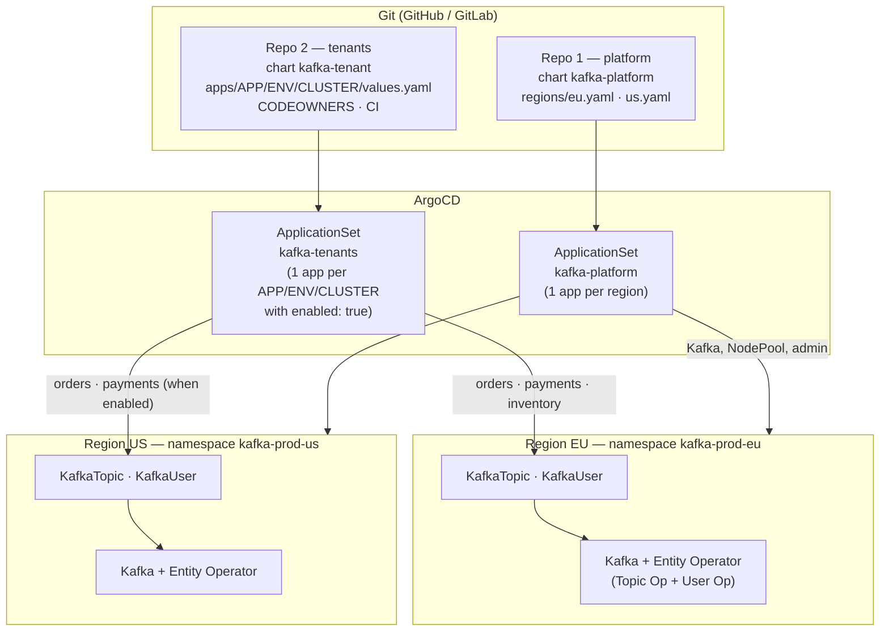
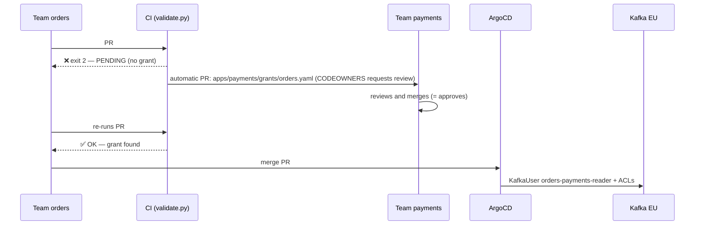

# Multi-Team GitOps with Strimzi — Topics and Users per Team, ArgoCD ApplicationSet and Cross-Team Approval (Bonus)

> **Goal:** take everything [Day 8](../Day8-TopicUserOperators/) taught about the Topic Operator
> and the User Operator and turn it into a **self-service platform** for a company where
> **many global teams** need Kafka topics and users on **many clusters (one per region)**,
> without the platform team becoming the bottleneck. The recipe: **two repositories / two Helm
> charts** (one for the *platform* — Strimzi + Kafka —, one for the *tenants* — topics and
> users), an **`APP / ENV / CLUSTER`** folder structure, an **ArgoCD ApplicationSet** that
> discovers the folders by itself, **`CODEOWNERS`** defining who owns what, and a **CI that
> automatically opens a PR to the team that owns a topic** when another team asks for access to
> it. Every scenario in this Day was executed end to end on kind (Strimzi 1.1.0, ArgoCD 3.4.6,
> Kafka 4.3.0) with two simulated regions (`eu` and `us`) — the outputs shown are real. What was
> **not** executed here is listed, plainly, in section 12.
>
> **This README is also the run script:** the `bash` blocks in sections 6 to 9 run in order,
> copy-paste friendly, and were validated from scratch on a clean kind cluster.

---

## Table of Contents

1. [The problem](#1-the-problem)
2. [Design decisions](#2-design-decisions)
3. [Architecture](#3-architecture)
4. [Prerequisites](#4-prerequisites)
5. [Lab Structure](#5-lab-structure)
6. [Bringing the lab up: cluster, ArgoCD, local Git and the platform](#6-bringing-the-lab-up-cluster-argocd-local-git-and-the-platform)
7. [Repo 2 — the team contract: `values.yaml` and the `kafka-tenant` chart](#7-repo-2--the-team-contract-valuesyaml-and-the-kafka-tenant-chart)
8. [The ApplicationSet that discovers everything](#8-the-applicationset-that-discovers-everything)
9. [Scenarios in practice](#9-scenarios-in-practice)
10. [CODEOWNERS, branch protection and CI](#10-codeowners-branch-protection-and-ci)
11. [Going to production](#11-going-to-production)
12. [What this lab does NOT cover (honestly)](#12-what-this-lab-does-not-cover-honestly)
13. [Cleanup](#13-cleanup)
14. [Suggested video outline](#14-suggested-video-outline)
15. [References](#15-references)

---

## 1. The problem

The situation (the motivation comes from a real presentation about scaling Kafka configuration
with GitOps):

- The company has **one Kafka per region** (`eu`, `us`, ...), but the **teams are global**: the
  `orders` team needs the same topics in Europe and in the US.
- **Each team** needs to create topics and users — without opening a ticket to the platform team
  and without running `kafka-topics.sh` in production.
- A team sometimes needs to **read another team's topic**. Who decides if it may? The topic's
  **owner** — and it must be **traceable, reviewed and automatic**, not an email.
- Copy-pasting YAML per cluster doesn't scale: *"adding a new site = hours of manual work"* and
  *"configuration drift: easy to miss a topic"*.

What we want:

| Goal | How we get there |
|---|---|
| A team declares topics/users **once** | `apps/<team>/values.yaml` inherited by every environment and region |
| Per-**site** prefixes/differences, automatically | `common → env → cluster` layers + `topicPrefix` |
| New region/team **without registering anything** | the `ApplicationSet` discovers the folder |
| A team only touches **its own** stuff | `CODEOWNERS` per folder + team name in the physical topic name |
| Access to another team's topic **only with the owner's consent** | CI detects it, opens a PR in the owner's folder; merge = approval |
| No disaster from a `git rm` | `Prune=false`, `preserveResourcesOnDeletion`, restricted AppProject |

## 2. Design decisions

### 2.1 Two repositories, two Helm charts

| | **Repo 1 — `platform`** | **Repo 2 — `tenants`** |
|---|---|---|
| Owner | platform team | **each team**, only its own folder |
| Chart | `kafka-platform` | `kafka-tenant` |
| Contains | Strimzi Operator (official chart), `Kafka`, `KafkaNodePool`, admin user | `KafkaTopic` and `KafkaUser` |
| Changes when | Kafka/Strimzi upgrade, new region, capacity | a team wants a topic/user/access |
| Frequency | weeks | **dozens per day** |
| Risk of a change | high (takes a cluster down) | low and **contained** (the AppProject accepts only 2 kinds) |

Splitting is the central decision: pace and risk are different, and repo 2's `CODEOWNERS` can be
generous (each team approves its own) without ever giving anyone the power to touch the cluster.

### 2.2 `APP / ENV / CLUSTER` structure ("app first")

```
apps/
└── orders/                        # ← the team/app. Folder name == team name == topic prefix
    ├── values.yaml                #   declared ONCE (common topics and users)
    ├── grants/                    #   what ORDERS allows OTHER teams to use (section 9, scenario C)
    ├── dev/…
    └── prod/
        ├── values.yaml            #   ENV layer (optional)
        ├── eu/values.yaml         #   LEAF: `enabled: true` + site overrides
        └── us/values.yaml
```

This is the "invert the hierarchy" lesson from the presentation: the traditional layout is
*cluster → environment → application* (each site with its full copy, no reuse); here it is
**application on top**, common definition once, and each site only *inherits and adds*. Adding
a new site means creating **a folder with a one-line file** (`enabled: true`).

The **layers** (Helm maps deep-merge across `valueFiles`; lists are replaced):

```
apps/orders/values.yaml            topics.events.partitions: 6          topics.events-dlq.retention: 14d
apps/orders/prod/values.yaml                                            topics.events-dlq.retention: 30d   ← ENV
apps/orders/prod/eu/values.yaml    topics.events.partitions: 12         + topics.gdpr-audit (EU only)      ← CLUSTER
```

> **That is why `topics:` and `users:` are *maps* (key = name) and not lists.** With a list, a
> cluster override would have to repeat the whole list (and that is where copy-paste sneaks back in).

### 2.3 Structural ownership (not just a convention)

The physical topic name is `<site prefix><team>.<name>`, **built by the chart**, not typed: the
`orders` team declares `events` and the chart creates `orders.events`. Consequences:

- A team **cannot** declare a topic in another team's "namespace": there is no syntax for it.
- The owner of any topic is **always** the folder `apps/<prefix before the first dot>/`.
- A reference to someone else's topic uses the full name: `payments.transactions` (**one dot** = another team's).

### 2.4 The guardrails (each one exists because of an accident that has happened somewhere)

| # | Guardrail | Where | Prevents |
|---|---|---|---|
| 1 | `AppProject` accepts only `KafkaTopic` and `KafkaUser` in `kafka-*` namespaces | `tenants/argocd/appproject.yaml` | a chart PR creating `ClusterRoleBinding`/`Secret`/`Deployment` |
| 2 | `values.schema.json`: **allow-list** of operations (`Read/Write/Describe/DescribeConfigs`) and topic configs | `chart/kafka-tenant` | a tenant giving itself `All`/`Alter` or turning on `unclean.leader.election` |
| 3 | `Prune=false,Delete=false` on topics | `templates/topics.yaml` | a `git rm` of a file deleting a topic (and its data) |
| 4 | `preserveResourcesOnDeletion: true` on the ApplicationSet | `argocd/applicationset.yaml` | switching a region off (`enabled: false`) deleting everything it created |
| 5 | `validate.py` + `CODEOWNERS` | `ci/`, `.github/` | access to another team's topic without the owner's consent; a team folder with no reviewer |

### 2.5 Two control loops (chained reconciliation)

```
Git ──(ArgoCD selfHeal)──▶ KafkaTopic/KafkaUser (K8s) ──(Topic/User Operator)──▶ Kafka
```

Each arrow is a controller that "heals" divergence — and Day 8 showed what each one does with
what it doesn't know. Tested in this lab: a `kubectl patch` on the `KafkaTopic` went back to the
Git value in < 25 s (ArgoCD); a `kafka-configs.sh` straight on Kafka went back in ~1 min (Topic Operator).

## 3. Architecture



In production each region is its own **Kubernetes cluster** registered in ArgoCD; in the lab,
`eu` and `us` are two **namespaces** of the same kind cluster (`kafka-prod-eu`, `kafka-prod-us`)
— the design is identical, only the `destination` changes (section 11).

## 4. Prerequisites

- [Docker](https://docs.docker.com/get-docker/) with ~8GB of free RAM
- [kind](https://kind.sigs.k8s.io/docs/user/quick-start/#installation), [kubectl](https://kubernetes.io/docs/tasks/tools/#kubectl), [Helm 3/4](https://helm.sh/docs/intro/install/)
- `python3` (for the CI scripts; they need PyYAML — section 9 creates a venv in `lab/.venv`) and [`yq`](https://github.com/mikefarah/yq) (v4, YAML editing in the scenarios)
- Have done [Day 8](../Day8-TopicUserOperators/) (labels, namespace per Kafka, adoption, `Ready=False`) — this Day assumes those concepts
- Optional: `gh` (GitHub CLI), only if you will open real PRs (section 10)

> **kubectl context:** same as Day 8, everything uses `--context kind-strimzi-day9` via the `kx`
> function. If your kubeconfig holds work clusters, do not trust the current context.

## 5. Lab Structure

```
Day9-GitOps-MultiTime/
├── kind-config.yaml
├── lab/
│   ├── git-server.yaml              # Git (smart HTTP) INSIDE kind: the lab runs offline
│   └── push-repos.sh                # seeds the 2 repos in the local Git and creates working clones in lab/work/
│
├── platform/                        # ───────── REPO 1 (platform team) ─────────
│   ├── chart/kafka-platform/        #   Kafka + KafkaNodePool + admin (Helm chart #1)
│   ├── regions/{eu,us}.yaml         #   what changes from one region to another
│   ├── argocd/
│   │   ├── appproject.yaml
│   │   ├── strimzi-operator.yaml    #   Strimzi 1.1.0 via the official chart (pinned)
│   │   └── applicationset.yaml      #   1 Application per region
│   └── .github/{CODEOWNERS,workflows/validate.yaml}
│
└── tenants/                         # ───────── REPO 2 (product teams) ─────────
    ├── chart/kafka-tenant/          #   KafkaTopic + KafkaUser (Helm chart #2) + values.schema.json
    ├── apps/
    │   ├── orders/{values.yaml, prod/values.yaml, prod/eu/…, prod/us/…, dev/eu/…}
    │   ├── payments/{values.yaml, grants/inventory.yaml, prod/eu/…, prod/us/…}
    │   └── inventory/{values.yaml, prod/eu/…}
    ├── argocd/{appproject.yaml, applicationset.yaml}
    ├── ci/{validate.py, open_grant_prs.py, render-all.sh, requirements.txt}
    └── .github/{CODEOWNERS, workflows/validate.yaml}
```

In the real world `platform/` and `tenants/` are **two separate Git repositories**; here they are
two folders so they fit in a lab, and `push-repos.sh` publishes them as two independent repos
in the local Git.

---

## 6. Bringing the lab up: cluster, ArgoCD, local Git and the platform

> **How to use this from here on:** every ` ```bash ` block is meant to be **copied and pasted,
> in order, in the same terminal** (zsh or bash). ` ```text ` blocks are the **expected
> output** — they don't run. Blocks that start with `: TERMINAL 2 — leave this command running`
> stay running and need **a second terminal** (open it at the repo root and paste the `kx` and
> `kfx` functions again). Everything was validated from scratch on a clean kind cluster. Total
> time: ~35 min (most of it is waiting for Kafka and ArgoCD to sync).

**Before you start** — Docker running and the tools installed:

```bash
docker info --format 'docker {{.ServerVersion}}' && kind version && kubectl version --client | head -1 && helm version --short && yq --version && git --version && python3 --version
```

> **Safety:** every command uses `--context kind-strimzi-day9` (the `kx` function). Nothing is
> applied outside kind, even if your `kubeconfig` holds work clusters.

**Reset** (if you ran the lab before). Run it **from the repository root**:

```bash
kind delete cluster --name strimzi-day9 2>/dev/null
pkill -f "port-forward svc/git-server" 2>/dev/null
rm -rf kafka-strimzi/Day9-GitOps-MultiTime/lab/work
echo "clean"
```

### 6.1 kind cluster and ArgoCD

`kx` is a function (not an `alias`) so it works the same in zsh and bash:

```bash
cd kafka-strimzi/Day9-GitOps-MultiTime
kind create cluster --config=kind-config.yaml --name strimzi-day9
kx() { kubectl --context kind-strimzi-day9 "$@"; }
kx wait --for=condition=Ready node --all --timeout=120s
kx get nodes
```

ArgoCD 3.4.6. `--server-side` is required because ArgoCD's CRDs are too large for client-side apply:

```bash
kx create namespace argocd
kx apply -n argocd --server-side --force-conflicts -f https://raw.githubusercontent.com/argoproj/argo-cd/v3.4.6/manifests/install.yaml > /dev/null
kx wait -n argocd --for=condition=Available deployment --all --timeout=300s
kx -n argocd rollout status statefulset/argocd-application-controller --timeout=300s
```

For the lab only, speed up ArgoCD's polling (default 3 min → 30 s). In production use a Git **webhook**:

```bash
kx -n argocd patch cm argocd-cm --type merge -p '{"data":{"timeout.reconciliation":"30s","timeout.reconciliation.jitter":"0s"}}'
kx -n argocd rollout restart statefulset/argocd-application-controller deploy/argocd-repo-server
kx -n argocd rollout status statefulset/argocd-application-controller --timeout=300s
kx -n argocd rollout status deploy/argocd-repo-server --timeout=300s
```

*(Optional, great for the video)* ArgoCD UI at <https://localhost:8080> (user `admin`). **In terminal 2**:

```bash
: TERMINAL 2 — leave this command running
kubectl --context kind-strimzi-day9 -n argocd port-forward svc/argocd-server 8080:443
```

And the `admin` password, in the main terminal:

```bash
kx -n argocd get secret argocd-initial-admin-secret -o jsonpath='{.data.password}' | base64 -d; echo
```

### 6.2 Local Git inside the cluster

ArgoCD needs a real Git remote. For the lab to run offline, we bring up a minimal Git server
inside the cluster ([`lab/git-server.yaml`](lab/git-server.yaml): `git-http-backend` + busybox
`httpd`, **no authentication**, lab only) and seed the two repos:

```bash
kx apply -f lab/git-server.yaml
lab/push-repos.sh
```

```text
pushed platform -> http://git-server.git.svc/cgi-bin/git/platform.git (from inside the cluster)
pushed tenants  -> http://git-server.git.svc/cgi-bin/git/tenants.git  (from inside the cluster)
```

The script creates **working clones** in `lab/work/platform` and `lab/work/tenants`. That's
where you run `git commit` and `git push` in the scenarios. Leave this port-forward open in
**terminal 2** (it's how your `git push`es reach the cluster's Git; ArgoCD sees Git from
inside the cluster and doesn't need it):

```bash
: TERMINAL 2 — leave this command running
kubectl --context kind-strimzi-day9 -n git port-forward svc/git-server 18080:80
```

> **Using real GitHub:** create two repositories, `git push` `platform/` and `tenants/`, and
> replace the URL `http://git-server.git.svc/cgi-bin/git/<repo>.git` with GitHub's in the
> `argocd/` manifests (`sed`). For a private repository, register the credential in ArgoCD
> (`argocd repo add` or a `Secret` labeled `argocd.argoproj.io/secret-type: repository`).

### 6.3 Repo 1 — the platform (Strimzi + one Kafka per region)

The [`kafka-platform`](platform/chart/kafka-platform/) chart is deliberately small: a `Kafka`
(with the Entity Operator enabled — Day 8), a `KafkaNodePool` and a platform `KafkaUser`. What
changes from region to region lives in [`regions/eu.yaml`](platform/regions/eu.yaml) and
[`us.yaml`](platform/regions/us.yaml) (in the lab: 1 broker; in production 3+, and the chart
derives `replication.factor=3` / `min.isr=2` by itself from the number of brokers).

Conventions that repo 2 **assumes** (which is why teams never need to know about the platform):
each region's `Kafka` is named `kafka` and lives in the namespace `kafka-<env>-<region>`.

```bash
kx apply -f platform/argocd/appproject.yaml -f platform/argocd/strimzi-operator.yaml -f platform/argocd/applicationset.yaml
```

What happens (nothing else is applied by hand from here on):

1. `strimzi-operator` installs the **official chart** of Strimzi 1.1.0 (pinned — an upgrade = a PR changing one line). `ServerSideApply=true` because Strimzi's CRDs blow past the client-side apply annotation limit.
2. The `kafka-platform` `ApplicationSet` (`list` generator) creates `kafka-platform-prod-eu` and `kafka-platform-prod-us`, each with its own namespace, and each namespace gets its own Entity Operator.

Both Kafkas (EU and US) come up on their own. Wait for them to be ready (~3 min):

```bash
for r in eu us; do
  until kx get kafka kafka -n kafka-prod-$r >/dev/null 2>&1; do echo "waiting for ArgoCD to create the $r Kafka..."; sleep 5; done
  kx wait kafka/kafka -n kafka-prod-$r --for=condition=Ready --timeout=420s
done
kx -n argocd get applications
kx get pods -A | grep -E "strimzi-operator|kafka-prod"
```

```text
NAME                     SYNC STATUS   HEALTH STATUS
kafka-platform-prod-eu   Synced        Healthy
kafka-platform-prod-us   Synced        Healthy
strimzi-operator         Synced        Healthy
```

Helper to "talk" to each Kafka (uses the `platform-admin` password, generated by the User
Operator). Usage: `kfx <region> <kafka-binary> args...` (e.g. `kfx eu kafka-topics.sh --list`):

```bash
kfx() {
  local r=$1 b=$2; shift 2; local ns=kafka-prod-$r
  local pass; pass=$(kx get secret platform-admin -n $ns -o jsonpath='{.data.password}' | base64 -d)
  kx exec -n $ns kafka-dual-role-0 -c kafka -- bash -c "cat > /tmp/admin.properties <<EOP
security.protocol=SASL_PLAINTEXT
sasl.mechanism=SCRAM-SHA-512
sasl.jaas.config=org.apache.kafka.common.security.scram.ScramLoginModule required username=\"platform-admin\" password=\"$pass\";
EOP"
  kx exec -n $ns kafka-dual-role-0 -c kafka -- /opt/kafka/bin/$b --bootstrap-server kafka-kafka-bootstrap:9092 --command-config /tmp/admin.properties "$@"
}
kfx eu kafka-topics.sh --list; echo "(empty: no tenants yet)"
```

---

## 7. Repo 2 — the team contract: `values.yaml` and the `kafka-tenant` chart

This is **everything** a team writes (from [`apps/orders/values.yaml`](tenants/apps/orders/values.yaml)):

```bash
cat tenants/apps/orders/values.yaml
```

```yaml
topics:
  events:                            # → physical topic  orders.events
    partitions: 6
    config:
      retention.ms: 604800000
  events-dlq:
    partitions: 1

users:
  producer:                          # → KafkaUser  orders-producer
    authentication: scram-sha-512
    access:
      - topic: events                # no dot = OWN topic
        operations: [Write, Describe]
  fulfillment-consumer:
    authentication: scram-sha-512
    access:
      - topic: events
        operations: [Read, Describe]
        group: fulfillment           # group "orders-fulfillment"
```

What reads it: the [`kafka-tenant`](tenants/chart/kafka-tenant/) chart, which generates
`KafkaTopic` and `KafkaUser` with the `strimzi.io/cluster: kafka` label, the physical name with
the right prefix, the ACLs already in Strimzi's format (`patternType: literal`, one per topic,
plus the group ACL when there's a `group`) and the protection annotation.

### 7.1 Physical name and per-site prefix

`helm template` shows what the team does **not** need to write:

| You write | The chart generates |
|---|---|
| `topics.events` (team `orders`) | `KafkaTopic orders.events` |
| `topicPrefix: "eu."` in the leaf | `eu.orders.events` (the prefix applies to **all** the site's topics, including references to other teams' topics) |
| `users.producer` | `KafkaUser orders-producer` |
| `access: [{topic: payments.refunds, …}]` | ACL on `payments.refunds` (literal) |

`app`, `env` and `cluster` are **not typed**: they come from the **folder path**, injected by the
ApplicationSet as Helm parameters. A team can't "impersonate" another by editing a file,
because the identity isn't in any file it controls.

### 7.2 Schema as policy

[`values.schema.json`](tenants/chart/kafka-tenant/values.schema.json) is validated by Helm
itself — in CI **and** in ArgoCD. We test by asking for the `All` operation (rejected):

```bash
cat > /tmp/bad.yaml <<'EOF'
users: {x: {access: [{topic: events, operations: [All]}]}}
EOF
helm template t tenants/chart/kafka-tenant -f /tmp/bad.yaml --set app=x,env=prod,cluster=eu 2>&1 | head -4
```

Other cases tested in this lab (`helm template` with invalid values):

```text
users.x.access[0].operations: [All]          → value must be one of 'Read', 'Write', 'Describe', 'DescribeConfigs'
topics.Bad_Name                               → 'Bad_Name' does not match pattern '^[a-z0-9]([-a-z0-9]*[a-z0-9])?$'
topics.t.config.unclean.leader.election.enable→ invalid propertyName … value must be one of 'retention.ms', 'retention.bytes', …
access.topic: a.b.c                           → does not match pattern  (at most ONE dot)
```

In other words: *which operations a team may request* and *which topic configs it may touch*
are **versioned policy**, changed through a platform-team PR (the `CODEOWNERS` of `/chart/`).
`All`, `Alter`, `Create` and `Delete` are left out on purpose: the topic lifecycle belongs to
the Topic Operator, not to a user.

### 7.3 Local render of every leaf

[`ci/render-all.sh`](tenants/ci/render-all.sh) renders every leaf exactly as ArgoCD will
(chart + `common → env → cluster` valueFiles + parameters). Run it before any PR:

```bash
tenants/ci/render-all.sh
```

```text
OK    inventory/prod/eu (2 resources)
OK    orders/dev/eu (4 resources)
OK    orders/prod/eu (5 resources)
OK    orders/prod/us (4 resources)
OK    payments/prod/eu (3 resources)
OK    payments/prod/us (3 resources)
rendered 6 leaves
```

---

## 8. The ApplicationSet that discovers everything

```bash
kx apply -f tenants/argocd/appproject.yaml -f tenants/argocd/applicationset.yaml
until [ "$(kx -n argocd get applications -o name | grep -c 'kafka-.*-prod-')" -ge 6 ]; do echo "waiting for the Applications..."; sleep 5; done
kx -n argocd get applications
```

```text
NAME                      SYNC STATUS   HEALTH STATUS
kafka-inventory-prod-eu   Synced        Healthy
kafka-orders-prod-eu      Synced        Healthy
kafka-orders-prod-us      Synced        Healthy
kafka-payments-prod-eu    Synced        Healthy
kafka-platform-prod-eu    Synced        Healthy
kafka-platform-prod-us    Synced        Healthy
strimzi-operator          Synced        Healthy
```

**4 tenant Applications for 6 leaf folders.** The two that are missing (`orders/dev/eu` and
`payments/prod/us`) have `enabled: false`. That is exactly "discover every app whose region is
enabled". The mechanism, in [`tenants/argocd/applicationset.yaml`](tenants/argocd/applicationset.yaml):

```yaml
generators:
  - git:
      repoURL: …/tenants.git
      revision: main
      requeueAfterSeconds: 30
      files:
        - path: "apps/*/*/*/values.yaml"     # exactly 3 levels: APP / ENV / CLUSTER
    selector:
      matchLabels:
        enabled: "true"                      # post-filter: only leaves with `enabled: true`
```

Points worth explaining:

- The **`files`** generator reads the content of every `values.yaml` and exposes each key as a
  parameter (`enabled`, …), plus `path.segments` (`[apps, orders, prod, eu]`). The `selector`
  filters on the `enabled` parameter. Tested: `enabled: true` (YAML boolean) matches `"true"`.
- The pattern `apps/*/*/*/values.yaml` **does not match** `apps/orders/values.yaml` (common),
  `apps/orders/prod/values.yaml` (env) or `apps/payments/grants/inventory.yaml` — wrong depth.
  Only leaves become Applications.
- Each Application uses **two sources** (`sources`): the chart (`path: chart/kafka-tenant`) and
  the repo itself as `ref: values`, from which the `valueFiles` come (`$values/apps/…`). With
  `ignoreMissingValueFiles: true` the env layer is optional.
- **The Application name, destination namespace and `app/env/cluster` parameters come from the
  path** (`index .path.segments N`): nothing to register, nothing to forget.
- `syncPolicy.preserveResourcesOnDeletion: true` — guardrail 4. We'll see it in scenario D.

> **One Application per (team, env, region)** looks like a lot, but it gives the right *blast
> radius*: a mistake in the `inventory` team's `values.yaml` turns **only**
> `kafka-inventory-prod-eu` red. Everything else keeps syncing.

We wait for the topics to be `Ready` and look at what arrived in each Kafka:

```bash
until [ "$(kx get kt -n kafka-prod-eu --no-headers 2>/dev/null | grep -c True)" -ge 6 ]; do echo "waiting for the topics..."; sleep 5; done
for r in eu us; do echo "===== kafka-prod-$r"; kfx $r kafka-topics.sh --list 2>/dev/null; done
```

The `common → env → cluster` layers at work (`orders/prod/eu`): `orders.events` with **12**
partitions in EU (cluster override; common says 6) and **6** in US; `orders.events-dlq` with
**30 days** of retention (env override; common says 14) and the extra topic
`orders.gdpr-audit` only in EU:

```bash
kfx eu kafka-topics.sh --describe --topic orders.events 2>/dev/null | head -1
kfx eu kafka-topics.sh --describe --topic orders.events-dlq 2>/dev/null | head -1
kfx us kafka-topics.sh --describe --topic orders.events 2>/dev/null | head -1
```

---

## 9. Scenarios in practice

### Preparation — the working clone (`lab/work/tenants`) and the CI's Python

The CI scripts need PyYAML; we create a venv. Then we enter the working clone, which points at
the cluster's Git (the terminal-2 port-forward must be running):

```bash
python3 -m venv lab/.venv
lab/.venv/bin/pip install -q -r tenants/ci/requirements.txt
DAY9=$PWD
PY=$PWD/lab/.venv/bin/python
cd lab/work/tenants
git config user.name lab; git config user.email lab@example.com
git status -sb | head -1
```

> **From here on you are in `lab/work/tenants`.** If you open another terminal, go back to this
> folder and paste `kx`, `kfx` again and (for the CI scripts) `PY=<path>/lab/.venv/bin/python`.

### Scenario A — A team creates a topic: edit **one** file

The `inventory` team needs a `reservations` topic. The change, in `apps/inventory/values.yaml`
(done here with `yq`, but it's just editing the file):

```yaml
topics:
  stock-updates:
    partitions: 3
  reservations:            # ← new
    partitions: 6
    config:
      retention.ms: 86400000
```

```bash
yq -i '.topics.reservations = {"partitions": 6, "config": {"retention.ms": 86400000}}' apps/inventory/values.yaml
git diff
git commit -qam "inventory: add reservations topic" && git push -q origin main
until kfx eu kafka-topics.sh --list 2>/dev/null | grep -q inventory.reservations; do echo "waiting for ArgoCD..."; sleep 5; done
kfx eu kafka-topics.sh --list 2>/dev/null | grep inventory
echo "in the US (inventory is only enabled in EU): $(kfx us kafka-topics.sh --list 2>/dev/null | grep -c inventory)"
```

In production this is a **PR** reviewed by the team's `CODEOWNERS` (section 10), not a direct push.

### Scenario B — A new region for a team: `enabled: true`

`payments` goes live in the US. The whole change is one line:

```bash
cat apps/payments/prod/us/values.yaml
yq -i '.enabled = true' apps/payments/prod/us/values.yaml
git commit -qam "payments: go live in us" && git push -q origin main
until kfx us kafka-topics.sh --list 2>/dev/null | grep -q payments.transactions; do echo "waiting for the new Application..."; sleep 5; done
kx -n argocd get applications | grep payments
kfx us kafka-topics.sh --list 2>/dev/null | grep payments
```

`kafka-payments-prod-us` shows up as a new Application, discovered by the ApplicationSet, with
`payments.refunds` and `payments.transactions` in the US.

Compare with the presentation's "before": copy the configuration to the new site, change
prefixes by hand, hope you don't forget a topic. Here the team inherited **everything** from
`apps/payments/values.yaml`.

### Scenario C — Access to **another** team's topic: the automatic PR to the owner

The heart of the bonus. The `orders` team wants to **read** `payments.transactions` in EU. This
is the requester's PR (a branch), in `apps/orders/prod/eu/values.yaml`:

```bash
git switch -q -c orders/read-payments
cat >> apps/orders/prod/eu/values.yaml <<'EOF'

users:
  payments-reader:
    authentication: scram-sha-512
    access:
      - topic: payments.transactions     # ONE DOT = another team's topic
        operations: [Read, Describe]
        group: payments-sync
EOF
git commit -qam "orders: payments-reader (EU)"
git push -q origin orders/read-payments
```

> **Why in the `prod/eu` leaf and not in the common `values.yaml`?** Users in the common file
> **inherit into every region**. In this lab `payments` is disabled in the US — CI blocks it
> (rule R3: *"topic 'payments.transactions' is not deployed in prod/us"*). Reproduced: putting
> the user in common gave `exit=1` because of `orders/prod/us`. Access to something that only
> exists in one region is, by nature, **local to that region**.

**Step 1 — CI detects it.** [`ci/validate.py`](tenants/ci/validate.py) builds the effective
configuration of every leaf, sees the dotted reference and looks for the owner's *grant*
(`exit=2` = pending request, blocks the PR):

```bash
$PY ci/validate.py --report /tmp/report.json; echo "exit=$?"
```

```text
PENDING orders -> payments.transactions ['Read', 'Describe']  (needed by: payments-reader @ prod/eu)
        no grant in apps/payments/grants/orders.yaml -> team payments must approve
exit=2        ← 2 = "no errors, but there are pending requests": blocks the requester's PR
```

**Step 2 — CI opens the PR to the owner.** [`ci/open_grant_prs.py`](tenants/ci/open_grant_prs.py)
creates the branch `access-request/orders-to-payments` with **one file in the owner's folder**
(here just the branch + the file; on GitHub add `--create-pr`):

```bash
$PY ci/open_grant_prs.py --report /tmp/report.json --push --requested-by "http://git-server/pull/orders/read-payments"
git ls-remote --heads origin | sed 's/.*refs\/heads\///'
git show origin/access-request/orders-to-payments:apps/payments/grants/orders.yaml
```

```yaml
# apps/payments/grants/orders.yaml   (generated)
grantee: orders
topics:
  transactions:
    operations: [Read, Describe]
    requestedIn: http://git-server/pull/orders/read-payments
```

Since the file lives under `/apps/payments/`, `CODEOWNERS` automatically requests a review from
**team payments**. The PR body carries a table of topics/operations, who needs it, the link to
the originating PR and a checklist for the owner (legitimate need? least privilege? PII/data
residency per region?). The branch name is deterministic: running again **updates** the same PR.



**Step 3 — the owner approves (merge) and the requester re-runs CI.** Simulated in the lab:

```bash
git switch -q main
git merge -q --no-ff -m "Merge access-request/orders-to-payments (approved by team-payments)" origin/access-request/orders-to-payments
git push -q origin main

git switch -q orders/read-payments
git merge -q --no-edit main
$PY ci/validate.py; echo "exit=$?"
```

```text
OK      all access references are valid and granted
exit=0
```

**Step 4 — the requester merges and ArgoCD + User Operator apply the ACLs:**

```bash
git switch -q main
git merge -q --no-ff -m "Merge orders/read-payments" orders/read-payments
git push -q origin main
until kfx eu kafka-acls.sh --list --principal User:orders-payments-reader 2>/dev/null | grep -q payments.transactions; do echo "waiting for ArgoCD + User Operator..."; sleep 5; done
kfx eu kafka-acls.sh --list --principal User:orders-payments-reader 2>/dev/null
```

Not a single `kafka-acls.sh` was typed to *create* the access:

```text
ACLs for principal `User:orders-payments-reader`
  TOPIC payments.transactions  LITERAL → READ, DESCRIBE   (principal=User:orders-payments-reader)
  GROUP orders-payments-sync   LITERAL → READ
```

**CI's error cases** (run whenever you want to show them; `git checkout -- .` undoes it):

```bash
cat >> apps/orders/prod/eu/values.yaml <<'EOF'
  ghost-reader:
    access:
      - topic: nobody.topic
        operations: [Read]
  over-reach:
    access:
      - topic: payments.transactions
        operations: [Read, Write]
EOF
$PY ci/validate.py; echo "exit=$?"
git checkout -- .
```

What `validate.py` covers (and we tested every case): a topic of a team that doesn't exist, a
topic the owner doesn't declare, a topic not deployed in that env/cluster, an operation
**beyond** what the grant allows (`[Read, Write]` with a `Read`-only grant → new pending
request), a team folder with no line in `CODEOWNERS`, names outside the standard. A grant is
only valid for the (owner, requester) pair: whoever edits `apps/payments/grants/orders.yaml`
in an `orders` PR falls under `payments`'s `CODEOWNERS`.

### Scenario D — Switching a region off does **not** delete data (`preserveResourcesOnDeletion`)

```bash
yq -i '.enabled = false' apps/orders/prod/us/values.yaml
git commit -qam "orders: disable us" && git push -q origin main
until [ -z "$(kx -n argocd get applications -o name | grep kafka-orders-prod-us)" ]; do echo "waiting for the Application to vanish..."; sleep 5; done
echo "--- orders Applications:"; kx -n argocd get applications | grep orders
echo "--- ...but the data is still in the US Kafka:"; kfx us kafka-topics.sh --list 2>/dev/null | grep orders
kx get ku -n kafka-prod-us | grep orders
```

The US Application is gone, but `orders.events`, `orders.events-dlq` and the `KafkaUser`s
(`orders-producer`, `orders-fulfillment-consumer`) are still there.

Without `preserveResourcesOnDeletion`, the removed Application would **cascade** into the
`KafkaTopic`/`KafkaUser`s and the Topic Operator would delete the topics (Day 8: deleting the
CR deletes the topic). Switching off in Git means "stop managing", not "destroy". The CRs are
left orphaned: clean them up **deliberately** (`kubectl delete`) when the time comes.

### Scenario E — Deleting a topic takes **two keys**

Remove `events-dlq` from `orders/values.yaml` **and** from `orders/prod/values.yaml` (the env
layer also declares this topic — if you forget it, the topic keeps being rendered with just the
`config`) and push:

```bash
yq -i 'del(.topics["events-dlq"])' apps/orders/values.yaml
yq -i 'del(.topics["events-dlq"])' apps/orders/prod/values.yaml
git diff --stat
git commit -qam "orders: drop events-dlq" && git push -q origin main
until [ "$(kx -n argocd get application kafka-orders-prod-eu -o jsonpath='{range .status.resources[?(@.kind=="KafkaTopic")]}{.name}={.requiresPruning}{"\n"}{end}' | grep -c 'events-dlq=true')" = "1" ]; do echo "waiting for ArgoCD to detect it..."; sleep 5; done
kx -n argocd get application kafka-orders-prod-eu
echo "--- the topic STILL exists in Kafka:"; kfx eu kafka-topics.sh --list 2>/dev/null | grep orders
```

```text
kafka-orders-prod-eu   OutOfSync   Healthy        ← Prune=false: doesn't delete, but warns (requiresPruning=true)
```

`Prune=false` prevented the removal; `OutOfSync` with `requiresPruning=true` is the visible
sign of "someone wants to delete this". To really delete it, two PRs **in sequence**.

**Key 1** — declare the topic again with `protect: false` (removes the annotation from the live
resource). **Wait for `Synced`**:

```bash
yq -i '.topics["events-dlq"] = {"protect": false, "partitions": 1}' apps/orders/values.yaml
git commit -qam "orders: events-dlq protect=false (step 1)" && git push -q origin main
until [ -z "$(kx get kt orders.events-dlq -n kafka-prod-eu -o jsonpath='{.metadata.annotations.argocd\.argoproj\.io/sync-options}')" ]; do echo "waiting for the annotation to go away..."; sleep 5; done
until [ "$(kx -n argocd get application kafka-orders-prod-eu -o jsonpath='{.status.sync.status}')" = "Synced" ]; do sleep 3; done
kx -n argocd get application kafka-orders-prod-eu
```

**Key 2** — remove the topic for good:

```bash
yq -i 'del(.topics["events-dlq"])' apps/orders/values.yaml
git commit -qam "orders: remove events-dlq (step 2)" && git push -q origin main
until ! kfx eu kafka-topics.sh --list 2>/dev/null | grep -q events-dlq; do echo "waiting for the prune + Topic Operator..."; sleep 5; done
kfx eu kafka-topics.sh --list 2>/dev/null | grep orders
```

ArgoCD's history records two syncs (`protect=false`, then the removal), the
`orders.events-dlq Pruned` event shows up and the topic disappears from Kafka —
`orders.events` and `orders.gdpr-audit` remain. (If you look at the resource ~1 min after
merging key 1, it may still show `OutOfSync` and the old annotation: wait for `Synced`.)

**What if both commits arrive together?** `Prune=false` is read from the **live** resource.
Tested: two commits (`protect: false` and then the removal) sent in a single `git push` →
ArgoCD sees only the final state, skips the prune, the topic **stays in Kafka**, the
annotation stays on the resource and the app is `OutOfSync` with `requiresPruning=true`. It's a
**safe failure**: nothing is deleted by accident. To finish the removal, redo it in two spaced
steps (declare again with `protect: false`, wait for `Synced`, remove).

(In `dev`, `protectTopics: false` in the leaf/env layer allows deleting with a single PR.)

### Scenario F — The two healing loops

| Someone does… | Who undoes it | Observed time |
|---|---|---|
| `kubectl patch kt orders.events … retention.ms=1000` | ArgoCD `selfHeal` (Git → K8s) | < 25 s |
| `kafka-configs.sh … retention.ms=1000` directly on Kafka | Topic Operator (K8s → Kafka) | ≈ 1 min (30 s interval in the lab) |

First, someone edits the `KafkaTopic` directly in the cluster (`kubectl`):

```bash
echo "--- 1) someone edits the KafkaTopic in the cluster (kubectl):"
kx patch kt orders.events -n kafka-prod-eu --type merge -p '{"spec":{"config":{"retention.ms":1000}}}' > /dev/null
kx get kt orders.events -n kafka-prod-eu -o jsonpath='retention.ms in the CR now: {.spec.config.retention\.ms}{"\n"}'
until [ "$(kx get kt orders.events -n kafka-prod-eu -o jsonpath='{.spec.config.retention\.ms}')" = "604800000" ]; do sleep 2; done
echo "ArgoCD (selfHeal) restored it: retention.ms = $(kx get kt orders.events -n kafka-prod-eu -o jsonpath='{.spec.config.retention\.ms}')"
```

Then, someone changes it directly on Kafka (`kafka-configs.sh`):

```bash
echo "--- 2) someone changes it directly on Kafka (kafka-configs):"
kfx eu kafka-configs.sh --entity-type topics --entity-name orders.events --alter --add-config retention.ms=1000 2>/dev/null | tail -1
until kfx eu kafka-topics.sh --describe --topic orders.events 2>/dev/null | head -1 | grep -q "retention.ms=604800000"; do echo "waiting for the Topic Operator..."; sleep 5; done
kfx eu kafka-topics.sh --describe --topic orders.events 2>/dev/null | head -1
```

Git is the source of truth; K8s is the mirror; Kafka is the effect. Touching anything in the
middle of the chain is undone — which is exactly what you want in an auditable environment.

---

## 10. CODEOWNERS, branch protection and CI

### 10.1 CODEOWNERS = the repo's org chart

[`tenants/.github/CODEOWNERS`](tenants/.github/CODEOWNERS):

```
/chart/                 @acme-corp/kafka-platform
/argocd/                @acme-corp/kafka-platform
/ci/                    @acme-corp/kafka-platform
/.github/               @acme-corp/kafka-platform

/apps/orders/           @acme-corp/team-orders
/apps/payments/         @acme-corp/team-payments
/apps/inventory/        @acme-corp/team-inventory
```

The naming rule that makes everything work: **folder = team = topic prefix**. That is why "who owns
`payments.refunds`?" has a mechanical answer: `/apps/payments/`. `validate.py` fails if an
`apps/<team>/` exists without a `CODEOWNERS` line.

### 10.2 Mandatory GitHub configuration (otherwise CODEOWNERS is decorative)

- Branch protection on `main`: **Require a pull request**, **Require review from Code Owners**, **Require status checks** (`validate-tenants`), **Dismiss stale approvals**, no admin bypass.
- GitHub teams (`team-orders` …) with **write permission** on the repo. They approve their own directory; they can't approve another's.
- A member of two teams can approve both sides of a grant. If that matters for your compliance, require 2 approvers on the grant PR.

### 10.3 The workflow

[`tenants/.github/workflows/validate.yaml`](tenants/.github/workflows/validate.yaml) does, on every PR touching `apps/**`, `chart/**` or `ci/**`:

1. `ci/render-all.sh` — every leaf must render (schema = policy).
2. `ci/validate.py` — structure, ownership and cross-team access.
3. On `exit 2` → `ci/open_grant_prs.py --create-pr` opens/updates the owner's PR (via `gh`).
4. Fails the check while anything is pending — the requester's PR stays **blocked**.

Two real GitHub gotchas: (a) PRs opened with the default `GITHUB_TOKEN` **don't trigger
workflows** — use a GitHub App token (or PAT) in `ACCESS_BOT_TOKEN` if you want CI to run on the
grant PR itself; (b) after the owner merges, the requester's check doesn't re-run by itself —
trigger it with *Re-run jobs* or `workflow_dispatch` (a second workflow on `push` to
`apps/*/grants/**` that re-triggers open PRs is a good evolution).

---

## 11. Going to production

| Topic | In the lab | In production |
|---|---|---|
| Regions | 2 namespaces in the same kind | 1 k8s cluster per region, registered in ArgoCD (`argocd cluster add`). `destination.name: '{{ cluster }}-{{ env }}'`; in the platform repo, a **`clusters`** generator with `selector: {kafka: "true"}` — registering the cluster **is** creating the region |
| Sync trigger | 30 s polling | Git **webhook** → ApplicationSet/ArgoCD (seconds of latency, less load) |
| Order across regions | all together | `strategy: RollingSync` on the ApplicationSet (progressive sync): dev → stg → prod-eu → prod-us |
| Secrets | admin password generated by the User Operator | no passwords in Git: the `KafkaUser` `Secret` is generated in the cluster; to hand it to the app use [KafkaAccess (Day 5)](../Day5-KafkaAccessOperator/) or External Secrets/Vault |
| Listeners | SASL_PLAINTEXT | TLS mandatory ([Day 4](../Day4-Autenticacao-Autorizacao/)) |
| Brokers | 1 per region | 3+, RF=3, `min.isr=2` (the chart already derives it) — and [Cruise Control](../Day6-CruiseControl/) to change `replicas` |
| Git | server without auth | GitHub/GitLab with SSO, branch protection, commit signing |
| Kafka **outside** k8s | — | in repo 1, instead of `Kafka`+`NodePool`, the chart deploys Day 8's **standalone operators** in the namespace `kafka-<env>-<region>` pointing at the external bootstrap (one `values` per region: `mode: external`). Repo 2 **doesn't change** — the advantage of it only knowing `strimzi.io/cluster: kafka`. *Design sketch: not implemented in this lab* |
| Observability | `kubectl get` | alert on `KafkaTopic`/`KafkaUser` with `Ready=False` (a green ArgoCD sync does **not** guarantee a healthy topic — Day 8, 6.7), `strimzi_reconciliations_*` metrics, `argocd_app_info` |
| Scale | 4 Applications | 3 teams × 3 envs × 5 regions ≈ 45 Applications; ApplicationSet and ArgoCD handle hundreds. With thousands of topics per Kafka, tune the Topic Operator queue/batch (Day 8, 7.3) |

**Per-site prefix.** The presentation used prefixes like `siteA-`. Here it is `topicPrefix` in the
leaf (e.g. `topicPrefix: "eu."`): the chart applies the prefix to the physical name of **all** the
site's topics, including ACL references to other teams' topics — so ownership and prefix never diverge.

## 12. What this lab does NOT cover (honestly)

- **The GitHub Actions workflow and `gh pr create` were not executed** (there is no GitHub in this
  environment). What was tested: `validate.py` in 6 scenarios, `open_grant_prs.py` creating the
  branch and the grant file, pushing to a real Git remote, and the entire ArgoCD flow. What's left
  to validate on your GitHub: token permissions, labels and check triggering.
- **The ApplicationSet post-filter `selector`** was tested with `enabled: true`; if you use
  non-boolean values in the leaves, check the string matching.
- **Real multi-cluster** (two distinct Kubernetes clusters) was not built — two regions simulated
  by namespace. The difference is only the `destination` (section 11).
- **The `external` mode of the platform chart** (standalone operators per region) is a design
  sketch; the standalone operators themselves are tested in Day 8.
- **No authentication on the lab Git** and no TLS on the listeners: none of this is production configuration.
- **Revoking a grant** (deleting `apps/<owner>/grants/<team>.yaml`) does not by itself remove the
  ACLs already applied: the requester's `KafkaUser` keeps asking for the access. By the script's
  logic, `validate.py` will flag the request as pending (and, since it validates the whole repo,
  **every** following PR fails until the requester removes the access). Behavior inferred from the
  code, **not executed** — treat revocation as a coordinated PR between the two teams.

## 13. Cleanup

```bash
cd "$DAY9"
pkill -f "port-forward svc/git-server" 2>/dev/null
pkill -f "port-forward svc/argocd-server" 2>/dev/null
kind delete cluster --name strimzi-day9
rm -rf lab/work lab/.venv
unset -f kx kfx 2>/dev/null; true
```

## 14. Suggested video outline

A **~12–15 min** bonus (or the end of the Day 8 episode). Common thread: *"how 30 teams request
topics and access in 5 regions without opening a ticket"*.

| Time | Block | What to show |
|---|---|---|
| 0:00 | The problem | The "before" slide (copy/paste per site) and the question: who approves access to someone else's topic? |
| 1:30 | The idea in one drawing | Section 3 diagram + the `APP/ENV/CLUSTER` tree ("app first", the presentation's lesson) |
| 3:30 | The team contract | The 15-line `values.yaml`; `helm template` showing the physical name and the schema rejecting `All` |
| 5:30 | ApplicationSet | `kubectl get applications` → 4 of 6 folders; show `enabled: false` |
| 7:00 | Scenario B live | `yq -i '.enabled = true'`, push, the Application appearing, topics in the US |
| 9:00 | Scenario C (the highlight) | A user requesting `payments.transactions` → `exit 2` → automatic PR in `apps/payments/grants/` → merge → ACL in Kafka |
| 12:00 | Guardrails | Scenario D (region off, data stays) and E (`requiresPruning`, two keys) |
| 13:30 | Wrap-up | Honesty (section 12) + "what would change in production" (section 11) |

## 15. References

- Presentation *"Scaling Kafka Configuration with GitOps"* (slides shared by this repository's author) — the motivation for app-first, layers and per-site prefix
- [ArgoCD — ApplicationSet: Git generator (files)](https://argo-cd.readthedocs.io/en/stable/operator-manual/applicationset/Generators-Git/)
- [ArgoCD — ApplicationSet: post selector on all generators](https://argo-cd.readthedocs.io/en/stable/operator-manual/applicationset/Generators-Post-Selector/)
- [ArgoCD — `preserveResourcesOnDeletion`](https://argo-cd.readthedocs.io/en/stable/operator-manual/applicationset/Controlling-Resource-Modification/)
- [ArgoCD — Sync options (`Prune=false`, `Delete=false`, `ServerSideApply`)](https://argo-cd.readthedocs.io/en/stable/user-guide/sync-options/)
- [ArgoCD — Multiple sources (`ref: values`)](https://argo-cd.readthedocs.io/en/stable/user-guide/multiple_sources/)
- [ArgoCD — Progressive Syncs (RollingSync)](https://argo-cd.readthedocs.io/en/stable/operator-manual/applicationset/Progressive-Syncs/)
- [GitHub — About code owners](https://docs.github.com/en/repositories/managing-your-repositorys-settings-and-features/customizing-your-repository/about-code-owners)
- [Helm — Schema files (`values.schema.json`)](https://helm.sh/docs/topics/charts/#schema-files)
- [Strimzi — official Helm chart](https://strimzi.io/docs/operators/latest/deploying.html#deploying-cluster-operator-helm-chart-str)
- [Day 8 — Topic Operator and User Operator](../Day8-TopicUserOperators/)
