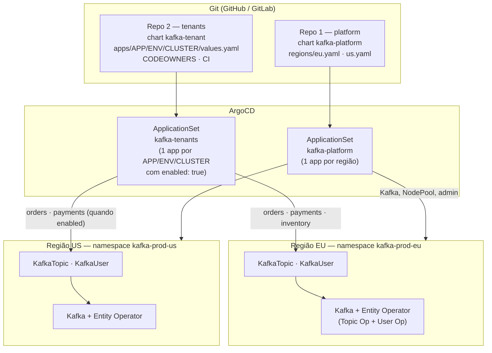
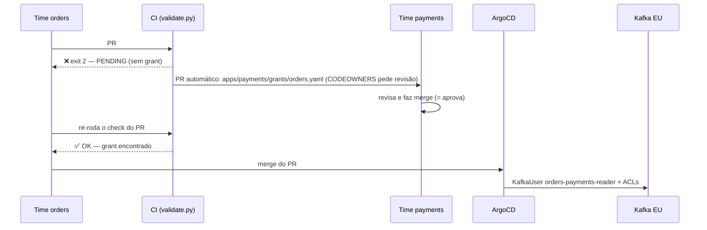

# GitOps Multi-Time com Strimzi — Tópicos e Usuários por Time, ArgoCD ApplicationSet e Aprovação Cross-Team (Bônus)

> **Objetivo:** pegar tudo o que o [Day 8](../Day8-TopicUserOperators/) ensinou sobre o Topic
> Operator e o User Operator e transformar em uma **plataforma de autoatendimento** para uma
> empresa onde **vários times globais** precisam de tópicos e usuários Kafka em **vários
> clusters (um por região)**, sem que o time de plataforma vire gargalo. A receita:
> **dois repositórios / dois Helm charts** (um para a *plataforma* — Strimzi + Kafka —, outro
> para os *tenants* — tópicos e usuários), uma estrutura de pastas **`APP / ENV / CLUSTER`**,
> **ArgoCD ApplicationSet** descobrindo as pastas sozinho, **`CODEOWNERS`** definindo quem é
> dono de quê e um **CI que abre PR automaticamente para o time dono de um tópico** quando
> outro time pede acesso a ele. Todo cenário deste Day foi executado de ponta a ponta num kind
> (Strimzi 1.1.0, ArgoCD 3.4.6, Kafka 4.3.0) com duas regiões simuladas (`eu` e `us`) — as
> saídas mostradas são reais. O que **não** foi executado aqui está listado, sem rodeios, na
> seção 12.
>
> **Este README é também o roteiro de execução:** os blocos `bash` das seções 6 a 9 rodam em
> ordem, copiando e colando, e foram validados do zero num kind limpo.

---

## Índice

1. [O problema](#1-o-problema)
2. [Decisões de design](#2-decisões-de-design)
3. [Arquitetura](#3-arquitetura)
4. [Pré-requisitos](#4-pré-requisitos)
5. [Estrutura do Lab](#5-estrutura-do-lab)
6. [Subindo o lab: cluster, ArgoCD, Git local e a plataforma](#6-subindo-o-lab-cluster-argocd-git-local-e-a-plataforma)
7. [Repo 2 — o contrato do time: `values.yaml` e o chart `kafka-tenant`](#7-repo-2--o-contrato-do-time-valuesyaml-e-o-chart-kafka-tenant)
8. [O ApplicationSet que descobre tudo](#8-o-applicationset-que-descobre-tudo)
9. [Cenários na prática](#9-cenários-na-prática)
10. [CODEOWNERS, branch protection e o CI](#10-codeowners-branch-protection-e-o-ci)
11. [Indo para produção](#11-indo-para-produção)
12. [O que este lab NÃO cobre (honestamente)](#12-o-que-este-lab-não-cobre-honestamente)
13. [Cleanup](#13-cleanup)
14. [Roteiro sugerido para o vídeo](#14-roteiro-sugerido-para-o-vídeo)
15. [Referências](#15-referências)

---

## 1. O problema

A situação (e a motivação vem de uma apresentação real sobre escalar configuração Kafka com
GitOps):

- A empresa tem **um Kafka por região** (`eu`, `us`, ...), mas os **times são globais**: o
  time `orders` precisa dos mesmos tópicos na Europa e nos EUA.
- **Cada time** precisa criar tópicos e usuários — sem abrir ticket para a plataforma e sem
  rodar `kafka-topics.sh` em produção.
- Um time às vezes precisa **ler o tópico de outro time**. Quem decide se pode? O **dono** do
  tópico — e isso precisa ser **rastreável, revisado e automático**, não um e-mail.
- Copiar e colar YAML por cluster não escala: *"adicionar um site novo = horas de trabalho
  manual"* e *"configuration drift: fácil esquecer um tópico"*.

O que queremos:

| Objetivo | Como atingimos |
|---|---|
| Time declara tópicos/usuários **uma vez** | `apps/<time>/values.yaml` herdado por todos os ambientes e regiões |
| Prefixo/diferenças **por site** automáticos | camadas `common → env → cluster` + `topicPrefix` |
| Nova região/time **sem registrar nada** | `ApplicationSet` descobre a pasta |
| Time só mexe no que é **dele** | `CODEOWNERS` por pasta + nome do time no nome físico do tópico |
| Acesso a tópico de outro time **só com aval do dono** | CI detecta, abre PR na pasta do dono; merge = aprovação |
| Nenhum desastre por um `git rm` | `Prune=false`, `preserveResourcesOnDeletion`, AppProject restrito |

## 2. Decisões de design

### 2.1 Dois repositórios, dois Helm charts

| | **Repo 1 — `platform`** | **Repo 2 — `tenants`** |
|---|---|---|
| Dono | time de plataforma | **cada time**, só a própria pasta |
| Chart | `kafka-platform` | `kafka-tenant` |
| Contém | Strimzi Operator (chart oficial), `Kafka`, `KafkaNodePool`, usuário admin | `KafkaTopic` e `KafkaUser` |
| Muda quando | upgrade de Kafka/Strimzi, nova região, capacidade | um time quer um tópico/usuário/acesso |
| Frequência | semanas | **dezenas por dia** |
| Risco de uma mudança | alto (derruba um cluster) | baixo e **contido** (AppProject só aceita 2 kinds) |

Separar é a decisão central: o ritmo e o risco são diferentes, e o `CODEOWNERS` do repo 2 pode
ser generoso (cada time aprova o seu) sem nunca dar a ninguém o poder de tocar no cluster.

### 2.2 Estrutura `APP / ENV / CLUSTER` ("app primeiro")

```
apps/
└── orders/                        # ← o time/app. Nome da pasta == nome do time == prefixo do tópico
    ├── values.yaml                #   declarado UMA vez (tópicos e usuários comuns)
    ├── grants/                    #   o que ORDERS autoriza OUTROS times a usar (seção 9, cenário C)
    ├── dev/…
    └── prod/
        ├── values.yaml            #   camada de ENV (opcional)
        ├── eu/values.yaml         #   FOLHA: `enabled: true` + overrides do site
        └── us/values.yaml
```

Essa é a lição de "inverter a hierarquia" da apresentação: o tradicional é *cluster → ambiente
→ aplicação* (cada site com sua cópia completa, sem reuso); aqui é **aplicação no topo**,
definição comum uma vez, e cada site só *herda e acrescenta*. Adicionar um site novo é criar
**uma pasta com um arquivo de 1 linha** (`enabled: true`).

As **camadas** (maps do Helm fazem deep-merge entre `valueFiles`; listas são substituídas):

```
apps/orders/values.yaml            topics.events.partitions: 6          topics.events-dlq.retention: 14d
apps/orders/prod/values.yaml                                            topics.events-dlq.retention: 30d   ← ENV
apps/orders/prod/eu/values.yaml    topics.events.partitions: 12         + topics.gdpr-audit (só na EU)     ← CLUSTER
```

> **Por isso `topics:` e `users:` são *maps* (chave = nome) e não listas.** Com lista, um
> override de cluster teria que repetir a lista inteira (e é aí que nasce o copy-paste de volta).

### 2.3 Ownership estrutural (não é só convenção)

O nome físico do tópico é `<prefixo do site><time>.<nome>`, **montado pelo chart**, não digitado:
o time `orders` declara `events` e o chart cria `orders.events`. Consequências:

- Um time **não consegue** declarar um tópico no "namespace" de outro: não existe sintaxe para isso.
- O dono de qualquer tópico é **sempre** a pasta `apps/<prefixo antes do primeiro ponto>/`.
- Referência a tópico alheio usa o nome completo: `payments.transactions` (**um ponto** = de outro time).

### 2.4 Os guardrails (cada um existe por um acidente que já aconteceu em algum lugar)

| # | Guardrail | Onde | Evita |
|---|---|---|---|
| 1 | `AppProject` só aceita `KafkaTopic` e `KafkaUser` nos namespaces `kafka-*` | `tenants/argocd/appproject.yaml` | um PR no chart criar `ClusterRoleBinding`/`Secret`/`Deployment` |
| 2 | `values.schema.json`: **allow-list** de operações (`Read/Write/Describe/DescribeConfigs`) e de configs de tópico | `chart/kafka-tenant` | tenant dar `All`/`Alter` a si mesmo ou ligar `unclean.leader.election` |
| 3 | `Prune=false,Delete=false` nos tópicos | `templates/topics.yaml` | `git rm` de um arquivo apagar um tópico (e os dados) |
| 4 | `preserveResourcesOnDeletion: true` no ApplicationSet | `argocd/applicationset.yaml` | desligar uma região (`enabled: false`) apagar tudo o que ela criou |
| 5 | `validate.py` + `CODEOWNERS` | `ci/`, `.github/` | acesso a tópico alheio sem aval do dono; pasta de time sem revisor |

### 2.5 Duas malhas de controle (reconciliação em cadeia)

```
Git ──(ArgoCD selfHeal)──▶ KafkaTopic/KafkaUser (K8s) ──(Topic/User Operator)──▶ Kafka
```

Cada seta é um controlador que "cura" divergência — e o Day 8 mostrou o que cada um faz com
o que não conhece. Testado neste lab: um `kubectl patch` no `KafkaTopic` voltou ao valor do Git
em < 25 s (ArgoCD); um `kafka-configs.sh` direto no Kafka voltou em ~1 min (Topic Operator).

## 3. Arquitetura



Em produção cada região é um **cluster Kubernetes** próprio registrado no ArgoCD; no lab, `eu`
e `us` são dois **namespaces** do mesmo cluster kind (`kafka-prod-eu`, `kafka-prod-us`) — o
desenho é idêntico, só o `destination` muda (seção 11).

## 4. Pré-requisitos

- [Docker](https://docs.docker.com/get-docker/) com ~8GB de RAM livres
- [kind](https://kind.sigs.k8s.io/docs/user/quick-start/#installation), [kubectl](https://kubernetes.io/docs/tasks/tools/#kubectl), [Helm 3/4](https://helm.sh/docs/intro/install/)
- `python3` (para os scripts de CI; precisam do PyYAML — a seção 9 cria um venv em `lab/.venv`) e [`yq`](https://github.com/mikefarah/yq) (v4, edição de YAML nos cenários)
- Ter feito o [Day 8](../Day8-TopicUserOperators/) (labels, namespace por Kafka, adoção, `Ready=False`) — este Day assume esses conceitos
- Opcional: `gh` (GitHub CLI), só se for abrir PRs de verdade (seção 10)

> **Contexto do kubectl:** igual ao Day 8, tudo usa `--context kind-strimzi-day9` via a função `kx`.
> Se o seu kubeconfig tem clusters de trabalho, não confie no contexto atual.

## 5. Estrutura do Lab

```
Day9-GitOps-MultiTime/
├── kind-config.yaml
├── lab/
│   ├── git-server.yaml              # Git (smart HTTP) DENTRO do kind: o lab roda offline
│   └── push-repos.sh                # semeia os 2 repos no Git local e cria clones de trabalho em lab/work/
│
├── platform/                        # ───────── REPO 1 (time de plataforma) ─────────
│   ├── chart/kafka-platform/        #   Kafka + KafkaNodePool + admin (Helm chart #1)
│   ├── regions/{eu,us}.yaml         #   o que muda de uma região para outra
│   ├── argocd/
│   │   ├── appproject.yaml
│   │   ├── strimzi-operator.yaml    #   Strimzi 1.1.0 pelo chart oficial (pinado)
│   │   └── applicationset.yaml      #   1 Application por região
│   └── .github/{CODEOWNERS,workflows/validate.yaml}
│
└── tenants/                         # ───────── REPO 2 (times de produto) ─────────
    ├── chart/kafka-tenant/          #   KafkaTopic + KafkaUser (Helm chart #2) + values.schema.json
    ├── apps/
    │   ├── orders/{values.yaml, prod/values.yaml, prod/eu/…, prod/us/…, dev/eu/…}
    │   ├── payments/{values.yaml, grants/inventory.yaml, prod/eu/…, prod/us/…}
    │   └── inventory/{values.yaml, prod/eu/…}
    ├── argocd/{appproject.yaml, applicationset.yaml}
    ├── ci/{validate.py, open_grant_prs.py, render-all.sh, requirements.txt}
    └── .github/{CODEOWNERS, workflows/validate.yaml}
```

No mundo real `platform/` e `tenants/` são **dois repositórios Git separados**; aqui são duas
pastas para caber num lab, e o `push-repos.sh` as publica como dois repos independentes no Git
local.

---

## 6. Subindo o lab: cluster, ArgoCD, Git local e a plataforma

> **Como usar daqui para frente:** cada bloco ` ```bash ` é para **copiar e colar, em ordem, no
> mesmo terminal** (zsh ou bash). Os blocos ` ```text ` são a **saída esperada** — não rodam.
> Blocos que começam com `: TERMINAL 2 — deixe este comando rodando` ficam rodando e precisam de
> **um segundo terminal** (abra-o na raiz do repo e cole de novo as funções `kx` e `kfx`).
> Tudo foi validado do zero num kind limpo. Tempo total: ~35 min (a maior parte é esperar o
> Kafka e o ArgoCD sincronizarem).

**Antes de começar** — Docker rodando e as ferramentas instaladas:

```bash
docker info --format 'docker {{.ServerVersion}}' && kind version && kubectl version --client | head -1 && helm version --short && yq --version && git --version && python3 --version
```

> **Segurança:** todos os comandos usam `--context kind-strimzi-day9` (função `kx`). Nada é aplicado
> fora do kind, mesmo que o seu `kubeconfig` tenha clusters de trabalho.

**Reset** (se já rodou o lab antes). Execute **a partir da raiz do repositório**:

```bash
kind delete cluster --name strimzi-day9 2>/dev/null
pkill -f "port-forward svc/git-server" 2>/dev/null
rm -rf kafka-strimzi/Day9-GitOps-MultiTime/lab/work
echo "limpo"
```

### 6.1 Cluster kind e ArgoCD

`kx` é uma função (não `alias`) para funcionar igual em zsh e bash:

```bash
cd kafka-strimzi/Day9-GitOps-MultiTime
kind create cluster --config=kind-config.yaml --name strimzi-day9
kx() { kubectl --context kind-strimzi-day9 "$@"; }
kx wait --for=condition=Ready node --all --timeout=120s
kx get nodes
```

ArgoCD 3.4.6. O `--server-side` é necessário porque os CRDs do ArgoCD são grandes demais para o
client-side apply:

```bash
kx create namespace argocd
kx apply -n argocd --server-side --force-conflicts -f https://raw.githubusercontent.com/argoproj/argo-cd/v3.4.6/manifests/install.yaml > /dev/null
kx wait -n argocd --for=condition=Available deployment --all --timeout=300s
kx -n argocd rollout status statefulset/argocd-application-controller --timeout=300s
```

Só para o lab, acelere o polling do ArgoCD (padrão 3 min → 30 s). Em produção use **webhook** do Git:

```bash
kx -n argocd patch cm argocd-cm --type merge -p '{"data":{"timeout.reconciliation":"30s","timeout.reconciliation.jitter":"0s"}}'
kx -n argocd rollout restart statefulset/argocd-application-controller deploy/argocd-repo-server
kx -n argocd rollout status statefulset/argocd-application-controller --timeout=300s
kx -n argocd rollout status deploy/argocd-repo-server --timeout=300s
```

*(Opcional, ótimo para o vídeo)* UI do ArgoCD em <https://localhost:8080> (usuário `admin`).
**No terminal 2**:

```bash
: TERMINAL 2 — deixe este comando rodando
kubectl --context kind-strimzi-day9 -n argocd port-forward svc/argocd-server 8080:443
```

E a senha do `admin`, no terminal principal:

```bash
kx -n argocd get secret argocd-initial-admin-secret -o jsonpath='{.data.password}' | base64 -d; echo
```

### 6.2 Git local dentro do cluster

O ArgoCD precisa de um remoto Git de verdade. Para o lab rodar offline, sobe-se um servidor
Git mínimo no cluster ([`lab/git-server.yaml`](lab/git-server.yaml): `git-http-backend` +
`httpd` do busybox, **sem autenticação**, só para lab) e semeia-se os dois repos:

```bash
kx apply -f lab/git-server.yaml
lab/push-repos.sh
```

```text
pushed platform -> http://git-server.git.svc/cgi-bin/git/platform.git (from inside the cluster)
pushed tenants  -> http://git-server.git.svc/cgi-bin/git/tenants.git  (from inside the cluster)
```

O script cria **clones de trabalho** em `lab/work/platform` e `lab/work/tenants`. É neles que
você faz `git commit` e `git push` nos cenários. Deixe este port-forward aberto no **terminal
2** (é por ele que os seus `git push` chegam ao Git do cluster; o ArgoCD enxerga o Git por
dentro do cluster e não precisa dele):

```bash
: TERMINAL 2 — deixe este comando rodando
kubectl --context kind-strimzi-day9 -n git port-forward svc/git-server 18080:80
```

> **Usando o GitHub de verdade:** crie dois repositórios, faça `git push` de `platform/` e
> `tenants/` e troque a URL `http://git-server.git.svc/cgi-bin/git/<repo>.git` pela do GitHub
> nos manifests de `argocd/` (`sed`). Para repositório privado, registre a credencial no
> ArgoCD (`argocd repo add` ou um `Secret` com label `argocd.argoproj.io/secret-type: repository`).

### 6.3 Repo 1 — a plataforma (Strimzi + um Kafka por região)

O chart [`kafka-platform`](platform/chart/kafka-platform/) é deliberadamente pequeno: um
`Kafka` (com Entity Operator ligado — Day 8), um `KafkaNodePool` e um `KafkaUser` de plataforma.
O que muda de região para região fica em [`regions/eu.yaml`](platform/regions/eu.yaml) e
[`us.yaml`](platform/regions/us.yaml) (no lab: 1 broker; em produção 3+, e o chart deriva
`replication.factor=3` / `min.isr=2` sozinho a partir do número de brokers).

Convenções que o repo 2 **assume** (e por isso os times nunca precisam saber de plataforma):
o `Kafka` de cada região se chama `kafka` e mora no namespace `kafka-<env>-<região>`.

```bash
kx apply -f platform/argocd/appproject.yaml -f platform/argocd/strimzi-operator.yaml -f platform/argocd/applicationset.yaml
```

O que acontece (nada mais é aplicado à mão daqui para frente):

1. `strimzi-operator` instala o **chart oficial** do Strimzi 1.1.0 (pinado — upgrade = PR trocando uma linha). `ServerSideApply=true` porque os CRDs do Strimzi estouram o limite de anotação do client-side apply.
2. O `ApplicationSet` `kafka-platform` (gerador `list`) cria `kafka-platform-prod-eu` e `kafka-platform-prod-us`, cada um com seu namespace, e cada namespace ganha seu próprio Entity Operator.

Os dois Kafkas (EU e US) sobem sozinhos. Espere ficarem prontos (~3 min):

```bash
for r in eu us; do
  until kx get kafka kafka -n kafka-prod-$r >/dev/null 2>&1; do echo "aguardando o ArgoCD criar o Kafka de $r..."; sleep 5; done
  kx wait kafka/kafka -n kafka-prod-$r --for=condition=Ready --timeout=420s
done
kx -n argocd get applications
kx get pods -A | grep -E "strimzi-operator|kafka-prod"
```

```text
NAME                     SYNC STATUS   HEALTH STATUS
kafka-platform-prod-eu   Synced        Healthy
kafka-platform-prod-us   Synced        Healthy
strimzi-operator         Synced        Healthy
```

Helper para "conversar" com cada Kafka (usa a senha do `platform-admin`, gerada pelo User
Operator). Uso: `kfx <região> <binário-kafka> args...` (ex.: `kfx eu kafka-topics.sh --list`):

```bash
kfx() {
  local r=$1 b=$2; shift 2; local ns=kafka-prod-$r
  local pass; pass=$(kx get secret platform-admin -n $ns -o jsonpath='{.data.password}' | base64 -d)
  kx exec -n $ns kafka-dual-role-0 -c kafka -- bash -c "cat > /tmp/admin.properties <<EOP
security.protocol=SASL_PLAINTEXT
sasl.mechanism=SCRAM-SHA-512
sasl.jaas.config=org.apache.kafka.common.security.scram.ScramLoginModule required username=\"platform-admin\" password=\"$pass\";
EOP"
  kx exec -n $ns kafka-dual-role-0 -c kafka -- /opt/kafka/bin/$b --bootstrap-server kafka-kafka-bootstrap:9092 --command-config /tmp/admin.properties "$@"
}
kfx eu kafka-topics.sh --list; echo "(vazio: ainda não há tenants)"
```

---

## 7. Repo 2 — o contrato do time: `values.yaml` e o chart `kafka-tenant`

Isto é **tudo** que um time escreve (de [`apps/orders/values.yaml`](tenants/apps/orders/values.yaml)):

```bash
cat tenants/apps/orders/values.yaml
```

```yaml
topics:
  events:                            # → tópico físico  orders.events
    partitions: 6
    config:
      retention.ms: 604800000
  events-dlq:
    partitions: 1

users:
  producer:                          # → KafkaUser  orders-producer
    authentication: scram-sha-512
    access:
      - topic: events                # sem ponto = tópico PRÓPRIO
        operations: [Write, Describe]
  fulfillment-consumer:
    authentication: scram-sha-512
    access:
      - topic: events
        operations: [Read, Describe]
        group: fulfillment           # grupo "orders-fulfillment"
```

Quem lê isso: o chart [`kafka-tenant`](tenants/chart/kafka-tenant/), que gera `KafkaTopic` e
`KafkaUser` com a label `strimzi.io/cluster: kafka`, o nome físico com o prefixo certo, as
ACLs já no formato do Strimzi (`patternType: literal`, uma por tópico, mais a ACL de grupo
quando há `group`) e a anotação de proteção.

### 7.1 Nome físico e prefixo por site

`helm template` mostra o que o time **não** precisa escrever:

| Você escreve | O chart gera |
|---|---|
| `topics.events` (time `orders`) | `KafkaTopic orders.events` |
| `topicPrefix: "eu."` na folha | `eu.orders.events` (o prefixo vale para **todos** os tópicos do site, inclusive referências a tópicos de outros times) |
| `users.producer` | `KafkaUser orders-producer` |
| `access: [{topic: payments.refunds, …}]` | ACL em `payments.refunds` (literal) |

`app`, `env` e `cluster` **não são digitados**: vêm do **caminho da pasta**, injetados pelo
ApplicationSet como parâmetros do Helm. Um time não consegue "se passar" por outro editando
um arquivo, porque a identidade não está em arquivo nenhum que ele controle.

### 7.2 O schema como política

[`values.schema.json`](tenants/chart/kafka-tenant/values.schema.json) é validado pelo próprio
Helm — no CI **e** no ArgoCD. Testamos pedindo a operação `All` (barrada):

```bash
cat > /tmp/bad.yaml <<'EOF'
users: {x: {access: [{topic: events, operations: [All]}]}}
EOF
helm template t tenants/chart/kafka-tenant -f /tmp/bad.yaml --set app=x,env=prod,cluster=eu 2>&1 | head -4
```

Outros casos testados neste lab (`helm template` com valores inválidos):

```text
users.x.access[0].operations: [All]          → value must be one of 'Read', 'Write', 'Describe', 'DescribeConfigs'
topics.Bad_Name                               → 'Bad_Name' does not match pattern '^[a-z0-9]([-a-z0-9]*[a-z0-9])?$'
topics.t.config.unclean.leader.election.enable→ invalid propertyName … value must be one of 'retention.ms', 'retention.bytes', …
access.topic: a.b.c                           → does not match pattern  (no máximo UM ponto)
```

Ou seja: *quais operações um time pode pedir* e *quais configs de tópico ele pode mexer* são
**política versionada**, mudada por PR do time de plataforma (o `CODEOWNERS` de `/chart/`).
`All`, `Alter`, `Create` e `Delete` ficam de fora de propósito: o ciclo de vida do tópico é do
Topic Operator, não de um usuário.

### 7.3 Render local de todas as folhas

[`ci/render-all.sh`](tenants/ci/render-all.sh) renderiza cada folha exatamente como o ArgoCD vai
(chart + valueFiles `common → env → cluster` + parâmetros). Rode antes de qualquer PR:

```bash
tenants/ci/render-all.sh
```

```text
OK    inventory/prod/eu (2 resources)
OK    orders/dev/eu (4 resources)
OK    orders/prod/eu (5 resources)
OK    orders/prod/us (4 resources)
OK    payments/prod/eu (3 resources)
OK    payments/prod/us (3 resources)
rendered 6 leaves
```

---

## 8. O ApplicationSet que descobre tudo

```bash
kx apply -f tenants/argocd/appproject.yaml -f tenants/argocd/applicationset.yaml
until [ "$(kx -n argocd get applications -o name | grep -c 'kafka-.*-prod-')" -ge 6 ]; do echo "aguardando as Applications..."; sleep 5; done
kx -n argocd get applications
```

```text
NAME                      SYNC STATUS   HEALTH STATUS
kafka-inventory-prod-eu   Synced        Healthy
kafka-orders-prod-eu      Synced        Healthy
kafka-orders-prod-us      Synced        Healthy
kafka-payments-prod-eu    Synced        Healthy
kafka-platform-prod-eu    Synced        Healthy
kafka-platform-prod-us    Synced        Healthy
strimzi-operator          Synced        Healthy
```

**4 Applications de tenant para 6 pastas-folha.** As duas que faltam (`orders/dev/eu` e
`payments/prod/us`) têm `enabled: false`. É exatamente o "descobrir cada app cuja região esteja
habilitada". O mecanismo, em [`tenants/argocd/applicationset.yaml`](tenants/argocd/applicationset.yaml):

```yaml
generators:
  - git:
      repoURL: …/tenants.git
      revision: main
      requeueAfterSeconds: 30
      files:
        - path: "apps/*/*/*/values.yaml"     # exatamente 3 níveis: APP / ENV / CLUSTER
    selector:
      matchLabels:
        enabled: "true"                      # pós-filtro: só folhas com `enabled: true`
```

Pontos que valem explicar:

- O gerador **`files`** lê o conteúdo de cada `values.yaml` e expõe cada chave como parâmetro
  (`enabled`, …), além de `path.segments` (`[apps, orders, prod, eu]`). O `selector` filtra pelo
  parâmetro `enabled`. Testado: `enabled: true` (booleano YAML) casa com `"true"`.
- O padrão `apps/*/*/*/values.yaml` **não casa** com `apps/orders/values.yaml` (common) nem com
  `apps/orders/prod/values.yaml` (env) nem com `apps/payments/grants/inventory.yaml` — profundidade
  errada. Só as folhas viram Application.
- Cada Application usa **duas fontes** (`sources`): o chart (`path: chart/kafka-tenant`) e o
  próprio repo como `ref: values`, de onde saem os `valueFiles` (`$values/apps/…`). Com
  `ignoreMissingValueFiles: true` a camada de env é opcional.
- **Nome da Application, namespace de destino e parâmetros `app/env/cluster` saem do caminho**
  (`index .path.segments N`): nada para registrar, nada para esquecer.
- `syncPolicy.preserveResourcesOnDeletion: true` — guardrail 4. Veremos no cenário D.

> **Um Application por (time, env, região)** parece muito, mas é o que dá o *raio de explosão*
> certo: um erro no `values.yaml` do time `inventory` deixa **só** `kafka-inventory-prod-eu`
> vermelho. Todo o resto continua sincronizando.

Esperamos os tópicos ficarem `Ready` e olhamos o que chegou em cada Kafka:

```bash
until [ "$(kx get kt -n kafka-prod-eu --no-headers 2>/dev/null | grep -c True)" -ge 6 ]; do echo "aguardando os tópicos..."; sleep 5; done
for r in eu us; do echo "===== kafka-prod-$r"; kfx $r kafka-topics.sh --list 2>/dev/null; done
```

As camadas `common → env → cluster` funcionando (`orders/prod/eu`): `orders.events` com **12**
partições na EU (override de cluster; o common diz 6) e **6** na US; `orders.events-dlq` com
retenção de **30 dias** (override de env; o common diz 14) e o tópico extra `orders.gdpr-audit`
só na EU:

```bash
kfx eu kafka-topics.sh --describe --topic orders.events 2>/dev/null | head -1
kfx eu kafka-topics.sh --describe --topic orders.events-dlq 2>/dev/null | head -1
kfx us kafka-topics.sh --describe --topic orders.events 2>/dev/null | head -1
```

---

## 9. Cenários na prática

### Preparação — o clone de trabalho (`lab/work/tenants`) e o Python do CI

Os scripts de CI precisam do PyYAML; criamos um venv. Depois entramos no clone de trabalho, que
aponta para o Git do cluster (o port-forward do terminal 2 precisa estar rodando):

```bash
python3 -m venv lab/.venv
lab/.venv/bin/pip install -q -r tenants/ci/requirements.txt
DAY9=$PWD
PY=$PWD/lab/.venv/bin/python
cd lab/work/tenants
git config user.name lab; git config user.email lab@example.com
git status -sb | head -1
```

> **A partir daqui você está em `lab/work/tenants`.** Se abrir outro terminal, volte a essa
> pasta e cole de novo `kx`, `kfx` e (para os scripts de CI) `PY=<caminho>/lab/.venv/bin/python`.

### Cenário A — Um time cria um tópico: edita **um** arquivo

O time `inventory` precisa de um tópico `reservations`. A mudança, em `apps/inventory/values.yaml`
(aqui feita com `yq`, mas é só editar o arquivo):

```yaml
topics:
  stock-updates:
    partitions: 3
  reservations:            # ← novo
    partitions: 6
    config:
      retention.ms: 86400000
```

```bash
yq -i '.topics.reservations = {"partitions": 6, "config": {"retention.ms": 86400000}}' apps/inventory/values.yaml
git diff
git commit -qam "inventory: add reservations topic" && git push -q origin main
until kfx eu kafka-topics.sh --list 2>/dev/null | grep -q inventory.reservations; do echo "aguardando o ArgoCD..."; sleep 5; done
kfx eu kafka-topics.sh --list 2>/dev/null | grep inventory
echo "na US (inventory só está habilitado na EU): $(kfx us kafka-topics.sh --list 2>/dev/null | grep -c inventory)"
```

Em produção isso é um **PR** revisado pelo `CODEOWNERS` do time (seção 10), não um push direto.

### Cenário B — Uma região nova para um time: `enabled: true`

`payments` entra no ar nos EUA. A mudança inteira é uma linha:

```bash
cat apps/payments/prod/us/values.yaml
yq -i '.enabled = true' apps/payments/prod/us/values.yaml
git commit -qam "payments: go live in us" && git push -q origin main
until kfx us kafka-topics.sh --list 2>/dev/null | grep -q payments.transactions; do echo "aguardando a Application nova..."; sleep 5; done
kx -n argocd get applications | grep payments
kfx us kafka-topics.sh --list 2>/dev/null | grep payments
```

A `kafka-payments-prod-us` aparece como Application nova, descoberta pelo ApplicationSet, com
`payments.refunds` e `payments.transactions` na US.

Compare com o "antes" da apresentação: copiar a configuração para o site novo, trocar prefixos
na mão, torcer para não esquecer um tópico. Aqui o time herdou **tudo** de `apps/payments/values.yaml`.

### Cenário C — Acesso a tópico de **outro** time: o PR automático para o dono

O coração do bônus. O time `orders` quer **ler** `payments.transactions` na EU. Isto é o PR do
requisitante (um branch), em `apps/orders/prod/eu/values.yaml`:

```bash
git switch -q -c orders/read-payments
cat >> apps/orders/prod/eu/values.yaml <<'EOF'

users:
  payments-reader:
    authentication: scram-sha-512
    access:
      - topic: payments.transactions     # UM PONTO = tópico de outro time
        operations: [Read, Describe]
        group: payments-sync
EOF
git commit -qam "orders: payments-reader (EU)"
git push -q origin orders/read-payments
```

> **Por que na folha `prod/eu` e não no `values.yaml` comum?** Usuários do arquivo comum
> **herdam para todas as regiões**. Neste lab o `payments` está desabilitado nos EUA — o CI barra
> (regra R3: *"topic 'payments.transactions' is not deployed in prod/us"*). Reproduzido: pôr o
> usuário no common deu `exit=1` por causa de `orders/prod/us`. Acesso a algo que só existe em
> uma região é, por natureza, **local àquela região**.

**Passo 1 — o CI detecta.** [`ci/validate.py`](tenants/ci/validate.py) monta a configuração
efetiva de cada folha, vê a referência com ponto e procura o *grant* do dono (`exit=2` = pedido
pendente, bloqueia o PR):

```bash
$PY ci/validate.py --report /tmp/report.json; echo "exit=$?"
```

```text
PENDING orders -> payments.transactions ['Read', 'Describe']  (needed by: payments-reader @ prod/eu)
        no grant in apps/payments/grants/orders.yaml -> team payments must approve
exit=2        ← 2 = "sem erros, mas há pedidos pendentes": bloqueia o PR do requisitante
```

**Passo 2 — o CI abre o PR para o dono.** [`ci/open_grant_prs.py`](tenants/ci/open_grant_prs.py)
cria o branch `access-request/orders-to-payments` com **um arquivo na pasta do dono** (aqui só o
branch + o arquivo; no GitHub acrescente `--create-pr`):

```bash
$PY ci/open_grant_prs.py --report /tmp/report.json --push --requested-by "http://git-server/pull/orders/read-payments"
git ls-remote --heads origin | sed 's/.*refs\/heads\///'
git show origin/access-request/orders-to-payments:apps/payments/grants/orders.yaml
```

```yaml
# apps/payments/grants/orders.yaml   (gerado)
grantee: orders
topics:
  transactions:
    operations: [Read, Describe]
    requestedIn: http://git-server/pull/orders/read-payments
```

Como o arquivo está sob `/apps/payments/`, o `CODEOWNERS` pede a revisão do **time payments**
automaticamente. O corpo do PR traz tabela de tópicos/operações, quem precisa, o link do PR de
origem e um checklist para o dono (necessidade legítima? mínimo privilégio? PII/residência de
dados por região?). O branch tem nome determinístico: rodar de novo **atualiza** o mesmo PR.



**Passo 3 — o dono aprova (merge) e o requisitante re-roda o CI.** Simulado no lab:

```bash
git switch -q main
git merge -q --no-ff -m "Merge access-request/orders-to-payments (approved by team-payments)" origin/access-request/orders-to-payments
git push -q origin main

git switch -q orders/read-payments
git merge -q --no-edit main
$PY ci/validate.py; echo "exit=$?"
```

```text
OK      all access references are valid and granted
exit=0
```

**Passo 4 — o requisitante faz merge e o ArgoCD + User Operator aplicam as ACLs:**

```bash
git switch -q main
git merge -q --no-ff -m "Merge orders/read-payments" orders/read-payments
git push -q origin main
until kfx eu kafka-acls.sh --list --principal User:orders-payments-reader 2>/dev/null | grep -q payments.transactions; do echo "aguardando o ArgoCD + User Operator..."; sleep 5; done
kfx eu kafka-acls.sh --list --principal User:orders-payments-reader 2>/dev/null
```

Nenhum `kafka-acls.sh` foi digitado para *criar* o acesso:

```text
ACLs for principal `User:orders-payments-reader`
  TOPIC payments.transactions  LITERAL → READ, DESCRIBE   (principal=User:orders-payments-reader)
  GROUP orders-payments-sync   LITERAL → READ
```

**Os casos de erro do CI** (rode quando quiser mostrar; o `git checkout -- .` desfaz):

```bash
cat >> apps/orders/prod/eu/values.yaml <<'EOF'
  ghost-reader:
    access:
      - topic: nobody.topic
        operations: [Read]
  over-reach:
    access:
      - topic: payments.transactions
        operations: [Read, Write]
EOF
$PY ci/validate.py; echo "exit=$?"
git checkout -- .
```

O que o `validate.py` cobre (e testamos cada caso): tópico de time que não existe, tópico que o
dono não declara, tópico não implantado naquele env/cluster, operação **além** do que o grant
concede (`[Read, Write]` com grant só de `Read` → novo pedido pendente), pasta de time sem linha
no `CODEOWNERS`, nomes fora do padrão. Um grant só vale para o par (dono, requisitante): quem
edita `apps/payments/grants/orders.yaml` em um PR do `orders` cai no `CODEOWNERS` de `payments`.

### Cenário D — Desligar uma região **não** apaga dados (`preserveResourcesOnDeletion`)

```bash
yq -i '.enabled = false' apps/orders/prod/us/values.yaml
git commit -qam "orders: disable us" && git push -q origin main
until [ -z "$(kx -n argocd get applications -o name | grep kafka-orders-prod-us)" ]; do echo "aguardando a Application sumir..."; sleep 5; done
echo "--- Applications de orders:"; kx -n argocd get applications | grep orders
echo "--- ...mas os dados continuam no Kafka da US:"; kfx us kafka-topics.sh --list 2>/dev/null | grep orders
kx get ku -n kafka-prod-us | grep orders
```

A Application de US sumiu, mas `orders.events`, `orders.events-dlq` e os `KafkaUser`s
(`orders-producer`, `orders-fulfillment-consumer`) continuam lá.

Sem `preserveResourcesOnDeletion`, a Application removida **faria cascade** nos
`KafkaTopic`/`KafkaUser` e o Topic Operator apagaria os tópicos (Day 8: apagar o CR apaga o
tópico). Desligar no Git é "parar de gerenciar", não "destruir". Os CRs ficam órfãos: limpe-os
**deliberadamente** (`kubectl delete`) quando for a hora.

### Cenário E — Apagar um tópico exige **duas chaves**

Remover `events-dlq` do `orders/values.yaml` **e** de `orders/prod/values.yaml` (a camada de env
também declara esse tópico — se esquecer dela, o tópico continua sendo renderizado só com a
`config`) e dar push:

```bash
yq -i 'del(.topics["events-dlq"])' apps/orders/values.yaml
yq -i 'del(.topics["events-dlq"])' apps/orders/prod/values.yaml
git diff --stat
git commit -qam "orders: drop events-dlq" && git push -q origin main
until [ "$(kx -n argocd get application kafka-orders-prod-eu -o jsonpath='{range .status.resources[?(@.kind=="KafkaTopic")]}{.name}={.requiresPruning}{"\n"}{end}' | grep -c 'events-dlq=true')" = "1" ]; do echo "aguardando o ArgoCD detectar..."; sleep 5; done
kx -n argocd get application kafka-orders-prod-eu
echo "--- o tópico AINDA existe no Kafka:"; kfx eu kafka-topics.sh --list 2>/dev/null | grep orders
```

```text
kafka-orders-prod-eu   OutOfSync   Healthy        ← Prune=false: não apaga, mas avisa (requiresPruning=true)
```

O `Prune=false` impediu a remoção; o `OutOfSync` com `requiresPruning=true` é o sinal visível
de "alguém quer apagar isto". Para apagar de verdade, dois PRs **em sequência**.

**Chave 1** — declarar o tópico de novo com `protect: false` (tira a anotação do recurso vivo).
**Espere o `Synced`**:

```bash
yq -i '.topics["events-dlq"] = {"protect": false, "partitions": 1}' apps/orders/values.yaml
git commit -qam "orders: events-dlq protect=false (step 1)" && git push -q origin main
until [ -z "$(kx get kt orders.events-dlq -n kafka-prod-eu -o jsonpath='{.metadata.annotations.argocd\.argoproj\.io/sync-options}')" ]; do echo "aguardando a anotação sair..."; sleep 5; done
until [ "$(kx -n argocd get application kafka-orders-prod-eu -o jsonpath='{.status.sync.status}')" = "Synced" ]; do sleep 3; done
kx -n argocd get application kafka-orders-prod-eu
```

**Chave 2** — remover o tópico de vez:

```bash
yq -i 'del(.topics["events-dlq"])' apps/orders/values.yaml
git commit -qam "orders: remove events-dlq (step 2)" && git push -q origin main
until ! kfx eu kafka-topics.sh --list 2>/dev/null | grep -q events-dlq; do echo "aguardando o prune + Topic Operator..."; sleep 5; done
kfx eu kafka-topics.sh --list 2>/dev/null | grep orders
```

O histórico do ArgoCD registra duas sincronizações (`protect=false`, depois a remoção), o evento
`orders.events-dlq Pruned` aparece e o tópico some do Kafka — `orders.events` e
`orders.gdpr-audit` permanecem. (Se você olhar o recurso ~1 min depois de mergear a chave 1, ele
ainda pode mostrar `OutOfSync` e a anotação antiga: espere o `Synced`.)

**E se os dois commits chegarem juntos?** O `Prune=false` é lido do recurso **vivo**. Testado: dois
commits (`protect: false` e depois a remoção) enviados num único `git push` → o ArgoCD vê só o estado
final, pula o prune, o tópico **continua no Kafka**, a anotação continua no recurso e o app fica
`OutOfSync` com `requiresPruning=true`. É uma **falha segura**: nada é apagado por acidente. Para
concluir a remoção, refaça em dois passos espaçados (declare de novo com `protect: false`, espere
`Synced`, remova).

(Em `dev`, `protectTopics: false` na folha/camada de env permite apagar com um PR só.)

### Cenário F — As duas malhas de cura

| Alguém faz… | Quem desfaz | Tempo observado |
|---|---|---|
| `kubectl patch kt orders.events … retention.ms=1000` | ArgoCD `selfHeal` (Git → K8s) | < 25 s |
| `kafka-configs.sh … retention.ms=1000` direto no Kafka | Topic Operator (K8s → Kafka) | ≈ 1 min (intervalo de 30 s no lab) |

Primeiro, alguém edita o `KafkaTopic` direto no cluster (`kubectl`):

```bash
echo "--- 1) alguém edita o KafkaTopic no cluster (kubectl):"
kx patch kt orders.events -n kafka-prod-eu --type merge -p '{"spec":{"config":{"retention.ms":1000}}}' > /dev/null
kx get kt orders.events -n kafka-prod-eu -o jsonpath='retention.ms no CR agora: {.spec.config.retention\.ms}{"\n"}'
until [ "$(kx get kt orders.events -n kafka-prod-eu -o jsonpath='{.spec.config.retention\.ms}')" = "604800000" ]; do sleep 2; done
echo "ArgoCD (selfHeal) restaurou: retention.ms = $(kx get kt orders.events -n kafka-prod-eu -o jsonpath='{.spec.config.retention\.ms}')"
```

Depois, alguém altera direto no Kafka (`kafka-configs.sh`):

```bash
echo "--- 2) alguém altera direto no Kafka (kafka-configs):"
kfx eu kafka-configs.sh --entity-type topics --entity-name orders.events --alter --add-config retention.ms=1000 2>/dev/null | tail -1
until kfx eu kafka-topics.sh --describe --topic orders.events 2>/dev/null | head -1 | grep -q "retention.ms=604800000"; do echo "aguardando o Topic Operator..."; sleep 5; done
kfx eu kafka-topics.sh --describe --topic orders.events 2>/dev/null | head -1
```

Git é a fonte da verdade; K8s é o espelho; Kafka é o efeito. Mexer em qualquer ponto do meio da
cadeia é desfeito — que é exatamente o que se quer num ambiente auditável.

---

## 10. CODEOWNERS, branch protection e o CI

### 10.1 CODEOWNERS = organograma do repo

[`tenants/.github/CODEOWNERS`](tenants/.github/CODEOWNERS):

```
/chart/                 @acme-corp/kafka-platform
/argocd/                @acme-corp/kafka-platform
/ci/                    @acme-corp/kafka-platform
/.github/               @acme-corp/kafka-platform

/apps/orders/           @acme-corp/team-orders
/apps/payments/         @acme-corp/team-payments
/apps/inventory/        @acme-corp/team-inventory
```

A regra de nomes que faz tudo funcionar: **pasta = time = prefixo do tópico**. É por isso que
"quem é o dono de `payments.refunds`?" tem resposta mecânica: `/apps/payments/`. O `validate.py`
falha se existir `apps/<time>/` sem linha no `CODEOWNERS`.

### 10.2 Configuração obrigatória no GitHub (senão o CODEOWNERS é decorativo)

- Branch protection em `main`: **Require a pull request**, **Require review from Code Owners**, **Require status checks** (`validate-tenants`), **Dismiss stale approvals**, sem bypass para admins.
- Times do GitHub (`team-orders` …) com **permissão de escrita** no repo. Eles aprovam o próprio diretório; não conseguem aprovar o de outro.
- Quem é membro de dois times pode aprovar os dois lados de um grant. Se isso importa para a sua conformidade, exija 2 aprovadores no PR de grant.

### 10.3 O workflow

[`tenants/.github/workflows/validate.yaml`](tenants/.github/workflows/validate.yaml) faz, em todo PR que toca `apps/**`, `chart/**` ou `ci/**`:

1. `ci/render-all.sh` — toda folha precisa renderizar (schema = política).
2. `ci/validate.py` — estrutura, ownership e acesso cross-team.
3. Se `exit 2` → `ci/open_grant_prs.py --create-pr` abre/atualiza o PR do dono (via `gh`).
4. Falha o check enquanto houver pendência — o PR do requisitante fica **bloqueado**.

Duas pegadinhas reais do GitHub: (a) PRs abertos com o `GITHUB_TOKEN` padrão **não disparam
workflows** — use um token de GitHub App (ou PAT) em `ACCESS_BOT_TOKEN` se quiser CI rodando no PR
de grant; (b) depois que o dono faz merge, o check do requisitante não re-roda sozinho —
dispare com *Re-run jobs* ou `workflow_dispatch` (um segundo workflow em `push` de
`apps/*/grants/**` que re-dispara os PRs abertos é uma boa evolução).

---

## 11. Indo para produção

| Tema | No lab | Em produção |
|---|---|---|
| Regiões | 2 namespaces no mesmo kind | 1 cluster k8s por região, registrados no ArgoCD (`argocd cluster add`). `destination.name: '{{ cluster }}-{{ env }}'`; no repo da plataforma, gerador **`clusters`** com `selector: {kafka: "true"}` — registrar o cluster **é** criar a região |
| Gatilho de sync | polling de 30 s | **webhook** do Git → ApplicationSet/ArgoCD (latência de segundos, menos carga) |
| Ordem entre regiões | todas juntas | `strategy: RollingSync` no ApplicationSet (progressive sync): dev → stg → prod-eu → prod-us |
| Segredos | senha do admin gerada pelo User Operator | nada de senha no Git: o `Secret` do `KafkaUser` é gerado no cluster; para entregar ao app, use [KafkaAccess (Day 5)](../Day5-KafkaAccessOperator/) ou External Secrets/Vault |
| Listeners | SASL_PLAINTEXT | TLS obrigatório ([Day 4](../Day4-Autenticacao-Autorizacao/)) |
| Brokers | 1 por região | 3+, RF=3, `min.isr=2` (o chart já deriva) — e [Cruise Control](../Day6-CruiseControl/) para mudar `replicas` |
| Git | servidor sem auth | GitHub/GitLab com SSO, branch protection, assinatura de commit |
| Kafka **fora** do k8s | — | no repo 1, em vez de `Kafka`+`NodePool`, o chart implanta os **operadores standalone** do [Day 8](../Day8-TopicUserOperators/) no namespace `kafka-<env>-<região>` apontando para o bootstrap externo (um `values` por região: `mode: external`). O repo 2 **não muda** — é a vantagem de ele só conhecer `strimzi.io/cluster: kafka`. *Esboço de design: não implementado neste lab* |
| Observabilidade | `kubectl get` | alerta em `KafkaTopic`/`KafkaUser` com `Ready=False` (um sync verde no ArgoCD **não** garante tópico saudável — Day 8, 6.7), métricas `strimzi_reconciliations_*`, `argocd_app_info` |
| Escala | 4 Applications | 3 times × 3 envs × 5 regiões ≈ 45 Applications; o ApplicationSet e o ArgoCD aguentam centenas. Se houver milhares de tópicos por Kafka, ajuste a fila/batch do Topic Operator (Day 8, 7.3) |

**Prefixo por site.** A apresentação usava prefixos como `siteA-`. Aqui é `topicPrefix` na
folha (ex.: `topicPrefix: "eu."`): o chart aplica o prefixo ao nome físico de **todos** os tópicos
do site, inclusive às referências de ACL a tópicos de outros times — então ownership e prefixo
nunca divergem.

## 12. O que este lab NÃO cobre (honestamente)

- **O workflow do GitHub Actions e o `gh pr create` não foram executados** (não há GitHub neste
  ambiente). Foram testados: `validate.py` em 6 cenários, `open_grant_prs.py` criando o branch e
  o arquivo de grant, push para um remoto Git real e todo o fluxo no ArgoCD. O que falta validar
  no seu GitHub: permissões do token, labels e o disparo dos checks.
- **O `selector` de pós-filtro do ApplicationSet** foi testado com `enabled: true`; se você
  usar valores não booleanos nas folhas, confira o casamento de string.
- **Multi-cluster real** (dois clusters Kubernetes distintos) não foi montado — duas regiões
  simuladas por namespace. A diferença é só o `destination` (seção 11).
- **O modo `external` do chart de plataforma** (operadores standalone por região) é um esboço de
  design; os operadores standalone em si estão testados no Day 8.
- **Sem autenticação no Git do lab** e listeners sem TLS: nada disto é configuração de produção.
- **Revogar um grant** (apagar `apps/<dono>/grants/<time>.yaml`) não remove sozinho as ACLs já
  aplicadas: o `KafkaUser` do requisitante continua pedindo o acesso. Pela lógica do script, o
  `validate.py` passa a acusar o pedido como pendente (e, como ele valida o repo inteiro, **todo**
  PR seguinte falha até o requisitante remover o acesso). Comportamento deduzido do código,
  **não executado** — trate a revogação como um PR coordenado entre os dois times.

## 13. Cleanup

```bash
cd "$DAY9"
pkill -f "port-forward svc/git-server" 2>/dev/null
pkill -f "port-forward svc/argocd-server" 2>/dev/null
kind delete cluster --name strimzi-day9
rm -rf lab/work lab/.venv
unset -f kx kfx 2>/dev/null; true
```

## 14. Roteiro sugerido para o vídeo

Bônus de **~12–15 min** (ou final do episódio do Day 8). Fio condutor: *"como 30 times pedem
tópicos e acessos em 5 regiões sem abrir um ticket"*.

| Tempo | Bloco | O que mostrar |
|---|---|---|
| 0:00 | O problema | O slide do "antes" (copiar/colar por site) e a pergunta: quem aprova acesso a um tópico alheio? |
| 1:30 | A ideia em um desenho | Diagrama da seção 3 + a árvore `APP/ENV/CLUSTER` ("app primeiro", lição da apresentação) |
| 3:30 | O contrato do time | O `values.yaml` de 15 linhas; `helm template` mostrando o nome físico e o schema barrando `All` |
| 5:30 | ApplicationSet | `kubectl get applications` → 4 de 6 pastas; mostrar `enabled: false` |
| 7:00 | Cenário B ao vivo | `yq -i '.enabled = true'`, push, Application aparecendo, tópicos na US |
| 9:00 | Cenário C (o ponto alto) | Usuário pedindo `payments.transactions` → `exit 2` → PR automático no `apps/payments/grants/` → merge → ACL no Kafka |
| 12:00 | Guardrails | Cenário D (região desligada, dados ficam) e E (`requiresPruning`, duas chaves) |
| 13:30 | Fechamento | Honestidade (seção 12) + "o que mudaria em produção" (seção 11) |

## 15. Referências

- Apresentação *"Scaling Kafka Configuration with GitOps"* (slides compartilhados pelo autor deste repositório) — a motivação do app-primeiro, das camadas e do prefixo por site
- [ArgoCD — ApplicationSet: Git generator (files)](https://argo-cd.readthedocs.io/en/stable/operator-manual/applicationset/Generators-Git/)
- [ArgoCD — ApplicationSet: post selector em todos os geradores](https://argo-cd.readthedocs.io/en/stable/operator-manual/applicationset/Generators-Post-Selector/)
- [ArgoCD — `preserveResourcesOnDeletion`](https://argo-cd.readthedocs.io/en/stable/operator-manual/applicationset/Controlling-Resource-Modification/)
- [ArgoCD — Sync options (`Prune=false`, `Delete=false`, `ServerSideApply`)](https://argo-cd.readthedocs.io/en/stable/user-guide/sync-options/)
- [ArgoCD — Multiple sources (`ref: values`)](https://argo-cd.readthedocs.io/en/stable/user-guide/multiple_sources/)
- [ArgoCD — Progressive Syncs (RollingSync)](https://argo-cd.readthedocs.io/en/stable/operator-manual/applicationset/Progressive-Syncs/)
- [GitHub — About code owners](https://docs.github.com/en/repositories/managing-your-repositorys-settings-and-features/customizing-your-repository/about-code-owners)
- [Helm — Schema files (`values.schema.json`)](https://helm.sh/docs/topics/charts/#schema-files)
- [Strimzi — Helm chart oficial](https://strimzi.io/docs/operators/latest/deploying.html#deploying-cluster-operator-helm-chart-str)
- [Day 8 — Topic Operator e User Operator](../Day8-TopicUserOperators/)
